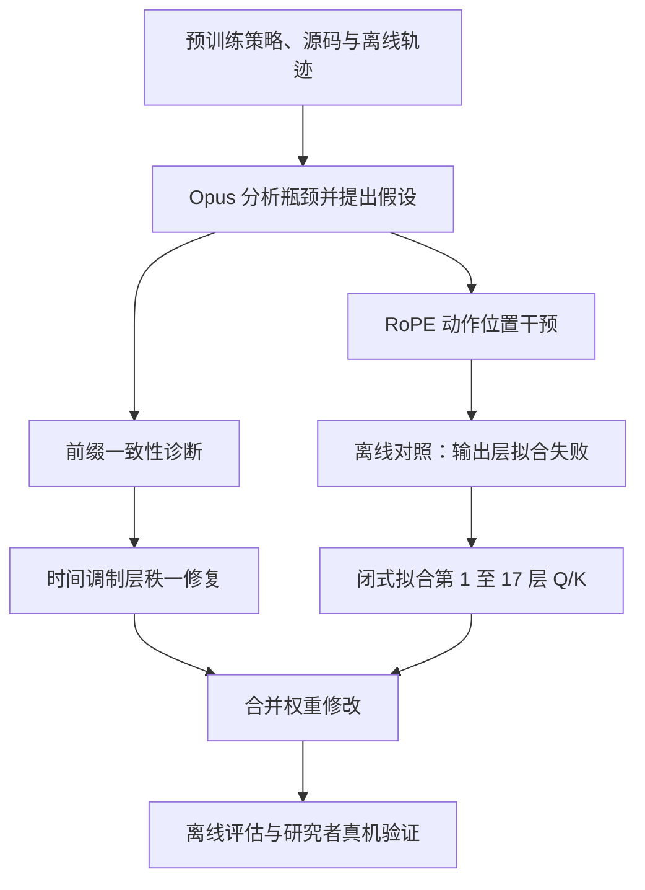

# We Asked Opus-5.5 to Edit π₀.₅'s Weights / 让 Opus 5.5 编辑机器人策略权重

## 一句话定义

研究者让 Opus 5.5 根据离线轨迹和模型机制，不经反向传播地修改 π₀.₅ Training-Time RTC 策略的权重，以探索更快执行和更平滑的动作块切换。

## 英文缩写速查

| 缩写 | 英文全称 | 简要说明 |
|------|----------|----------|
| VLA | Vision-Language-Action | 视觉、语言与动作策略 |
| RTC | Real-Time Chunking | 实时动作分块及衔接 |
| RoPE | Rotary Position Embedding | 旋转位置编码 |
| Q/K | Query / Key | 注意力中的查询与键 |
| TCP | Tool Center Point | 工具中心点 |

## 为什么重要

- **权重编辑与加速的目标须区分：** 原文先核对模型推理耗时与 chunk 执行周期，发现主要瓶颈不是推理等待，而是策略生成动作的执行节奏；不能把推理时延下降当成真机任务提速。
- **反馈闭环能够从失败候选转向更可信的机制：** 输出层拟合在留出输入上的路径偏差与 jerk 变差后，Agent 改为在注意力内部拟合 Q/K，对照 RoPE teacher 检查实际生成动作。
- **不显式改生产代码也能修复部署时序问题：** 通过权重近似修复 RTC 条件前缀在最后一次采样更新后没有恢复的缺陷；但原文也给出更直接的一行代码修复等效对照，应优先判断哪种方案更可维护。
- **真机收益必须绑定实验条件：** 夹瓶子 30/35/40 Hz 同频比较中的时间缩短，不足以证明换布局、换机器人或更大样本仍然有效。

## 基本信息

- **作者：** Ziyang Gong 等；Shanghai Innovation Institute、上海交通大学及香港大学，2026 年博客。
- **版本：** [中文原文](https://cuzyoung.github.io/robotics-weight-editing/zh/)，网页仓库提交 `0bea69fe55b167058caeb65969c8a21c229dc6d0`；2026-11-06 通读完整博客及研究提示。
- **设置：** 提供训练好的策略、源码、历史 YAM 轨迹及 1 张 RTX 4090；Opus 通过 Claude Code 离线研究约 111 分钟，未操作真机。研究者随后实施真机验证。
- **约束：** 无反向传播、梯度优化和 LoRA；允许前向实验与闭式拟合；不改生产推理代码，保存可回滚的新 checkpoint。

## 流程总览

## 核心机制

1. **定位瓶颈：** 单次推理约 105–109 ms，短于约 1.073 s 的计划更新周期；研究重点因此转向预测动作的执行节奏，而非推理加速。
2. **RTC 前缀修复：** 最后一次 flow matching 采样更新后未重新恢复条件前缀；当实际延迟短于预留长度时，被改写的条件动作可能进入执行。编辑最终归一化层时间调制权重，使前缀更新接近零；与返回前恢复前缀的一行代码在该实验中效果接近，但实际交付的是权重修改。
3. **节奏加速：** 将动作 RoPE 位置从 `P+i` 干预为 `P+1.25i` 形成 teacher；采集隐藏特征，以正则最小二乘拟合 Q/K 投影，使原有推理位置规则近似产生额外旋转。只拟合末端输出层的方案在留出观测上路径偏差和 jerk 较大，因而被放弃。共享投影对额外旋转的拟合是近似。
4. **组合：** 前缀修复与 Q/K 编辑合并，作者报告修改全模型 1.16% 参数。拟合与留出时刻来自同一批轨迹，不能当作跨轨迹泛化验证。

## 实验与局限

| 对照 | 作者报告 | 解释 |
|------|----------|------|
| 离线联合编辑 | 35 个有效观测中，路径进度比中位数 1.214，偏差 1.071 mm，chunk 内 jerk 比 1.363 | 路径进度并非真实任务完成时间；chunk 内 jerk 增大 |
| YAM 放瓶子 | 30、35、40 Hz 同频原版对照，平均时间分别减少 4.3%、7.4%、12.0%；三档等权的平均切换步长 30.88 → 3.14 mm | 同一布局，每条件各 3 次成功执行；不能据此估计成功率变化 |
| YAM 投硬币 | 夹取后至交接放手阶段 5.849 → 4.641 s，缩短 20.7% | 是局部阶段时间，不是完整任务加速 |
| YAM 叠方块 | 排除一次原版重试后，原版 2 次与编辑版 3 次均值 19.46 → 19.28 s | 未见明显提速；样本很小且均值计算不对称 |
| 离线前缀对照 | 36 个观测的切换步长中位数：原版 19.158 mm，权重修复 1.798 mm，代码修复 1.885 mm | 比较特定输入和前缀条件；两种修复为近似等效 |

时间缩放基线在离线比较中有更低路径偏差和 jerk，但保留原始跳变；作者未比较“前缀修复 + 时间缩放”，故不能断言权重编辑优于所有后处理方案。网站仓库只公开网页、提示和代码摘录，完整实验代码、编辑权重及数据未见公开下载；不能据此复现完整流程。

## 工程实践

1. **明确执行指标：** 同时记录推理耗时、一次 chunk 的实际执行时长、端到端任务时间与 chunk 切换点的关节/TCP 命令差；不能把离线路径进度比解释为真实任务加速比例。
2. **建立无污染的对照：** 保留原模型与生产推理代码，保存可回滚独立 checkpoint；比较原版、单独前缀修复、单独节奏编辑、联合编辑、轨迹时间缩放和动作幅度缩放。原文未做“前缀修复 + 时间缩放”组合对照，因此不要宣称其编辑最优。
3. **检测 RTC 前缀边界：** 分别测试“实际推理延迟 = 预留前缀长度”与“实际延迟小于预留前缀”条件，核查末轮积分后是否将条件动作恢复；原文的权重修复是让更新接近零，代码修复是显式恢复，两者不是逐比特相同。
4. **评价平滑性与泛化：** 将 chunk 边界的 TCP 跳变与 chunk 内 jerk 分别计算；尝试不同速度、布局、任务和新的轨迹拆分以避免同轨迹取时刻造成的相关性。
5. **复现边界：** 官方 GitHub 仓库公开网页、提示词与部分代码摘录，未提供本次编辑完整实验入口、权重、演示及轨迹数据；不能从网页脚本直接搭建可复现训练流水线。

## 源码运行时序图

不适用：公开仓库是网站与局部代码摘录，未发现可运行的权重编辑实验入口；不能以网页展示脚本推测策略运行时序。

## 局限与风险

- 作者的放瓶子与其他任务真机实验中，每个设置仅有 3 次执行；所有被统计记录均成功，不足以估计成功率差异或跨场景鲁棒性。
- 离线 Q/K 方案的拟合与留出时刻来自同一批轨迹，不是严格按整条新轨迹隔离的独立泛化评测。
- 仅节奏编辑在离线指标中提高 chunk 内 jerk；联合编辑的 chunk 跳变改善和执行频率增加后的剩余跳变变化，应分别报告。
- 前缀修复并非唯一解：直接在采样结束后恢复条件动作的代码方案在作者设置下具有近似效果；是否必须做权重级修复取决于生产代码限制。
- 公开仓库不含完整可执行的权重编辑实现、已编辑 checkpoint 或训练/测试原始数据；内容整理完成不代表实验独立复现。

## 关联页面

- [Weight-Space Programming](weight-space-programming.md)：原文的研究动机来源；本项目侧重机器人策略与真机验证。
- [Action Chunking（动作分块）](../methods/action-chunking.md)：本文的 RTC 前缀修复与 chunk 之间的执行衔接有关。
- [π₀ 策略模型](../methods/pi0-policy.md)：定位所编辑的 π₀.₅ 策略所属的流匹配 VLA 谱系；不将 π₀ 与 π₀.₅ 当成同一 checkpoint。

## 参考来源

- [中文原文及开放状态归档](../../sources/sites/robotics-weight-editing.md)
- [网页仓库归档](../../sources/repos/robotics-weight-editing.md)

## 推荐继续阅读

- [作者完整中文原文、实验表及原始研究提示](https://cuzyoung.github.io/robotics-weight-editing/zh/)
- [作者公开网页仓库与局部源码摘录](https://github.com/Cuzyoung/robotics-weight-editing)
- [Training-Time Action Conditioning for Efficient Real-Time Chunking](https://arxiv.org/abs/2512.05964)
