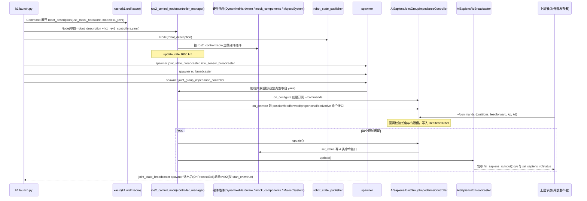

# ROBOTIS AI Sapiens（ai_sapiens）

**AI Sapiens** 是 ROBOTIS 的 **开源人形** 产品线（K1）；官方 ROS 2 软件入口为 [`ROBOTIS-GIT/ai_sapiens`](https://github.com/ROBOTIS-GIT/ai_sapiens)（~21★，Apache-2.0）。产品页与文档：[ecosystem-aisapiens](https://www.robotis.com/en/product/ecosystem-aisapiens.php) · [docs 简介](https://docs.robotis.com/docs/systems/aisapiens/introduction)。

## 一句话定义

为 AI Sapiens **K1** 提供 ROS 2 **描述、bringup（`k1.launch.py`）、关节组阻抗控制与遥控广播**，作为人形侧 Physical AI / 重定向消费的官方软件锚点（相对半人形 [AI Worker](./robotis-ai-worker.md)）。

## 英文缩写速查

| 缩写 | 英文全称 | 简要说明 |
|------|----------|----------|
| K1 | AI Sapiens K1 | 当前开源包主型号 / rev1 配置 |
| ROS 2 | Robot Operating System 2 | 本仓中间件 |
| Impedance | Impedance Control | `joint_group_impedance_controller` |
| RC | Remote Control | `ai_sapiens_rc_broadcaster` |
| URDF | Unified Robot Description Format | 描述与重定向资产来源 |

## 为什么重要

- **ROBOTIS 人形开源软件入口**：与历史 [OP3](./robotis-op3.md) / [THORMANG3](./robotis-thormang3.md) 教育/研究人形形成世代对照。
- **重定向生态接入**：[`soma-retargeter`](https://github.com/ROBOTIS-GIT/soma-retargeter) 子模块拉取本仓 URDF/STL，作人形目标之一（与 Unitree G1 目标并列演进）。
- **Physical AI 叙事对齐**：README 同样指向 Tools、MuJoCo menagerie、HF 与 Docker，便于和 AI Worker 共用工具链习惯。

## 核心原理

| 包 | 角色 |
|----|------|
| `ai_sapiens` | 元包 |
| `ai_sapiens_bringup` | `config/k1_rev1`、`launch/k1.launch.py` |
| `ai_sapiens_joint_group_impedance_controller` | 关节组阻抗插件 |
| `ai_sapiens_rc_broadcaster` | 遥控相关广播 |
| `ai_sapiens_ci.repos` | CI / 依赖锁定 |

## 工程实践

1. 读官方 docs 确认当前支持的 ROS 发行版与硬件修订（`k1_rev1`）。
2. 按仓库 CI/README 用 colcon 构建；先 bringup 再接 [physical_ai_tools](./robotis-physical-ai-tools.md)。
3. 运动数据：关注组织内 `soma-retargeter`（SOMA BVH → 机器人 CSV）及 [运动重定向 hub](../overview/hub-motion-retargeting.md)。
4. 与 [AI Worker](./robotis-ai-worker.md) 选型：操作/移动操作半人形 vs 全身人形 K1——软件仓与控制器插件不互通。
5. 仿真资产：以 menagerie / 文档当前列表为准（人形资产可能滞后于 FFW/OMY）。
6. **全身技能 pipeline（ROBOTIS 真机案例，2026-09）**：Kimodo/GEM-X 等 → SOMA → SOMA Retargeter → [Isaac Lab](https://isaac-sim.github.io/IsaacLab/) + [BeyondMimic](../methods/beyondmimic.md)（文内 **4096** 并行 K1、**50 Hz** 策略）；导出 `policy.onnx` + `sim2real.yaml` 在 **Jetson Orin NX** 上以 **DYNAMIXEL-Q 阻抗** 闭环。Sim2Real 上报告 **Newton** 物理后端相对默认 PhysX 更利于真机平衡；细节见 [Humanoid Skills 技术地图](../overview/robotis-humanoid-skills-nvidia-stack-technology-map.md)。

## 局限与风险

- **开源状态：已开源**（Apache-2.0）；仓库较新，公开 RL/IL 任务密度低于 `cyclo_lab` 对 OMY/FFW 的覆盖。
- **生态成熟度**：社区教程与第三方集成仍少于 TurtleBot3 / Unitree G1；以官方 docs 与 Discord 为准。
- **安全**：阻抗与遥控使能前遵循产品安全手册；本 wiki 不替代厂商操作规程。

## 源码运行时序图

入口：`ros2 launch ai_sapiens_bringup k1.launch.py`（真机；仿真为 `k1_mujoco.launch.py`，差别仅在 xacro 参数 `sim_mujoco:=true` 与 MuJoCo 硬件插件）

图依据：ROBOTIS-GIT/ai_sapiens@937c67d，读过 README.md、ai_sapiens_bringup/launch/k1.launch.py、k1_mujoco.launch.py、config/k1_rev1/k1_rev1_controllers.yaml、ai_sapiens_controllers 下 impedance controller 与 rc_broadcaster 的 .cpp（部分）、ai_sapiens_description/ros2_control 下 xacro。

## 关联页面

- [ROBOTIS hub](./robotis.md) · [AI Worker](./robotis-ai-worker.md)
- [Humanoid Skills × NVIDIA 栈技术地图](../overview/robotis-humanoid-skills-nvidia-stack-technology-map.md)
- [Physical AI Tools](./robotis-physical-ai-tools.md)
- [OP3](./robotis-op3.md) · [THORMANG3](./robotis-thormang3.md)
- [Unitree G1（对照）](./unitree-g1.md)
- [运动重定向 hub](../overview/hub-motion-retargeting.md)

## 参考来源

- [sources/repos/ai_sapiens.md](../../sources/repos/ai_sapiens.md)
- [human five · Humanoid Skills（ROBOTIS K1 全身 pipeline）](../../sources/blogs/wechat_human_five_robotis_humanoid_skills_nvidia_stack_2026-09-28.md)
- 上游：<https://github.com/ROBOTIS-GIT/ai_sapiens>
- 源码核对（2026-11-02）：ROBOTIS-GIT/ai_sapiens@937c67d，读过 README.md、ai_sapiens_bringup/launch/k1.launch.py、k1_mujoco.launch.py、k1_rev1_controllers.yaml、joint_group_impedance_controller 与 rc_broadcaster 的 .cpp、description/ros2_control/k1_rev1/*.xacro；时序图依据以上文件，未运行代码。

## 推荐继续阅读

- [AI Sapiens 文档](https://docs.robotis.com/docs/systems/aisapiens/introduction)
- [soma-retargeter](https://github.com/ROBOTIS-GIT/soma-retargeter)
