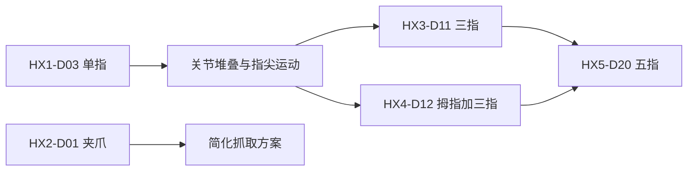

# ROBOTIS HX Friends

**HX Friends** 是 [ROBOTIS](./robotis.md) 围绕 DYNAMIXEL 执行器生态发布的模块化手部参考设计集，覆盖单指、夹爪和多指灵巧手。官方产品页说明它面向比较不同手指布局、执行器与自由度的设计探索。

## 一句话定义

一组可组合、可改造的 DYNAMIXEL 手部参考设计：以 HX1-D03 单指为基础单元，逐步扩展到 HX3-D11、HX4-D12 和 HX5-D20 等多指手。

## 英文缩写速查

| 缩写 | 英文全称 | 简要说明 |
|------|----------|----------|
| DoF | Degrees of Freedom | 模型中可动关节自由度数 |
| DXL | DYNAMIXEL | ROBOTIS 智能执行器产品族及通信生态 |
| URDF | Unified Robot Description Format | 描述连杆、关节、惯量和模型资源的机器人格式 |
| ROS 2 | Robot Operating System 2 | ROBOTIS 手部控制和仿真的软件接口环境 |

## 为什么重要

- **从模块到整手：** 单指适合研究关节堆叠，多指手则提供不同自由度、拇指与指尖触觉配置，便于机械设计比较。
- **共享执行器生态：** 多款设计使用 XM335；HX2-D01 则展示以 XM430 构成简化夹爪的路线。
- **模型与软件入口并存：** 官方文档页、URDF 网格与 `robotis_hand` 驱动可分别支持结构检查、仿真和控制开发。

## 核心设计

| 型号 | 结构 | 自由度 | 官方模型状态 |
|------|------|--------|--------------|
| HX1-D03 | 单指，三关节均为俯仰 | 3 | docs 仓有 URDF / STL |
| HX2-D01 | XM430 驱动的夹爪 | 1 | 官方页面称交互模型即将提供；docs 仓未发现模型文件 |
| HX3-D11 | 三指手 | 11 | docs 仓有 URDF / STL |
| HX4-D12 | 三指加拇指 | 12 | docs 仓有 URDF / STL |
| HX5-D20 | 拇指加四指 | 20 | 官方产品页有 URDF 下载；图库现有条目来自第三方展开版 |

## 工程实践

1. 用官方 URDF 与网格检查连杆、关节和默认姿态，再选择适合的手部构型。
2. ROS 2 控制接口与触觉读取参考 [`robotis_hand`](https://github.com/ROBOTIS-GIT/robotis_hand)；具体驱动支持和传感器配置以该仓库当前文档为准。
3. 在 [Robot Description Gallery Online](https://github.com/ImChong/Robot_Description_Gallery_Online) 可交互比较 HX1-D03、HX3-D11、HX4-D12 的关节模型。
4. 评估仿真时，确认 URDF 是否包含 collision、惯量和质量数据；文档仓新增三款模型的 URDF 当前缺少这些动力学字段，不能直接当作高保真动力学模型。

## 局限与风险

- 官方页面将 HX Friends 称为开源设计，但 `ROBOTIS-GIT/docs` 中这些模型资产未标注专属 SPDX 许可证；使用或再分发前应核对 ROBOTIS 许可条款。
- HX2-D01 当前没有在官方 docs 源仓找到 URDF/网格，故不能纳入该图库的在线 URDF 预览。
- 结构模型与驱动能力不是一回事：是否能读取触觉传感器、控制特定电机或适配某个 ROS 2 版本，应以实际软件包及硬件为准。
- URDF 中缺少惯量和碰撞描述的模型可用于运动链可视化，但需补齐物理参数后才能用于可靠动力学仿真。

## 关联页面

- [ROBOTIS（乐百机器人）](./robotis.md) — 官方组织与软件生态导航。
- [ROBOTIS OpenMANIPULATOR 线](./robotis-open-manipulator-line.md)
- [Yale OpenHand](./yale-openhand.md) — 另一类开放灵巧手机构。
- [Manipulation](../tasks/manipulation.md)

## 参考来源

- [HX Friends 项目资料归档](../../sources/repos/robotis-hx-friends.md)
- [ROBOTIS 官方 HX Friends 产品页](https://docs.robotis.com/docs/systems/hx_friends/)
- [官方模型文件目录](https://github.com/ROBOTIS-GIT/docs/tree/main/docusaurus/static/assets/hx)
- [ROBOTIS Hand 软件仓库](https://github.com/ROBOTIS-GIT/robotis_hand)

## 推荐继续阅读

- [ROBOTIS DYNAMIXEL](https://www.robotis.com/)
- [ROBOTIS Open Source Team](https://github.com/ROBOTIS-GIT)
