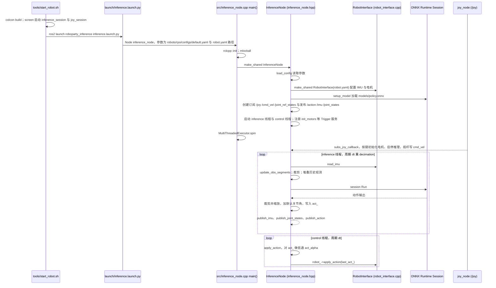

---

type: entity
tags: [humanoid, hardware, open-source, ros2, isaac-lab, roboparty]
status: complete
updated: 2026-10-27
related:
  - ./roboparty.md
  - ./roboparty-rp1.md
  - ./party-os.md
  - ../overview/roboparty-lab-party-os-technology-map.md
  - ./open-source-humanoid-hardware.md
  - ./humanoid-robot.md
  - ./robot-lab.md
  - ./unitree.md
  - ./atom01-hardware.md
  - ./atom01-description.md
  - ./roboparty-train.md
  - ./roboparty-deploy.md
  - ./atom01-firmware.md
  - ../concepts/character-animation-vs-robotics.md
sources:
  - ../../sources/repos/roboto_origin.md
  - ../../sources/sites/roboparty_com_roboto_origin_doc.md
  - ../../sources/sites/roboparty_com.md
  - ../../sources/blogs/wechat_roboparty_lab_party_os_3_tools.md
  - ../../sources/repos/atom01_hardware.md
  - ../../sources/repos/atom01_deploy.md
  - ../../sources/repos/atom01_train.md
  - ../../sources/repos/atom01_description.md
  - ../../sources/repos/atom01_firmware.md
  - ../../sources/sites/roboparty_rp1_opensource_status_2026-10-15.md
  - ../../sources/sites/roboparty_rp1_official.md
  - ../../sources/repos/roboparty_rp1.md
summary: "Roboto Origin（萝博头原型机 / RPO）是 RoboParty 发布的开源人形机器人基线：聚合 rpo_* / roboparty_* 子仓库，提供从硬件到训练再到部署的可复现工程路径（约 1.25 m、23 DOF）。"
---

# Roboto Origin（开源人形机器人基线）

**Roboto Origin（萝博头原型机，RPO）** 是 [RoboParty](./roboparty.md) 发布的「全链路开源」人形机器人项目入口，目标不是只给一个仓库，而是提供从硬件到训练再到部署的可复现工程路径。

## 英文缩写速查

| 缩写 | 英文全称 | 简要说明 |
|------|----------|----------|
| RPO | Roboto Origin / RoboParty Origin | 萝博头原型机项目代号 |
| URDF | Unified Robot Description Format | 统一机器人描述格式 |
| MJCF | MuJoCo XML Format | MuJoCo 仿真模型描述格式 |
| RL | Reinforcement Learning | 通过与环境交互最大化长期回报来学习策略的范式 |
| ROS 2 | Robot Operating System 2 | 机器人系统集成与通信的常用中间件 |
| CAD | Computer-Aided Design | 计算机辅助设计，硬件结构建模 |
| PCB | Printed Circuit Board | 印刷电路板 |
| BOM | Bill of Materials | 物料清单，硬件零部件列表 |

## 为什么重要

1. **低门槛复现路径**：将 DIY 人形机器人的关键模块显式拆分，降低单人/小团队上手门槛。
2. **工程边界清晰**：官方明确聚合仓库用于导航，贡献回流到子仓库，避免 monorepo 混乱。
3. **覆盖全栈闭环**：硬件设计、URDF/MJCF 描述、RL 训练、ROS2 部署、固件链路全部公开（[官方文档站](https://roboparty.com/roboto_origin/doc) 给出参数与开源范围表）。

## 产品参数（文档站，2026-07）

| 项目 | 参数 |
|------|------|
| 身高 | 约 1.25 m |
| 自由度 | 23 DOF |
| 体重 | 约 34 kg |
| 最高速度 | 约 3 m/s |
| 腿部关节峰值扭矩 | 120 N·m |
| 电池 | 48 V, 15 Ah；续航 2 h+ |
| 可选感知 | Intel D435i、3D 激光雷达 |

## 核心结构

Roboto Origin 的仓库体系可理解为「多段流水线 + 聚合快照」：

- **rpo_hardware / rpo_description**：机械与模型（CAD/PCB/BOM、URDF/MJCF）；历史索引见 [atom01-hardware](./atom01-hardware.md)、[atom01-description](./atom01-description.md)
- **roboparty_train**：IsaacLab 训练与 Sim2Sim；历史索引见 [roboparty_train](./roboparty-train.md)
- **roboparty_deploy**：ROS2 真机驱动与部署；历史索引见 [roboparty_deploy](./roboparty-deploy.md)
- **roboparty_firmware**：底层固件与板端支持；历史索引见 [atom01-firmware](./atom01-firmware.md)
- **扩展模块**：rpo_appearance、roboparty_navigation、roboparty_xr_teleop（实验性）

> 官方 `roboto_origin` 为 **snapshot aggregation only**；模块级贡献应进入上表各子仓库。2026 README_cn 已将对外主名从 Atom01 统一为 RPO 系列，快照内可能保留兼容路径。

### 与 Party OS / RP1 的演进关系（2026-10）

Roboto Origin（RPO）是独立于 RP1 的已开放人形项目；[RoboParty Lab / Party OS](./party-os.md) 进一步沉淀 **训练、控制与数据工具链基础设施**（[MimicLite](./mimiclite.md)、[UFO](./roboparty-ufo.md)、[hhtools](./human-humanoid-tools.md)）。RoboParty 后续推出 [RP1（ROBOTO 01）](./roboparty-rp1.md)，两者有各自的本体配置、模型和代码路径，不能混用参数或把一个项目的实测结果转用到另一个。RP1 当前的模块入口与开放/许可边界见[官方核查归档](../../sources/sites/roboparty_rp1_official.md)和[仓库索引](../../sources/repos/roboparty_rp1.md)；2026-10-15 的状态快照保留为历史记录。详见 [技术地图](../overview/roboparty-lab-party-os-technology-map.md)。

## 常见误区 / 局限

- **误区 1：把 `roboto_origin` 当成可直接开发主仓库。**
  实际上它更像索引入口，真正开发需进入各模块仓库。
- **误区 2：认为开源即开箱即用。**
  项目仍需要较强的 Linux/ROS2/硬件调试能力。
- **局限：** 当前公开资料更偏“原型复现与社区协作”，对工业级可靠性（长期运行、认证、安全冗余）覆盖有限。

## 源码运行时序图

`roboto_origin` 本身是聚合快照；其中可运行的真机部署链在快照目录 `modules/roboparty_deploy/`（ROS2 Humble + C++17 + ONNX Runtime）。训练（`modules/roboparty_train`）、固件等模块未读，下图只画部署侧。

入口：`./tools/start_robot.sh --robot rpo --policy default`（在 `modules/roboparty_deploy/` 下执行；脚本先 `colcon build --symlink-install`，再在 `screen` 会话里启动 `ros2 launch roboparty_inference inference.launch.py robot:=rpo policy:=default` 与 `ros2 run joy joy_node`）。

图依据：Roboparty/roboto_origin@d94afba，读过 `README.md`、`modules/roboparty_deploy/README.md`、`modules/roboparty_deploy/tools/start_robot.sh`（启动命令部分）、`modules/roboparty_deploy/src/inference/launch/inference.launch.py`、`src/inference/src/inference_node.cpp`、`inference_node.hpp`、`ros_interface.cpp`（订阅回调与服务名）、`robot_interface.cpp`（构造函数）。`RobotInterface::apply_action` 内部的电机总线收发、`obs_manager.cpp` 的观测拼装未读，故未画。

## 关联页面

- [RoboParty（公司）](./roboparty.md)
- [开源人形机器人硬件方案对比](./open-source-humanoid-hardware.md)
- [人形机器人（Humanoid Robot）](./humanoid-robot.md)
- [robot_lab (IsaacLab 扩展框架)](./robot-lab.md)
- [Unitree](./unitree.md)
- [Party OS（研发底座）](./party-os.md)
- [RoboParty Lab / Party OS 技术地图](../overview/roboparty-lab-party-os-technology-map.md)
- [Atom01 Hardware](./atom01-hardware.md)
- [Atom01 Description](./atom01-description.md)
- [Atom01 Train](./roboparty-train.md)
- [Atom01 Deploy](./roboparty-deploy.md)
- [Atom01 Firmware](./atom01-firmware.md)
- [Character Animation vs Robotics](../concepts/character-animation-vs-robotics.md) — 作为「中性研究型开源人形」对照组：机构未为角色形象做妥协，与 Disney Olaf 形成两端

## 推荐继续阅读

- [Roboparty / roboto_origin](https://github.com/Roboparty/roboto_origin)
- [Humanoid Robot Know-How Documentation](https://roboparty.com/roboto_origin/doc)

## 参考来源

- [sources/repos/roboto_origin.md](../../sources/repos/roboto_origin.md)
- [sources/sites/roboparty_com_roboto_origin_doc.md](../../sources/sites/roboparty_com_roboto_origin_doc.md)
- [sources/sites/roboparty_com.md](../../sources/sites/roboparty_com.md)
- [sources/repos/atom01_hardware.md](../../sources/repos/atom01_hardware.md)
- [sources/repos/atom01_deploy.md](../../sources/repos/atom01_deploy.md)
- [sources/repos/atom01_train.md](../../sources/repos/atom01_train.md)
- [sources/repos/atom01_description.md](../../sources/repos/atom01_description.md)
- [sources/repos/atom01_firmware.md](../../sources/repos/atom01_firmware.md)
- [Roboparty/roboto_origin README](https://github.com/Roboparty/roboto_origin)
- 源码核对（2026-11-02）：Roboparty/roboto_origin@d94afba，读过 README.md、modules/roboparty_deploy/README.md、modules/roboparty_deploy/tools/start_robot.sh、modules/roboparty_deploy/src/inference/launch/inference.launch.py、src/inference/src/inference_node.cpp、inference_node.hpp、ros_interface.cpp、robot_interface.cpp；时序图依据以上文件，未运行代码。
