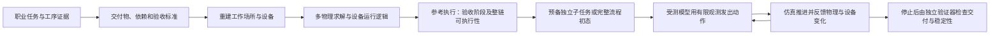

# 机器人终极考试：长程职业流程仿真评测 / Robots’ Last Exam

## 一句话定义

Robots’ Last Exam（RLE）把奶茶制作、搬运、收银等职业工作拆成可仿真、可独立验收的端到端任务，检验机器人能否在场景持续变化时交付正确结果，而不只是从预摆好的状态做好一个子技能。

## 英文缩写速查

| 缩写 | 英文全称 | 含义 |
|---|---|---|
| RLE | Robots’ Last Exam | 本项目的职业工作流仿真评测 |
| USD | Universal Scene Description | 项目从 Unreal Engine 5 导出场景的格式 |
| TCP | Tool Center Point | 仿真控制使用的末端工具中心点 |
| PBF | Position-Based Fluids | 用于部分液体交互的求解方法 |
| MPM | Material Point Method | 用于粉末和切割等材料行为的方法 |

## 为什么重要

从零开始调一杯奶茶时，未倒够的液体会影响封口和交付。单项倒液测试可以从杯已摆稳的状态出发，却测不到前序错误造成的连锁影响。RLE 在同一任务族里保留整条流程与独立子任务，前者测交付，后者用来定位哪步不会，两者不应混报。

## 核心原理与流程

1. **先定交付，再造场景。** 从 O*NET 职业任务候选与设备手册、配方及工序视频提炼交付物、状态依赖和验收条件；在 Unreal Engine 5 搭建场景后导出 USD，以渲染、碰撞和功能测试校验开口、轨道或容器等关键细节。
2. **物理状态与设备状态分开处理。** Newton/Warp 的求解器负责关节和接触，也处理液体、散粒与布料等材料；耦合层交换接触冲量。设备运行逻辑读取关节、接触或材料信号，并更新显示、耗材或带时间戳的操作事件。比如扫描器拍到条码后，收银台还需要写入交易状态；碰到按钮本身不算扫码成功。
3. **参考执行和正式考试隔离。** 构建验收可用能看仿真真值的参考代理验证阶段和整链可执行性。正式模型只能使用允许的操作手册、RGB-D、本体感觉、力/力矩估计等，输出 TCP 位姿和夹爪指令。提交或达预算后，独立验证器检查交付、关键处理历史与稳定性，必要时再检查松夹后的状态。

## 评测与证据

| 口径 | 官方首轮报告 | 解读 |
|---|---|---|
| 首发场景与试点评测 | 发布介绍展示首批 10 个场景；榜单试点覆盖 8 个工作场所、16 条完整流程 | 场景图库不是榜单分母；另有 80 个单独初始化的 Agent 模式诊断子任务 |
| Agent 模式 | Fable 5.2 通过 5/16 条完整流程（31.25%），独立子任务 46/80（57.5%） | 相机与两只浮动夹爪可独立移动 |
| S1 具身模式 | 9 个模型均未完成任何一条完整流程 | 是带 Astribot S1 运动约束的仿真对照，不是真机成功率 |

奶茶回放中，模型在浮动夹爪配置能察觉液量不足而补茶，在 S1 配置则取杯后未能完成任务。该案例适合检查恢复能力，但无法单独归因于某个关节、视觉错误或规划模块。

## 与其他工作对比

- [Embodied First Exam](./embodied-first-exam.md) 横跨多个现有机器人套件，用独立评测重跑来检查程序；RLE 重点重建职业环境和设备，测试同一流程在不同执行约束下的交付差异。
- [RLE-Bench](./rle-bench.md) 是另一项测编码代理能否交付机器人学习工程产物的评测，不是本项目的简称。在这里，受测交付物是工作场景中的物理结果。

## 工程实践

- [场景演示](https://robots-last-exam.com/scenes/) 适合看设备细节与录制回放；[Robot World](https://robots-last-exam.com/world/) 用于桌面键鼠漫游；[排行榜](https://robots-last-exam.com/leaderboard/) 用来比较 Agent 模式的分数、耗时和估算成本。
- [共建说明](https://robots-last-exam.com/contribute/) 区分场景建设和设计考题，也给出[申请入口](https://robots-last-exam.com/next/apply)。定义新题时先写起点、可观测交付条件及哪些过程依赖必须核查。
- **源码运行时序图：不适用。** 截至 2026-11-28，官方计划于 2026 年 12 月开源，尚未核实可运行评测发行物。网页预览及上游 Newton/Warp 不等于独立的 RLE 运行入口，流程图根据官方技术文章绘制。

## 局限与风险

一组模型、任务和模式只初始化一次，结果是首轮特定题集的能力切片。官方真机擦板、倒液和提袋是开发演示，未与榜单做配对统计。真实工作中还需比较同初态、同验收条件下的液量、残留和放手后的稳定性，才能判断仿真结果是否外推。

## 关联页面

- [仿真评测基础设施](../concepts/simulation-evaluation-infrastructure.md)
- [操作任务](../tasks/manipulation.md)
- [移动操作](../tasks/loco-manipulation.md)
- [具身模型测评纵深 Stage 3](../../roadmap/depth-embodied-eval.md)

## 参考来源

- [项目团队技术文章归档](../../sources/blogs/robots-last-exam-from-robot-skills-to-real-work-2026-11.md)
- [官方站点与入口归档](../../sources/sites/robots-last-exam.md)

## 推荐继续阅读

- [官方评测协议及奶茶任务的三种设置对照](https://robots-last-exam.com/blog/from-robot-skills-to-real-work/)
