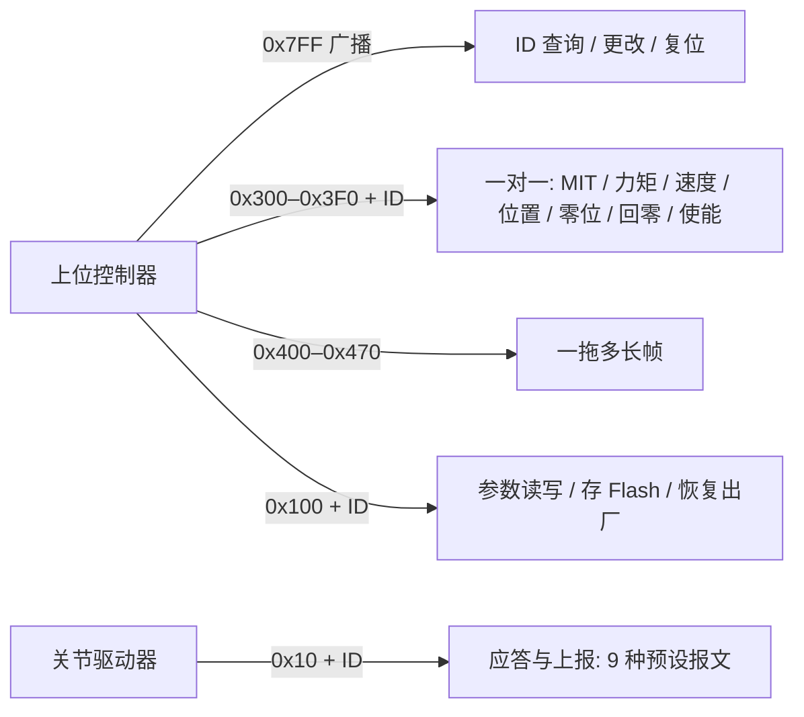

# ROMOMO（RMM 关节模组公开资料）

## 一句话定义

**ROMOMO** 是 RoboParty 自研关节模组 RMM 系列的“资料仓”：三款统一驱动架构、不同功率级的 48 V 一体化关节（电机 + 减速器 + 双编码器 + 圆形驱动板），以规格图纸、测试报告和协议手册的形式公开，**不是**固件或源码仓。

## 英文缩写速查

| 缩写 | 英文全称 | 简要说明 |
|------|----------|----------|
| RMM | RoboParty Motor Module（推测，仓库未展开） | 模组型号前缀，如 RMM6562-2E |
| FOC | Field-Oriented Control | 磁场定向控制；驱动板电流环 20 kHz，见 [FOC](../concepts/field-oriented-control.md) |
| MIT 模式 | MIT-style impedance mode | 位置 / 速度 / 前馈力矩 / Kp / Kd 混合的“力位混合”控制，协议手册 §2.2.1 |
| CAN-FD | CAN with Flexible Data-rate | 协议手册所用总线，见 [CAN-FD](../concepts/can-fd.md) |
| EtherCAT | Ethernet for Control Automation Technology | 驱动板主总线选项，见 [EtherCAT](../concepts/ethercat-protocol.md) |
| Pre-DV | Pre-Design Verification | 设计验证前阶段测试，对应 Pre-DV 测试用例 PDF |

## 为什么重要

- RP1 总览对 ROMOMO 的描述是 “Joint modules, firmware and host tools”，但**仓库实际仅 14 个文件、全是 PDF 与一张 GIF**——读者若按总览期待固件会落空，这一点必须在选型前知道。
- 它是 [RP1 整机](./roboparty-rp1.md) 中“执行器”一层的唯一公开技术依据：协议手册、型号量程、测试报告给出了上位机/主控与关节通信所需的全部接口信息（CAN ID 分配、帧格式、值域映射）。
- 文档里同时有**规格宣称**（硬件介绍）与**实测报告**（测试报告），可用来交叉核对厂商数字，这在开源关节里并不常见。

## 核心结构

### 三款模组

| 型号 | 适配关节（硬件介绍） | 功率器件 | 额定 / 峰值转矩 | 减速比 | 额定 / 峰值转速 |
|------|--------------------|----------|-----------------|--------|----------------|
| RMM6562-2E | 手臂、手腕、踝 | GaN | 10 / 35 N·m | 19.5 | 60 / 200 RPM |
| RMM8463-2E | 肩、腰 | Si MOSFET ×6 | 20 / 87 N·m（硬件介绍；README 表中留空） | 仓库未列 | 仓库未列 |
| RMM10062-2E | 大腿、膝、髋 | Si MOSFET 双管并联 | 44 / 160 N·m | 22 | 80 / 130 RPM |

共同点（硬件介绍 V1.0，2026.10）：主控为先楫 HPM5E3Y（RISC-V，480 MHz）；供电 DC 48 V（24–60 V）；电流环 20 kHz FOC/SVPWM；内圈 17 位 + 外圈 19 位双磁编码器，重复定位 ±0.1°；过流 / 过温 / 短路 / 欠压保护；EtherCAT（1 kHz，双 PHY 菊花链）+ CAN-FD（仲裁 1 Mbps / 数据 4 Mbps）双总线。三款驱动板接口引脚一致，只在功率级和板径上区分。

### CAN-FD 协议（`CANFD协议手册.pdf` V0.4，46 页）

- 全部使用 11 位标准帧；ID 位域：bit0–3 设备 ID（0–15）、bit4 应答标志、bit5–7 子类型、bit8–10 主类型。
- 控制模式：MIT、速度、位置、力矩四种；上报报文含位置 / 速度 / 力矩 / 电流 / 温度及“双圈”版本（类型 1–9，最长 29 字节）。
- 值域映射（§11）：RMM10062 速度 ±13.61 rad/s、力矩 ±160 N·m；RMM8463 ±16.23 rad/s、±87 N·m；RMM6562 ±20.94 rad/s、±35 N·m。

### 上位机与测试文档

`上位机使用手册.pdf`（V1.0）介绍 RoboDrive：设备管理、OTA 固件升级、电机设置、实时曲线与控制演示；推荐周立功 USBCANFD 系列 CAN 盒或 Type-C 直连。Pre-DV 文档按机械、电机特性、电气、控制四类给出用例，P0 必过、P1 建议，**预期值与实测值留待执行后填写**。

## 工程实践

1. **选型**：按关节负载选型号——腿部大负载关节用 10062，手臂/踝用 6562，肩腰用 8463（以硬件介绍的适配表为依据）。
2. **总线规划**：同一 CAN 段设备 ID 范围 0–15（位域限制）；整机用多段总线（[RP1 硬件](./rp1-hardware.md)的主控板提供 5×CANFD）。
3. **读测试报告**：RMM10062 报告显示额定工况（80 rpm@44 N·m@60 min，环温约 24 ℃）下总成效率约 81–83%，稳态电机温度 107.44 ℃、绕组温升 80.68 ℃，实测最大扭矩 165.6 N·m（额定的 3.76 倍），100 rpm@30 N·m 处效率最高 86.98%；RMM6562 报告瞬时最大转矩 35.60 N·m。
4. **开源状态核查（2026-10-27）**：仅文档开放，CC BY 4.0；**固件 / 驱动源码 / 上位机软件均未在本仓**——README 声明代码另在各自仓库以 GPL-3.0-only 发布（本次未逐仓核对），RoboDrive 需到官网下载中心取得。
5. **与整机配套**：CAN 帧与 [RP Hand](./rp-hand.md) 的 CAN-FD 参考速率（1 Mbit/s / 5 Mbit/s）不同（关节 4 Mbps 数据段），同总线混接前需核对。

## 局限与风险

- **数字不一致**：RMM10062 报告封面写峰值转矩 160 N·m，同报告的规格表写 140 N·m，实测最大 165.6 N·m；README 沿用 160。引用时写明出处并取保守值。
- **RMM8463 无测试报告**，README 表中参数留空，硬件介绍的 20 / 87 N·m 仅为厂商宣称。
- **协议手册标注“内部资料，仅供评审”、版本 V0.4**，字段可能随固件迭代变化；使用前核对固件版本（推测：手册版本与固件版本并非一一对应，仓库未给出对应表）。
- **测试报告 ≠ 安全保证**：README 免责声明说明测试报告和用例不构成安全、性能或适用性保证。
- **温升接近上限**：10062 额定工况稳态电机 107 ℃，连续高负载部署需自行核对热余量（推测：未给出绕组绝缘等级前无法判定）。

## 关联页面

- [RP1 总览（RoboParty RP1）](./roboparty-rp1.md)
- [RoboParty（公司）](./roboparty.md)
- [RP1 Hardware](./rp1-hardware.md) — 主控板与 5×CANFD 总线
- [RP Hand](./rp-hand.md) — 手部另一条 CAN-FD 终端
- [RP1 Test](./rp1-test.md) — 关节与整机老化 / 可靠性验证
- [CAN-FD](../concepts/can-fd.md)
- [FOC](../concepts/field-oriented-control.md)
- [关节模组自研流程](../concepts/joint-module-self-development-workflow.md)
- [执行器驱动链枢纽](../overview/hub-actuator-drive-chain.md)

## 参考来源

- [ROMOMO 仓库归档](../../sources/repos/romomo.md)
- [RP1 官方仓库体系归档](../../sources/repos/roboparty_rp1.md)

## 推荐继续阅读

- [ROMOMO GitHub](https://github.com/Roboparty/ROMOMO)
- [先楫半导体 HPM5E 系列](https://www.hpmicro.com/)
- [EtherCAT Technology Group](https://www.ethercat.org/)
