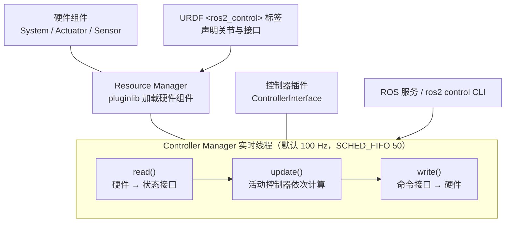
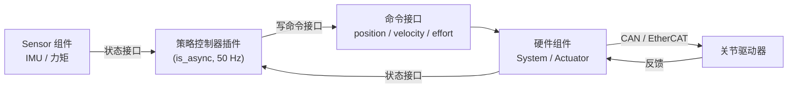

# ros2_control

[ros2_control](https://github.com/ros-controls/ros2_control) 是 ROS 2 官方生态里的 **实时控制框架**（Apache-2.0），收录于具身智能研究室 [开源项目主表](https://github.com/RealXiaoze/humanoid-motion-intelligence/blob/main/%E8%AE%BA%E6%96%87%E4%B8%8E%E9%A1%B9%E7%9B%AE/%E5%BC%80%E6%BA%90%E9%A1%B9%E7%9B%AE%E4%B8%BB%E8%A1%A8.md) 的「工程与实机部署」分组。本页依据仓库 README、`ros2_control_node.cpp` 源码与 control.ros.org（rolling，2026-11 版）文档核对改写；框架本体在 `ros2_control` 仓库，现成控制器在 `ros2_controllers` 仓库。

## 一句话定义

硬件接口负责读写状态，Controller Manager 管理控制器生命周期并按固定周期执行 `read → update → write`，同一控制器因此可以切换仿真与真实设备。策略部署可沿这条接口检查关节命令、反馈时间戳和安全切换是否一致。

## 英文缩写速查

| 缩写 | 英文全称 | 简要说明 |
|------|----------|----------|
| CM | Controller Manager | 管理控制器生命周期与接口分配，并驱动实时循环的核心节点 |
| RM | Resource Manager | 用 pluginlib 加载硬件组件、管理其生命周期与接口 |
| HW | Hardware Component | 硬件组件：System / Actuator / Sensor 三类，对应真机或仿真后端 |
| URDF | Unified Robot Description Format | 机器人描述；`<ros2_control>` 标签在其中声明硬件与接口 |
| PD | Proportional-Derivative | 关节位置环的常见形式，由驱动器或硬件组件承担 |
| JTC | Joint Trajectory Controller | ros2_controllers 的关节轨迹控制器 |
| RT | Real-Time | 实时；CM 主循环默认请求 SCHED_FIFO 优先级 50 |
| SCHED_FIFO | FIFO real-time scheduling policy | Linux 实时调度策略，高优先级线程独占 CPU 直到阻塞 |
| DOF | Degrees of Freedom | 自由度 |
| Sim2Real | Simulation to Real | 仿真到真机部署主线 |
| RL | Reinforcement Learning | 训练与评测常用框架 |

## 为什么重要

- **接口契约稳定**：控制器只依赖「命令接口 / 状态接口」的名字与类型，不关心背后是 mock、Gazebo / MuJoCo / Isaac Sim 还是真机驱动，因此仿真与真机共用同一控制器与参数文件。官方文档的 Simulator Integrations 页列出 Gazebo、MuJoCo、Isaac Sim、Webots、Algoryx AGX Dynamic 等集成。
- **把实时线程管起来**：CM 的主循环是显式的实时线程（默认 SCHED_FIFO 50、可锁内存、可绑核、带周期超限检测），比自己在 ROS 回调里跑控制环更容易做到低抖动。
- **安全切换与诊断**：控制器激活 / 停用有生命周期；`switch_controller` 有 strict / best_effort 两种策略；命令限位、周期与执行时间诊断、后备控制器都是内建机制。
- **接口生态**：`ros2_controllers` 提供 JTC、PID、Forward Command、Admittance、差速 / 麦轮底盘等现成控制器，MoveIt 与 Nav2 也能复用。

## 核心原理

### 三层结构

- **Controller Manager**：连接控制器侧与硬件抽象侧，管理（加载 / 激活 / 停用 / 卸载）控制器，**匹配「需要的接口」与「提供的接口」**，访问冲突时报错；`update()` 先读硬件、再更新所有活动控制器、最后写硬件。
- **Resource Manager**：用 pluginlib 加载硬件组件并管理其生命周期；`read()` / `write()` 与硬件通信。
- **控制器**：派生自 `ControllerInterface`，以插件方式导出，生命周期基于 `LifecycleNode`；每个周期调用 `update()`，读最新状态并写命令接口。
- **硬件组件三类**：`System`（复杂多自由度，只有一个逻辑通信通道）、`Actuator`（单自由度，也可用于每个电机独立 CAN 通信的模块化机器人）、`Sensor`（只读）。
- **URDF 声明**：`<ros2_control name=… type="system">` 下列出 `<hardware><plugin>`、`<joint>` 的 `<command_interface>` / `<state_interface>`（可带 min / max / initial_value，类型默认 double，可选 float32、bool、整数）、以及 `<gpio>`。

### 实时循环细节（源码与文档）

`ros2_control_node.cpp` 的主线程循环按 `read → update → write` 执行后睡到周期末；默认 `realtime_tools::configure_sched_fifo(50)`（失败只告警），检测到实时内核时默认锁内存，可通过 `cpu_affinity` 绑核，`overruns.manage` 默认开启。CM 的 `update_rate` 是只读参数，**默认 100 Hz**。文档强调：同步模式下所有控制器 `update()` 与所有硬件 `read()/write()` 的总耗时必须小于一个 CM 周期（100 Hz 即 10 ms）。循环使用单调的 steady clock 计时，硬件 `read/write` 收到 steady time，控制器 `update` 收到 ROS time。

### 异步与多速率

- **异步控制器**：设 `is_async: true`，控制器在专用 FIFO 线程运行，`update_rate` 可低于 CM（文档示例 CM 100 Hz、控制器 20 Hz）；若上一次 `update()` 还没结束，下一次触发会复用上一次结果并告警 "missed N update cycles"。
- **异步硬件组件**：`is_async="true"` 与 `<async thread_priority affinity scheduling_policy>`，适合读取很慢的传感器；`rw_rate` 可让不同硬件组件以不同于 CM 的频率读写。

### 错误与限位

`read()` / `write()` 返回 ERROR 会触发 `on_error`；进入 FINALIZED 后**不可恢复，只能重新加载整个插件，CM 目前没有对应服务**。`enforce_command_limits`（默认 true）把越限命令钳到限位内，可在 URDF 里按关节或按接口关闭；控制器 update 失败时可自动切到 `fallback_controllers`（文档警告应先在仿真验证）。

## 工程实践

### 把学习到的策略接到 ros2_control（推荐做法与注意点）

下列做法是对官方机制的组合，不是官方教程（推测性的架构建议）：

1. **策略做成控制器插件**，从状态接口读关节位置、速度（以及 IMU 等 Sensor 组件的状态），向命令接口写关节目标；观测拼装、归一化、history 与训练侧保持一致（见 [机器人策略调试手册](../queries/robot-policy-debug-playbook.md)）。
2. **推理放在异步控制器里**：策略频率（如 50 Hz）常低于或不同于 CM 频率；用 `is_async` + `update_rate` 让推理线程独立运行，CM 的实时线程只做 read / write 和轻量控制器。需要注意"上一次未完成就复用上一次结果"的语义，会让动作延迟一个周期——要在延迟预算里算进去（见 [控制与推理频率解耦](../concepts/control-inference-frequency-decoupling.md)）。
3. **关节低层 PD 放在硬件侧**：硬件组件通过 [CAN](../concepts/can-bus-protocol.md) 或 [EtherCAT](../concepts/ethercat-protocol.md) 与驱动器通信，位置 / 速度 / 力矩命令走标准接口；需要 Kp、Kd 等自定义量时可在 `<command_interface name=…>` 里声明自定义接口名（接口名是字符串，推测用法，需自行约定）。
4. **先 mock 再仿真再真机**：`mock_components/GenericSystem` 把命令镜像到状态，用于不接硬件测试控制器、broadcaster、launch 与 MoveIt 集成；然后换仿真器集成，最后换真机硬件组件，控制器与参数文件不变。
5. **实时环境配置**：建 `realtime` 组并在 `/etc/security/limits.conf` 设 `rtprio 99` 与 `memlock unlimited`；Docker 里需传相应 capability；检查日志中 "Successful set up FIFO RT scheduling policy" 是否出现——失败时框架只告警、不退出，容易被忽略。
6. **监控**：打开 CM 周期与控制器 / 硬件组件的执行时间诊断（均值误差、标准差的 warn / error 阈值），用 `ros2 control` CLI 查看控制器与接口状态。

### 检查项

| 检查项 | 建议 |
|--------|------|
| 许可与版本 | Apache-2.0；`master` 对应 rolling / Lyrical，另有 Kilted、Jazzy、Humble 分支，按所用 ROS 发行版取分支 |
| 接口名与单位 | URDF 中接口名、min / max 限位与策略输出单位一致，避免被 `enforce_command_limits` 静默钳位 |
| 实时调度是否生效 | 看 CM 启动日志；检查周期超限告警 |
| 激活顺序 | 文档称 INACTIVE 状态下命令接口"目前都可用并会被写出"（安全关键接口仍在计划中），不要依赖 INACTIVE 作为安全态 |
| 失败后备 | 对策略控制器配置 `fallback_controllers`（如保持位置的控制器），并在仿真验证 |

## 局限与风险

- **本页只覆盖框架层**：`ros2_controllers` 各控制器的参数细节、设计文档（Hardware Access、Chaining 设计稿）、`controller_manager.cpp` 等大部分源码实现与 ros2_control_demos 本次未读。
- **硬件组件进入 FINALIZED 后无法热恢复**：只能重载整个插件，现场处理需要重启 CM 或设计外部监督。
- **同步模式的耗时预算很紧**：CM 100 Hz 时全部控制器与硬件 read/write 须在 10 ms 内完成；重推理放同步控制器会触发周期超限。
- **异步 ≠ 免费**：异步控制器复用旧结果会带来额外延迟，且需要自行评估策略对延迟的敏感度；线程优先级与绑核配置不当可能反而增加抖动。
- **INACTIVE 并不安全**：见上表；启动 / 停机时的力矩行为要在硬件组件内自己保证。
- **关节限位算法文档仍是 tba**：`enforce_command_limits` 的具体钳位算法以源码为准。
- **文档为 rolling 版**：页面标注"development version"，Humble / Jazzy 上的参数名、默认值可能不同，先对照所用发行版的文档。
- **主表是策展摘要**：主表给出的"策略部署可沿这条接口检查…"属于策展者提示，不是框架保证。

## 流程总览（策略 → 命令接口 → 硬件）

## 关联页面

- [Sim2Real](../concepts/sim2real.md)
- [ROS 2 基础](../concepts/ros2-basics.md)
- [控制与推理频率解耦](../concepts/control-inference-frequency-decoupling.md)
- [CAN 总线](../concepts/can-bus-protocol.md) — 关节驱动器常见底层总线
- [EtherCAT 协议基础](../concepts/ethercat-protocol.md) — 高实时主干总线
- [实时运控中间件配置指南](../queries/real-time-control-middleware-guide.md)
- [Isaac Lab](../entities/isaac-lab.md)
- [Humanoid Motion Intelligence](./humanoid-motion-intelligence.md)
- [开源主表覆盖索引](../queries/hmi-opensource-projects-coverage.md)
- [fiveages-sim robot_descriptions](./fiveages-sim-robot-descriptions.md) — 国内机型 description 包；控制器在姊妹仓 `arms_ros2_control`
- [C/C++ 运动控制开源库清单](../overview/cpp-motion-control-open-source-libraries-map.md)

## 参考来源

- [ros2_control 来源归档](../../sources/repos/ros2-control.md)（原文，已通读：README、`ros2_control_node.cpp`、control.ros.org 文档）
- [Humanoid Motion Intelligence 仓库归档](../../sources/repos/humanoid-motion-intelligence.md)
- [fiveages-sim robot_descriptions 仓库归档](../../sources/repos/fiveages-sim-robot-descriptions.md)
- [C/C++ 运动控制开源库清单（公众号）](../../sources/blogs/wechat_qt_adventure_cpp_motion_control_libs_2026-11-02.md)（二手线索）
- [开源项目主表（上游）](https://github.com/RealXiaoze/humanoid-motion-intelligence/blob/main/%E8%AE%BA%E6%96%87%E4%B8%8E%E9%A1%B9%E7%9B%AE/%E5%BC%80%E6%BA%90%E9%A1%B9%E7%9B%AE%E4%B8%BB%E8%A1%A8.md)

## 推荐继续阅读

- [control.ros.org 文档](https://control.ros.org/) 与 [Getting Started](https://control.ros.org/rolling/doc/getting_started/getting_started.html)
- [Controller Manager 用户文档](https://control.ros.org/rolling/doc/ros2_control/controller_manager/doc/userdoc.html)
- [Writing a Hardware Component](https://control.ros.org/rolling/doc/ros2_control/hardware_interface/doc/writing_new_hardware_component.html)
- [ros2_control_demos](https://github.com/ros-controls/ros2_control_demos)
- [GitHub 仓库](https://github.com/ros-controls/ros2_control)
