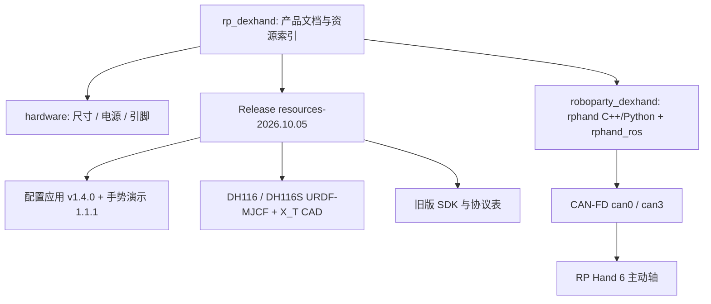

# RP Hand（五指灵巧手产品与开发资料）

## 一句话定义

**RP Hand** 是 RoboParty 的紧凑五指灵巧手，**6 个主动轴驱动 11 个机械自由度**（其余 5 个为被动/耦合），蜗轮蜗杆传动、CAN-FD 接入；**rp_dexhand** 是它的产品文档与资源索引仓，真正的 C++/Python/ROS 2 SDK 在另一仓库 `roboparty_dexhand`。

## 英文缩写速查

| 缩写 | 英文全称 | 简要说明 |
|------|----------|----------|
| DoF | Degrees of Freedom | 11 机械自由度 = 6 主动 + 5 被动/耦合 |
| CAN-FD | CAN with Flexible Data-rate | 本手的 RP1 接入总线，参考速率 1 Mbit/s 仲裁 / 5 Mbit/s 数据 |
| SDK | Software Development Kit | `rphand`：C++ `rphand::Hand` 与 Python `rphand.Hand` |
| URDF / MJCF | Unified Robot Description Format / MuJoCo XML | 仓库资源含 DH116 与 DH116S 左右手模型 |
| CAD / X_T | Computer-Aided Design / Parasolid transmit | DH116S 白色手 revision A，XZ 压缩后分发 |
| ROS 2 Jazzy | Robot Operating System 2, Jazzy Jalisco | `rphand_ros` 节点所针对的发行版 |

## 为什么重要

- 它是 [RP1](./roboparty-rp1.md) 的标准末端：README 展示“RP1 上快换安装”，RP1 总览仓库的 RP Hand 条目也指向这里，使人形整机有了开放的操作末端入口。
- 文档把“能做什么、不能假设什么”写得很细（轴序不是已标定的 URDF 映射、电流不是力矩、ROS 无命令超时停机），对实际接入灵巧手的工程团队比营销式 README 更有价值。
- 资源随 Release 发布并附 **SHA-256 清单与版本表**（`resources/resources-2026.10.05/`），便于复现同一份软件/模型；同类对照入口见 [Fourier DexHand SDK](./cn-os-fourier-dexhand-sdk.md)（本页未逐项对比其文档质量）。

## 核心结构

### 硬件规格（产品手册 revision 13，`docs/en/hardware.md`）

| 项 | 值 |
|----|----|
| 尺寸 / 质量 | 147.54 × 73.53 × 26.35 mm；379 ± 10 g |
| 行程 | 拇指外展 0–87.5°、拇指屈曲 0–65°、其余手指屈曲 0–72° |
| 电流 | 静态 ≤ 0.1 A / 最大 ≤ 2.5 A |
| 供电 | 12 V（−10%）–48 V（+10%）；引脚 1、2 VDC，5、6 GND，3 CANH，4 CANL |
| 环境 | 工作 −10–45 ℃、10–90% RH；存储 −10–70 ℃；IP30 |
| 开合时间 | 手册最小 ≤ 0.7 s，测试条件未写明 |

### SDK 约定（基线 `roboparty_dexhand@eb923ac`，由本仓文档转述）

- 轴序数组下标 0–5：拇指外展、拇指屈曲、食指、中指、无名指、小指（轴 ID 1–6）。
- 位置目标是 **0–10000 的行程单位**，不是角度；速度为行程单位/秒（ROS 接受 1–20000）；电流限值为额定电流的千分比 0–3000，不是 mA。
- 生命周期：`connect → disable → configure → enable → home → position control → stop/disable → disconnect`；`connect()` 会写通信配置并可能恢复锁存的停止，**不是只读探测**。
- ROS 2：`ros2/rphand_ros`，话题 `/dexhand_left/cmd`（Int32MultiArray，六轴位置）、`/dexhand_left/state`（`DexHandState`）、服务 `/dexhand_left/reset`（Trigger，使能并归零）；双手默认接口 `can0` / `can3`、节点 ID 均为 1。

### 模型

DH116S 每只手 17 个 link、11 个可动关节（6 独立 + 5 mimic）、5 个固定关节；独立关节 `finger11, finger12, finger21, finger31, finger41, finger51`；mimic 如 `finger13 = 0.929·finger12 − 0.015082`（`resources/model-inspection-2026.10.19.json`）。

## 工程实践

1. **离线先行**：Linux + CMake ≥ 3.20 + C++17 构建，Python ≥ 3.9 绑定需 pybind11；先跑 `-DRPHAND_BUILD_SMOKE=ON` 的 ctest（模拟响应），再接硬件。
2. **CAN-FD 配置**：`ip link set can0 type can bitrate 1000000 dbitrate 5000000 fd on`；SDK 不会替你建接口或设波特率；`connect()` 会配置六轴 20 ms 反馈周期。
3. **资源校验**：Release 文件用 `sha256sum -c SHA256SUMS.txt`；CAD 是 XZ 包裹的原始 X_T，须与 `manifest.json` 的 `original_sha256` 比较展开后的哈希。
4. **模型落地前先标定**：零位、符号、行程→弧度换算未标定，URDF 部分 effort/velocity 字段为 0；ROS 无 `/joint_states` 发布。
5. **开源状态核查（2026-10-27）**：
   - 本仓：文档与资源清单公开，但 `LICENSES.md` 称**原创文档尚未选定独立许可证**；
   - SDK 基线无独立许可证文件，`rphand_ros/package.xml` 声明 `Proprietary`；
   - 大文件（配置应用 205 MB、手势软件约 300 MB）在 Release，非 git 内容；未下载核对。
   - 本次未克隆 `roboparty_dexhand`，SDK 行为以本仓转述为准（待核实）。

## 局限与风险

- **许可不明确**：再分发前须向权利方确认；不要假设宽松或 GPL 授权（`LICENSES.md` 原文要求）。
- **ROS 安全边界**：节点按设定频率重复发送最后目标，**无命令超时停机、无 stop 服务、无失效反馈自动停机**；`reset` 返回 `success=true` 只表示请求被接受。
- **反馈非力觉**：电流反馈不是力/力矩测量，不能直接用作抓取力闭环；两路反馈异步，状态 `header.stamp` 是 ROS 发布时间而非硬件采样时间。
- **多版本 SDK 并存**：旧 `dexhand_py` / v0.5.0 / `046108e` 与新 `rphand` API 不兼容，不可原地替换。
- **平台覆盖有限**：CI 只覆盖 Ubuntu 24.04 x86-64；ARM64、ROS 2、真机需自行验证。
- **性能参数为手册值**：开合时间、行程不是逐轴软件限位或标定结果。

## 关联页面

- [RP1 总览（RoboParty RP1）](./roboparty-rp1.md)
- [RoboParty（公司）](./roboparty.md)
- [RP1 Hardware](./rp1-hardware.md) — 含 `RBE-PWR-HANDPlusPro` 手转接板
- [ROMOMO](./romomo.md) — 同属 CAN-FD 终端，速率设置不同
- [Fourier DexHand SDK](./cn-os-fourier-dexhand-sdk.md)
- [Allegro Hand](./allegro-hand.md)
- [Manipulation 任务](../tasks/manipulation.md)
- [CAN-FD](../concepts/can-fd.md)

## 参考来源

- [rp_dexhand 仓库归档](../../sources/repos/rp_dexhand.md)
- [RP1 官方仓库体系归档](../../sources/repos/roboparty_rp1.md)

## 推荐继续阅读

- [rp_dexhand GitHub](https://github.com/Roboparty/rp_dexhand)
- [roboparty_dexhand（SDK）](https://github.com/Roboparty/roboparty_dexhand)
- [ROS 2 Jazzy 安装文档](https://docs.ros.org/en/jazzy/Installation.html)
