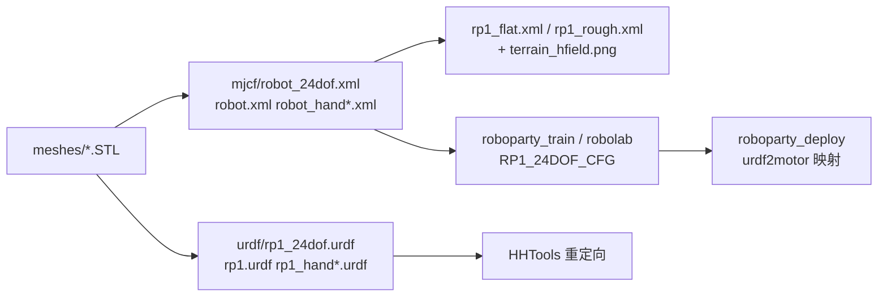

# RP1_description（RP1 本体模型：URDF / MJCF / 网格）

**RP1_description** 是 RoboParty RP1 人形机器人的 **机器人描述仓库**：用 URDF 与 MJCF 两种格式给出同一台机器人的运动学、惯量、关节限位与网格，训练仓（[roboparty_train](./roboparty-train.md) 的 `robolab` 子模块）和部署仓（[roboparty_deploy](./roboparty-deploy.md)）的关节顺序都以它为准。它与 [atom01-description](./atom01-description.md) **不是同一个仓**：后者的 HEAD（`8e0f8f7`）与 `rpo_description` 相同，属于 RPO 本体。

## 英文缩写速查

| 缩写 | 英文全称 | 简要说明 |
|------|----------|----------|
| URDF | Unified Robot Description Format | ROS 体系的机器人运动学 / 动力学描述，见 [URDF 机器人描述](../concepts/urdf-robot-description.md) |
| MJCF | MuJoCo XML Format | MuJoCo 模型格式；本仓用 `<motor>` 执行器与 `ctrlrange` 力矩范围 |
| STL | Stereolithography | 网格文件格式；本仓为二进制 STL（文件头 `RP1 refined binary STL`） |
| DoF | Degrees of Freedom | 24 DoF（`rp1_24dof`）与 28 DoF（`rp1`）两档 |
| hfield | Height Field | `terrain_assets/terrain_hfield.png` 驱动的 MuJoCo 高度场粗糙地形 |

## 为什么重要

- **Sim2Sim 与训练同源**：`robolab` 把本仓挂为 `data/robots/roboparty/rp1` 子模块，`RP1_MJCF_PATH` 指向 `mjcf/robot_24dof.xml`；改本仓的执行器参数（最近提交 `update actuator params for new motors`，2026-10-26）会直接改变训练环境。
- **一份仓库覆盖多档构型**：同时给出无手 24 / 28 DoF 与带手版本，便于核对 [RP1 总览](./roboparty-rp1.md)所述 24/28/30/42 DoF 变体里**哪些有公开模型**——本仓只覆盖 24 与 28 DoF，30 与 42 DoF 无对应文件。

## 核心结构

| 文件 | 事实 |
|------|------|
| `urdf/rp1_24dof.urdf` | 24 个 revolute 关节：每腿 6（髋 pitch/roll/yaw、膝、踝 pitch/roll）、腰 2（`waist_roll`、`waist_yaw`）、每臂 5（肩 pitch/roll/yaw、肘、`wrist`）；25 个 link |
| `urdf/rp1.urdf` | 28 个 revolute：每臂腕部拆为 `wrist_roll` / `wrist_yaw` / `wrist_pitch` 三轴 |
| `urdf/rp1_hand.urdf`、`rp1_hand_fixed.urdf` | 带灵巧手：前者 50 个可动关节（比 28 DoF 多 22）；后者 28 可动 + 34 固定（手指冻结） |
| `mjcf/robot_24dof.xml`、`robot.xml` | MuJoCo 模型：`timestep 0.005`、`implicitfast`、Newton 求解器；`base_link` 初始高度 `0.78`，带 `imu` site |
| `mjcf/rp1_flat.xml`、`mjcf/rp1_rough.xml` | 场景封装，均 `include robot.xml`（28 DoF）；rough 使用 `hfield`（`size 10 10 3.4 2.0`） |
| `meshes/` | 每个 link 一个 STL；左右手各 16 个手指 / 掌 STL，**未使用 Git LFS** |

### 执行器与惯量数据（取自 URDF / MJCF）

- **关节力矩上限**（24 DoF URDF）：`effort` 140 N·m ×8、64 ×4、55 ×4、32 ×8；28 DoF 为 140 ×8、64 ×4、55 ×4、32 ×12。左髋 pitch 的限位 ±2.86 rad、速度上限 13.61 rad/s、`armature 0.0290856`。
- **总质量**：对 `rp1_24dof.urdf` 25 个 link 的 `<mass>` 求和约 39.11 kg（本页计算；与 [RP1 总览](./roboparty-rp1.md)所引官方约 39 kg 的整机口径同量级，是否含电池未核实）。
- **踝关节**：URDF 以串联 `ankle_pitch` / `ankle_roll` 关节表达，未见并联连杆 link；电机侧的闭链解耦由部署仓 `decouple_rp1` 与 `close_chain_motor_idx` 处理（二者分工为据文件内容的推测）。

## 工程实践

1. **挑对文件**：训练 / Sim2Sim 用 `robot_24dof.xml`；要验证 28 DoF 或腕部三轴时用 `robot.xml` 或场景 `rp1_flat.xml`。三者关节名一致，但**数量不同，策略输入输出维度须匹配**。
2. **动作重定向**：用 [human-humanoid-tools](./human-humanoid-tools.md) 时选择与导出一致的 URDF（`robolab` 的 AMP / BeyondMimic 转换按 `--robot rp1`）。
3. **与部署对齐**：部署仓 `robot.yaml` 的 `urdf2motor`、`motor_sign`、`kp/kd` 必须与模型关节顺序一致；24 DoF 的默认站姿角在 `roboparty_inference/robots/rp1_24dof/configs/*.yaml` 的 `joint_default_angle`。
4. **开源状态核查**：模型文件公开可读；**仓库无 `LICENSE` 与 `README`**，许可证与再分发条件未声明，二次发布前应向 RoboParty 确认。

## 局限与风险

- **无文档**：没有关节编号表、坐标系约定、装配说明或版本号；只能从 XML 反推。
- **版本漂移**：HEAD 只有一次可见提交说明（更新执行器参数），模型随电机迭代变化；复现旧策略要固定 commit。
- **可信度**：质量与惯量来自 CAD 导出的数值，没有辨识或台架验证说明；摩擦 `frictionloss 0.1`、阻尼 `0.01` 为统一默认值（见 MJCF `default`），不代表各关节实测。
- **场景不匹配**：`rp1_flat.xml` / `rp1_rough.xml` 引用的是 28 DoF `robot.xml`，而训练配置使用 24 DoF 模型。

## 关联页面

- [RP1 总览（roboparty-rp1）](./roboparty-rp1.md)
- [RoboParty（公司）](./roboparty.md)
- [atom01-description（RPO 本体描述，区分页）](./atom01-description.md)
- [roboparty_train](./roboparty-train.md)、[roboparty_deploy](./roboparty-deploy.md)
- [MuJoCo](./mujoco.md)
- [人形并联关节运动学](../concepts/humanoid-parallel-joint-kinematics.md)

## 参考来源

- [RP1_description 仓库归档](../../sources/repos/rp1_description.md)
- [Roboparty/RP1_description](https://github.com/Roboparty/RP1_description)

## 推荐继续阅读

- [URDF 官方规范](http://wiki.ros.org/urdf/XML)
- [MuJoCo XML 参考](https://mujoco.readthedocs.io/en/stable/XMLreference.html)
