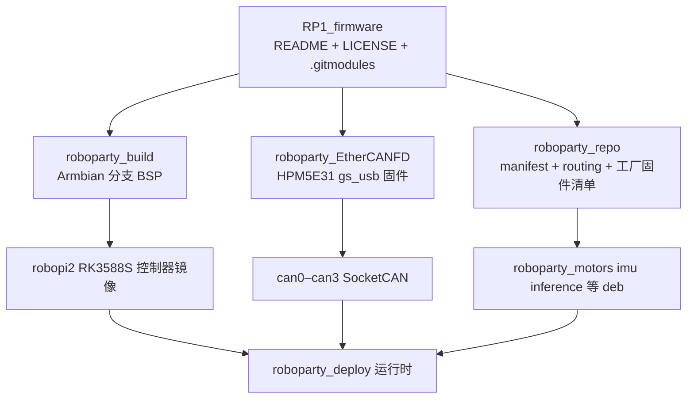

# RP1_firmware（RP1 固件、BSP 与 CAN 桥入口）

**RP1_firmware** 是 RoboParty RP1 的 **固件与板级系统入口仓库**：它本身不含固件代码，而是把「RoboPi 计算板系统镜像」「USB-CAN FD 桥固件」「APT 软件包与工厂固件清单」三类来源用 Git 子模块汇聚在一页 README 之下。它与 [atom01-firmware](./atom01-firmware.md) 是**不同的仓库**（HEAD 分别为 `1cfbe77` 与 `f06f409`；两者是否为前后代关系仓库内未说明）。

## 英文缩写速查

| 缩写 | 英文全称 | 简要说明 |
|------|----------|----------|
| BSP | Board Support Package | 内核、设备树、引导程序与镜像构建流水线（`roboparty_build`） |
| CAN FD | CAN with Flexible Data-rate | 电机总线协议，见 [CAN FD](../concepts/can-fd.md) |
| gs_usb | Geschwister Schneider USB/CAN | Linux 内核自带的 USB-CAN 协议，插入即得 `can0–can3` SocketCAN 设备 |
| HPM5E31 | HPMicro HPM5E31 | CAN 桥固件所用 RISC-V（rv32imac）MCU |
| APT | Advanced Package Tool | Debian 系软件源；`roboparty_repo` 自动化 deb 路由与发布 |
| OTA | Over-The-Air update | 电机 / IMU 子仓里的 `scripts/motor_ota.py`、`imu_ota.py` 固件升级脚本 |

## 为什么重要

- **RP1 的“最底层”其实是三件事**：控制器上的 Linux 系统、把四路电机总线接进 Linux 的 CAN 桥、以及把 `roboparty_motors` / `roboparty_imu` / `roboparty_inference` 等 deb 发布出去的软件源。部署仓 [roboparty_deploy](./roboparty-deploy.md) 默认这些已就绪。
- **能看出控制器选型**：`roboparty_build` 新增板型 `robopi2`（RK3588S，启动参数隔离 CPU 4–7），与部署文档里的 RK3588 实时内核资源相互印证（推测 RP1 控制器沿用 RK3588 类板卡；RP1 专用硬件文档不在本仓）。

## 核心结构

| 子仓 | 快照与内容 |
|------|------|
| `roboparty_build` | `77101e9`（2026-10-25）；`VERSION` 为 `26.11.0-trunk-2.0.2`；沿用 Armbian 框架（README 原文为 Armbian，许可证 GPL-2.0）；板型 `config/boards/robopi2.conf`：`BOARDFAMILY=rockchip-rk3588`、DTB `rockchip/rk3588s-orangepi-cm5-robopi2.dtb`、`SERIALCON=ttyS2:1500000`、`extraargs=cma=256M isolcpus=4-7 nohz_full=4-7 rcu_nocbs=4-7 irqaffinity=0-3`，EtherCAT 为可选项（`INSTALL_ETHERCAT=yes`）；引导配置注释写明“initially reuses the Orange Pi 5 Plus boot/DTS setup” |
| `roboparty_EtherCANFD` | `25b54a2`（2026-10-26）；HPM5E31，4 路独立 CAN FD，USB 高速，VID `0x1209` / PID `0x2323`，固件 1.1.0，闪存地址 `0x80000400`，HPM SDK 1.13.0 + RISC-V GCC 13.2；位时序由主机用 `ip link set canX type can ... fd on` 动态配置；GPL-3.0；`SSC/` 目录含 EtherCAT 从站配置，`scripts/5evocanfd.sh`、`5lrocanfd.sh` 区分 EVO 与 LRO 电机测试 |
| `roboparty_repo` | `87f5290`（2026-10-25）；`manifest.xml` 列出约 20 个源码仓（`roboparty_motors`、`roboparty_imu`、`roboparty_inference`、`roboparty_camera`、`roboparty_dexhand`、`roboparty_lidar`、`robopi_TUI` 等），`routing.yaml` 控制 deb 路由，`scripts/firmware-manifest.json` 登记工厂固件来源（电机 `v2.3.0`、BMS `v1.6.0`、HPM `roboparty_analyze v1.0.10`、IMU 固定到某一提交），含 APT 签名公钥 `scripts/roboparty.gpg` |

## 工程实践

1. **取源**：README 建议 `git clone --recurse-submodules`。但快照 HEAD 树仅有 `.gitmodules`、`LICENSE`、`README.md` 三项、没有子模块 gitlink，递归克隆能否拉到子仓内容未经验证（推测需手动克隆三个子仓）；README 所称“子模块固定到已提交修订”在该快照中不成立。
2. **CAN 桥使用**：插入后 Linux 直接出现 `can0–can3`；每路需先停用接口再设置仲裁 / 数据位速率，通信双方速率必须一致。README 说明 ONE_SHOT 严格遵循主机设置，电机部署若要禁止陈旧命令重发须显式 `one-shot on`。该固件的 Windows 构建流程（PowerShell + `env.ps1`）与 Linux 主机使用是两条不同路径。
3. **镜像**：按 `roboparty_build` 的 Armbian 流程选择 `robopi2` 板型构建；RP1 实时部署对 CPU 隔离的依赖见上表启动参数。
4. **开源状态核查**：入口仓 GPL-3.0，三个子仓公开可克隆；`roboparty_motors` 的 `firmware/*.lsepbin` 与 `roboparty_imu` 的 `.hex` / `.bin` 为**二进制固件**，非源码；`roboparty_repo` 仓内未见 LICENSE。README 的“Deploy on the robot”指向 `Roboparty/RP1_deploy`，匿名访问不可读，公开部署仓实为 [roboparty_deploy](./roboparty-deploy.md)。

## 局限与风险

- **入口仓无实质内容**：想读固件源码必须进子仓；电机驱动板固件（LRO 等）只有二进制，没有源码。
- **子模块不固定**：见上，复现镜像需自行记录三个子仓的提交。
- **板型信息不等于 RP1 控制器规格**：`robopi2` 配置沿用 Orange Pi 5 Plus 的设备树，RP1 实际使用的控制器型号仓库未明确。
- **许可混合**：Armbian 部分 GPL-2.0、CAN 桥 GPL-3.0、APT 清单仓未见许可证，再分发镜像前需逐项核对。

## 关联页面

- [RP1 总览（roboparty-rp1）](./roboparty-rp1.md)
- [RoboParty（公司）](./roboparty.md)
- [atom01-firmware（区分页）](./atom01-firmware.md)
- [roboparty_deploy](./roboparty-deploy.md)、[RP1_description](./rp1-description.md)
- [CAN FD](../concepts/can-fd.md)、[CAN 总线协议](../concepts/can-bus-protocol.md)
- [机器人策略部署开发板选型对比](../comparisons/robot-policy-deployment-dev-board-selection.md)

## 参考来源

- [RP1_firmware 仓库归档](../../sources/repos/rp1_firmware.md)
- [Roboparty/RP1_firmware](https://github.com/Roboparty/RP1_firmware)
- [Roboparty/roboparty_EtherCANFD](https://github.com/Roboparty/roboparty_EtherCANFD)

## 推荐继续阅读

- [Armbian 构建框架文档](https://docs.armbian.com/Developer-Guide_Overview/)
- [Linux SocketCAN 文档](https://docs.kernel.org/networking/can.html)
