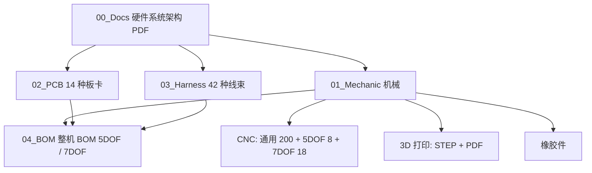

# RP1 Hardware（RP1.3.4 整机制造资料）

## 一句话定义

**rp1_hardware** 是 RP1 人形机器人的“可制造性”仓库：按 `00_Docs → 01_Mechanic → 02_PCB → 03_Harness → 04_BOM` 五层目录给出整机架构、机械、电路板、线束与物料清单，读者可凭料号把任一零件追溯到图纸与生产文件。

## 英文缩写速查

| 缩写 | 英文全称 | 简要说明 |
|------|----------|----------|
| BOM | Bill of Materials | 物料清单；本仓有整机 BOM、板级 BOM、线束 BOM、加工 BOM 四层 |
| CPL | Component Placement List | 贴片坐标表，PCBA 打样/贴装用，文件前缀 `04_CPL` |
| CMF | Color, Material, Finish | 颜色/材料/表面处理规格，各工艺目录下 `CMF说明/` |
| FPC | Flexible Printed Circuit | 柔性板；`01_FPC柔性板` 对应主控与背部板间的 USB3.0 高速连接（架构 PDF） |
| CERN-OHL-W | CERN Open Hardware Licence v2 – Weakly Reciprocal | 弱互惠开源硬件许可，本仓自有设计所用 |
| CANFD | CAN with Flexible Data-rate | 主控板对关节执行器的 5 路总线（架构 PDF） |

## 为什么重要

- 与只给 CAD 的开源人形不同，这里把**机械 + 电子 + 线束 + 物料**放进同一料号体系（机械件 `YCL.M…`、板卡 `YCL.E…`），采购、加工、装配可以不依赖口头沟通。
- 提供 5DOF / 7DOF（手臂自由度）两份整机 BOM，均含“运控头”，意味着复现时先要在两条配置里选一条。
- 与 [ROMOMO](./romomo.md) 的关节模组、[RP Hand](./rp-hand.md) 的灵巧手、[RP1 Test](./rp1-test.md) 的老化台架一起构成 [RP1 总览](./roboparty-rp1.md) 中“硬件与工具”一组的主干。

## 核心结构

### 电气架构（据 `00_Docs/RP1_Hardware_Architecture.pdf`）

- **双电源**：48 V 锂电池后抽拉式装在胸腔背部，直供主控板与背部接口板；30 V 小电池经保护板（`RBE-PWR-HOTSWAP`）热插拔，主电瞬断时反向放电给背部板维持关键回路。
- **主控板 `RBE-MAIN-RK3588S`（V1.6.1pro）**：RK3588（NPU 6 TOPS）+ 实时 MCU（480 MHz）；5×CANFD、RS485、USB3.0、2×千兆网、WiFi6/BT5.2、433 MHz。急停信号直接关断执行器输出，不经操作系统。
- **背部接口板 `RBE_PWR_BACKHUB`（V2.1）**：USB 扩展、Type-C 充电、30 V 小电池管理，并为 Jetson NX 算力板预留扩展位。
- **其他板卡**：电机电容板 MCAP（×2）、手转接板 HANDPlusPro（×2）、风扇板 FAN、头部板 HEAD（麦克风阵列/摄像头/MIPI 屏）、IMU 板、433 MHz 发射板、140 W 充电板、灯板与背部电源指示灯。
- 执行器为每关节内置驱动器的分布式无刷伺服，主控经 CANFD 下发位置/力矩（对应 [ROMOMO](./romomo.md)）。

### 机械制造文件

| 工艺 | 条目（本次统计 `git ls-files`） | 附带 |
|------|-------------------------------|------|
| CNC | 301 个文件：`Common` 200、`5DOF` 8、`7DOF` 18，另有 BOM 与 CMF | `RP1_CNC_BOM.xlsx`、`RP1_CNC_CMF_Specification.xlsx` |
| 3D 打印 | 124 个文件：STEP 模型 + PDF 图纸 | `RP1_3D_Print_BOM.xlsx` |
| 橡胶件 | 20 个文件 | `RP1_Rubber_BOM.xlsx` |

SolidWorks 源文件从 Release 压缩包解压后，以 `RP1_SolidWorks_Source/RP1.3.4整机.SLDASM` 为整机入口。

## 工程实践

1. **选配置**：在 `04_BOM/` 里选 5DOF 或 7DOF 的 `总BOM` 工作表；`包材` 工作表另列包装物料。
2. **按料号找资料**：机械件 `YCL.M000642` 这类编号对应 CNC 图纸（如“大臂上本体（01版）”）；板卡用 `02_PCB/README.md` 的“料号 + 修订”表，**采购和装配须取同一修订**的 BOM/Gerber/CPL。
3. **注意不装件**：HEAD 板 C30 与 140WCHG 板 R59 为 NC，不装；HEAD 的 BOM/CPL 各含 200 个装配位号，CPL 的 `NC_List` 表只供追溯，导入贴装时不能使用。
4. **线束**：先在 `RP1_Harness_BOM.xlsx` 查名称，再到 `Drawings/` 找 PDF（如 `ARM_10线材` 对应 `ARM_10_信号线.pdf`；`主控供电线` 为 18AWG 软硅胶线 + XT30，成品长 120±5 mm）。
5. **开源状态核查（2026-10-27）**：已开源——图纸、Gerber、BOM、线束图均为仓库内实体文件（无 `.gitattributes`，非 LFS）；CAD 源文件在 Release `v0.1.0` 附件中，本次未下载核对。许可见下节。
6. **贡献方式**：README 要求 issue 里写明料号 / 板卡修订与文件路径。

## 局限与风险

- **许可是分层的**：自有设计 CERN-OHL-W-2.0、文档 CC BY-SA 4.0、第三方/供应商文件保留原条款；包含采购件的 BOM 不等于采购件被重新授权（`LICENSES.md`）。
- **只覆盖 RP1.3.4**：BOM 文件名带 `RP1.3.4`；产品页另有 24 / 30 DoF 配置（见 [RP1 总览](./roboparty-rp1.md)），本仓两份 BOM 的自由度口径是“五/七自由度（手臂）+运控头”，与整机 DoF 数的对应关系未在 README 里展开（推测：5DOF/7DOF 指单臂，需对照 BOM 核实）。
- **架构 PDF 为描述性文档**：用 Apache POI 导出（PDF 元数据），数值（RK3588 8 nm、NPU 6 TOPS 等）是厂商描述，未经独立测评。
- **未提供软件/固件**：板级固件与主控软件不在本仓，分别见 RP1 总览中的 firmware / deploy 仓库。
- **制造可行性未验证**：仓库未附复现实测记录；Release 压缩包完整性、第三方件版本需自行核对。

## 关联页面

- [RP1 总览（RoboParty RP1）](./roboparty-rp1.md)
- [RoboParty（公司）](./roboparty.md)
- [ROMOMO 关节模组](./romomo.md) — 本机的执行器规格与 CAN-FD 协议
- [RP Hand 灵巧手](./rp-hand.md) — 手部末端与 `HANDPlusPro` 转接板配套
- [RP1 Test 可靠性平台](./rp1-test.md) — 为整机和模块做老化验证
- [开源人形机器人硬件方案对比](./open-source-humanoid-hardware.md)
- [Atom01 Hardware](./atom01-hardware.md) — RoboParty 另一条本体线（RPO / Atom01）的硬件仓，不要与 RP1 混用

## 参考来源

- [rp1_hardware 仓库归档](../../sources/repos/rp1_hardware.md)
- [RP1 官方仓库体系归档](../../sources/repos/roboparty_rp1.md)

## 推荐继续阅读

- [rp1_hardware GitHub](https://github.com/Roboparty/rp1_hardware)
- [CERN-OHL-W-2.0 许可证说明](https://cern-ohl.web.cern.ch/)
- [RP1 官方技术文档](https://roboparty.com/documents/roboto-01)
