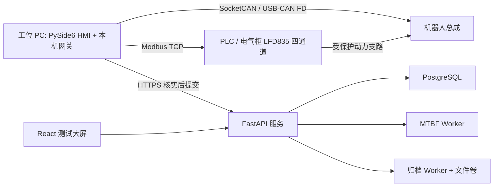

# RP1 Test（模块老化与整机可靠性测试平台）

## 一句话定义

**RP1 Test** 是 RP1 的“出厂前验证”工程：用台架把机器人手臂、胸腔、腿部固定并加载，由 PLC/CAN 上位机控制并记录，把结果送入可靠性平台做 MTBF、归档与审批；`test-cases/` 则给出 18 项整机可靠性方法（老化、温湿、振动冲击、保护恢复、动态与操作任务）。

## 英文缩写速查

| 缩写 | 英文全称 | 简要说明 |
|------|----------|----------|
| HMI | Human-Machine Interface | PySide6 桌面上位机，含本机 FastAPI 网关 |
| PLC | Programmable Logic Controller | 控制柜 PLC，经 Modbus TCP 受 HMI 控制，协议 V1.0–V1.2 |
| MTBF | Mean Time Between Failures | 平台 Worker 按暴露时长与故障组计算 |
| DVT | Design Validation Test | 用例文档标注的阶段（如 SYS-REL-002 为 DVT） |
| SocketCAN | Linux CAN socket interface | HMI 经 USB-CAN / CAN FD 与机器人通信 |
| RLS | Row-Level Security | PostgreSQL 行级安全，平台权限的一层 |

## 为什么重要

- 开源人形项目里，**可靠性验证方法与工具**几乎没人公开；这里把台架、软件、判据放在同一仓库，并明说“用例参数与判据需实测前确认”，不把草案当成合格证据。
- 它把关节模组（[ROMOMO](./romomo.md)）、整机（[RP1 Hardware](./rp1-hardware.md)）的“能不能长期用”变成可追踪的记录：每次运行关联用例 ID 与配置，经核实—归档—审批后才成为正式记录。
- 对想做自己的整机耐久测试的团队，`test-cases/` 的结构（目的/条件/步骤/记录/通过与中止）与 [humanoid 测试流程](../concepts/humanoid-testing-workflow.md) 可直接对照。

## 核心结构

### 软件（`software/`，仓库 0.2.0 / 平台 2.0.6 / HMI 2.0.9+ubuntu24.04）

| 模块 | 职责 |
|------|------|
| `frontend` | React 大屏：总控、样品/计划、时长/MTBF、工位、审批、归档与曲线 |
| `service` | 会话/权限、执行上下文、监控、归档、历史 CSV 导入 |
| `database` | Alembic 迁移、角色与 RLS、静态用例目录、统计约束；应用角色无超级用户 |
| `host` | PLC/CAN 桌面：`factory_hmi/{desktop,gateway,plc,core,sync}`；`motors/` 为设备 SDK 源码 |

PLC 控制要求 Host Protocol V1.2（`HR1=0x0102`，配套 PLC 软件 V1.5）；V1.0/V1.1 仅监控，其余拒绝。默认时间参数：心跳 500 ms、轮询 200 ms、TCP 快照过期 1000 ms，冷启动总预算 70400 ms（`plc/config.py` 等）。

### 数据流程

HMI 本地保存 `telemetry/raw.csv`、`analysis/summary.json`、`analysis/report.md`；测试员核实后显式提交，进入 SQLite 上传队列（可续传）；服务器校验、解析、归档，执行员/管理员“批准并发布正式记录”或驳回。测量事实不能通过应用接口改写，核实与重新分析以追加版本方式记录。

### 硬件与测试方法

- 三个台架：手臂测试平台、胸腔测试平台、腿部负载测试平台；共用资料含 STEP、PDF 加工图与采购表；总装模型为 `腿部老化测试平台总装.x_t`、`胸部支架总装.x_t`、`手部腿部支架总装.x_t`（Release `RP1_Test_Parasolid_CAD.zip`）。
- 控制柜：一台可调直流源提供公共电压与总限流，KM0 管理交流输入，四个支路独立通断并采集电压/电流（`hardware/electrical/README.md`）。
- 18 项整机用例，编号不连续但稳定：

| 方向 | 代表用例（参数摘自 `test-cases/README.md`） |
|------|------|
| 持续运行 | 001 站立老化 3 h×3；002 行走老化 50 km 且 ≥300 次姿态循环；003 带载站立；016 负载行走 |
| 温湿环境 | 004 40±2 ℃ 运行 2 h；005 −10±2 ℃ 5 次冷启动；006 温度循环；007 湿热 ≥93%RH 48 h |
| 存储恢复 | 008 高温存储 55±2 ℃ 16 h；009 −20±2 ℃ 16 h |
| 机械应力 | 010 振动 5–55 Hz；011 冲击 150 m/s²、11 ms×18 次；017 倾倒与受控跌倒 |
| 保护与恢复 | 012 热保护降额；013 双电池热插拔；014 电源循环与急停恢复 |
| 动态 / 操作 | 020 动态与跑步 30 min；021 抓取搬运 60 min |

## 工程实践

1. **先跑 mock**：`software/host/launch.py --offline-check` 强制 mock PLC、禁用 CAN 与平台；软件检查、构建或安装**不授权**启动真实 PLC/CAN。
2. **平台部署**：Ubuntu 24.04 amd64 + Docker Engine/Compose + Python 3 + OpenSSL；`python3 scripts/configure.py && bash scripts/up.sh && python3 scripts/verify.py`，默认 `https://localhost:8443`，需信任站点 CA，初始账号首次登录必须改密。
3. **用例使用顺序**：读 `common.md`（配置冻结、F0–F3 检查分级）→ 解决 `open-items.md` 的待确认参数 → 在 `checklist.md` 登记方法/单位/基线 → 执行并记录有效时长、暂停、人工干预 → 试后复测。
4. **接入自己的机器人**：控制柜 PLC 接口和机器人协议“按目标设备适配与验证”；台架适配需核对安装孔、总质量、重心、反力矩和运动包络。
5. **开源状态核查（2026-10-27）**：源码、台架设计、测试方法均已公开；**未提供**电气施工原理图、I/O 表、端子表、逐芯线束图和 PLC 工程。许可按材料分层：软件 Apache-2.0，硬件设计 CERN-OHL-W-2.0，文档与用例 CC-BY-SA-4.0，`software/host/motors/` 保留 GPL-3.0，第三方 CAD/SDK 保留各自权利。

## 局限与风险

- **用例是“方法草案”**：参数与判据需实测前确认，F0–F3 分级与性能判据须项目负责人批准，未确定时不判定通过；本仓没有公开的实测数据集。
- **软件停止不等于物理急停**：普通 PLC、SSR、KM0 通断和上位机心跳不代替安全控制；供电保护、回馈、预充、重力支撑与安全停止需按总成自行设计。
- **多网关写同一 PLC 不会自动协调**；锁态（人工重启锁）无远程解锁命令。
- **复现门槛高**：缺 PLC 工程与电气施工图，台架+控制柜无法仅凭仓库复现（推测：需要自行完成电气设计与 PLC 编程）。
- **许可碎片化**：混合 Apache/CERN-OHL/CC-BY-SA/GPL，部分 CAD 附带纹理与参考部件的权属未确认（`THIRD_PARTY.md`）。
- **数据另需许可**：真实测量、生产记录需明确数据许可，脚本许可不决定数据许可。

## 关联页面

- [RP1 总览（RoboParty RP1）](./roboparty-rp1.md)
- [RoboParty（公司）](./roboparty.md)
- [RP1 Hardware](./rp1-hardware.md) — 被测整机
- [ROMOMO](./romomo.md) — 被测关节与 CAN-FD 协议
- [人形机器人测试流程](../concepts/humanoid-testing-workflow.md)
- [机器人安全状态机](../concepts/robot-safety-state-machine.md)
- [硬件在环](../concepts/hardware-in-the-loop.md)
- [CAN-FD](../concepts/can-fd.md)

## 参考来源

- [rp1_test 仓库归档](../../sources/repos/rp1_test.md)
- [RP1 官方仓库体系归档](../../sources/repos/roboparty_rp1.md)

## 推荐继续阅读

- [rp1_test GitHub](https://github.com/Roboparty/rp1_test)
- [CERN Open Hardware Licence](https://cern-ohl.web.cern.ch/)
- [Modbus 协议规范](https://modbus.org/specs.php)
