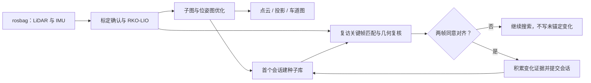
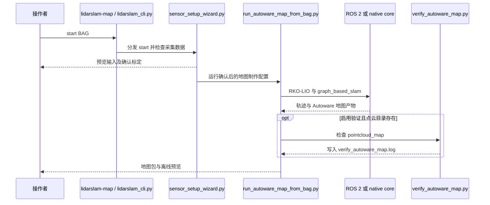

# lidar_slam: 3D LiDAR Map Authoring and Lifelong Updates（点云建图与跨会话更新）

## 一句话定义

**lidar_slam**（原仓库名 `lidar_slam_ros2`）是 Ryohei Sasaki 独立发布的三维点云制图工具，以 RKO-LIO 和图优化后端为主线，支持 Autoware 地图包导出，并实验性地在已建地图上自动对齐和增量更新后续会话。

## 英文缩写速查

| 缩写 | 英文全称 | 说明 |
|---|---|---|
| SLAM | Simultaneous Localization and Mapping | 同时估计运动和地图 |
| LiDAR | Light Detection and Ranging | 激光扫描点云 |
| IMU | Inertial Measurement Unit | 给惯性里程计提供运动观测 |
| LIO | LiDAR–Inertial Odometry | 激光与惯性联合里程计 |
| PCD | Point Cloud Data | 点云导出格式 |
| NCLT | North Campus Long-Term | 密歇根大学北校区跨季节数据集 |
| GNSS | Global Navigation Satellite System | 可为兼容配置提供全局地理投影基准 |

## 为什么重要

- **建图和可用地图包不是一回事。** rosbag 离线回放能估计轨迹、生成点云；Autoware 还需要一致的坐标投影、文件布局与语义车道图。维护者提供制作和预览入口，而不是自动驾驶安全认证。
- **长期可用不是将旧地图原样保存。** 后续会话先对齐持久 store，再提交新的子图和变化证据。这样可以更新几何，而不用把所有时段都从头重建。
- **项目身份。** 作者主页自述为 MAP IV（TIER IV group）工程师；本仓库由个人账号发布，不能写成 MAP IV 官方产品，也不同于商业 MAP IV Engine。

## 核心原理

1. 单次建图：发现 bag 话题和消息类型，确认激光与 IMU 外参，默认以 RKO-LIO 提供去畸变点云和里程计，`graph_based_slam` 生成子图、识别并验证回环、优化位姿图及导出地图。
2. 持久更新：先生成种子地图；再用新观测检索库内关键帧，通过几何匹配、两帧一致性检查得到 store 对齐，未锚定时不把未对齐扫描当作变化证据。
3. 变化处理：已锚定的关键帧累积命中与自由空间证据，导出时据此清除部分旧体素；过滤不稳定新点及可见性修正是额外模式，不等同于演示里仅启用的 `--detect-changes`。

## 实验口径：19 个会话不是 19 次重定位

| 官方证据 | 经核对的口径 |
|---|---|
| 地图演示 | 2012-01-15 建种子；到 2012-12-01 的 18 个复访条目均退出 0 且产出锚点，共 19 个展示会话。用 NCLT 一个约 150 m × 150 m 区域的通过窗口，不是跑了一年或覆盖全校区。 |
| 启动耗时 | 成功锚定约 3.4–159.6 秒**数据时间**，不是计算延迟。5 月 11 日只用首版地图约 92.8 秒，使用累计地图约 4.5 秒，是一次特定回放对照。 |
| 额外一次 | 2013-02-23 日志退出 137、锚点字段为空；文档说明已提交会话但合并导出内存耗尽，未纳入演示，不能计为有日志可验证的成功重定位。 |
| 单独留出测试 | 作者的无首姿态第二轮留出：4 个在图窗口正确锚定（3.4–6.6 秒数据时间）、4 个不在图窗口均未锚定。它不是 19 会话演示的等价重复。 |

出处：[演示过程与逐次记录](../../sources/repos/rsasaki-lidar-slam.md)。以上为维护者公开数据回放，未独立复跑，不能当作不受场景限制的全图定位或连续真车验证。

## 源码运行时序图

无 ROS 2 版本的入口见 [product.py](https://github.com/rsasaki0109/lidar_slam/blob/bfe6d280e06cf6433f714a70f8e0f725a274890c/lidarslam_core/python/lidarslam/product.py)。NCLT 实验走另一入口 `python -m lidarslam live`，创建 `live.Session`、按顺序处理 IMU 与点云、完成后以 `Session.finish` 提交；不把它当成普通 `start` 的默认行为。

## 工程实践与选型

- **易用与无配置不同。** `lidarslam-map doctor` 先只读诊断；`start` 根据话题、配置和运行环境选工作流，RKO-LIO 需要显式标定确认。无 GNSS 的文档示例是 Local，具备稳定 GNSS 原点的示例可导出 LocalCartesian。

## 局限与风险

- **格式兼容与量产区别。** 轨迹生成的 Lanelet2 不会凭空补齐车道拓扑、交通规则和现场验收。核查投影、车道边界、停止线、限速和路线后才进入受控验证。检查工具输出与 Autoware 真实环境的接入验收不能混用。
- **与同作者定位仓区分。** [lidar_localization_ros2](./lidar-localization-ros2.md) 消费预建地图用于实时定位；此处的仓库主要生产地图并研究跨会话扩展。不要把前者在 Go2 或后者在 NCLT 的指标互相归因。

## 关联页面

- [LiDAR 里程计融合](../methods/lidar-odometry-fusion.md) · [LingBot-Map](../methods/lingbot-map.md) — 各自对照惯性里程计与地图表示。
- [Autoware](./autoware.md) · [导航纵深路线 Stage 1](../../roadmap/depth-navigation.md) — 了解制图与消费地图的接口边界。

## 参考来源

- [固定版本源码、实验日志与项目归档](../../sources/repos/rsasaki-lidar-slam.md)
- [Autoware 官方工具列表](https://docs.autoware.org/main/tutorials/integrating-autoware/creating-maps/open-source-slam/) · [NCLT 数据](https://robots.engin.umich.edu/nclt/)

## 推荐继续阅读

- [地图制作 Quickstart](https://rsasaki0109.github.io/lidar_slam/autoware-quickstart.html) — 核对预览、地图投影和目标接口。
- [长程地图实验路线](https://rsasaki0109.github.io/lidar_slam/roadmap/long-term-mapping-2026-11.html) — 查看无初始位姿匹配、图外负对照与变化检测的分开验收。
