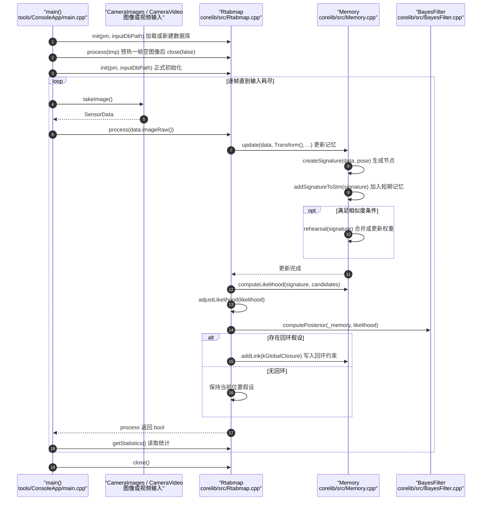

---

type: entity
tags: [repo, slam, rgbd, ros, mapping, loop-closure, hku]
status: complete
updated: 2026-05-27
related:
  - ../entities/navigation2.md
  - ../comparisons/lidar-slam-lio-vio-selection.md
sources:
  - ../../sources/repos/rtabmap.md
summary: "RTAB-Map 支持 RGB-D/立体/激光的多模态 SLAM 与记忆管理，提供独立 GUI 与 ROS/ROS2 集成。"
---

# RTAB-Map

**RTAB-Map** 以 **记忆管理（WM）** 处理长期建图与闭环，一套工具链覆盖采集到导航。

## 英文缩写速查

| 缩写 | 英文全称 | 简要说明 |
|------|----------|----------|
| RGB | Red-Green-Blue | 彩色图像通道，常与深度 (RGB-D) 配合 |
| SLAM | Simultaneous Localization and Mapping | 同步定位与建图 |
| ROS 2 | Robot Operating System 2 | 机器人系统集成与通信的常用中间件 |
| WM | World Model | 学习环境动态以供想象/规划的世界模型 |
| LIO | LiDAR-Inertial Odometry | 激光-惯性里程计 |
| LiDAR | Light Detection and Ranging | 激光雷达，地形感知与建图主传感器 |
| VIO | Visual-Inertial Odometry | 视觉-惯性里程计，融合相机与 IMU 估计位姿 |

## 为什么重要

- **RGB-D 机器人常用**：TurtleBot 等历史生态。
- **GUI 友好**：适合快速原型与数据集回放。

## 核心结构/机制

| 能力 | 说明 |
|------|------|
| **Multi-session** | 多会话建图 |
| **Loop closure** | 词袋 + 图优化 |
| **Navigation** | 可选与 move_base/Nav2 衔接 |

## 常见误区或局限

- **高动态场景**：需运动补偿或过滤动态点。
- **与纯 LIO 对比**：激光-only 大场景可能不如 FAST-LIO 简洁。

## 源码运行时序图

入口：`tools/ConsoleApp/main.cpp` 的 `main()`（CMake 目标 `consoleApp`），逐帧调用 `Rtabmap::process()`。

图依据：introlab/rtabmap@8ebc407，读过 `README.md`、`tools/ConsoleApp/main.cpp`、`corelib/src/Rtabmap.cpp`（`process` 与内存更新、似然、后验段）、`corelib/src/Memory.cpp`（`update`、`addSignatureToStm`、`rehearsal`）、`corelib/src/RtabmapThread.cpp`、`corelib/src/Odometry.cpp`。库内另有 `RtabmapThread::process()` 经 `OdometryThread` 驱动的线程路径，未画入本图。

## 参考来源

- [sources/repos/rtabmap.md](../../sources/repos/rtabmap.md)
- [introlab/rtabmap](https://github.com/introlab/rtabmap)
- 源码核对（2026-11-02）：introlab/rtabmap@8ebc407，读过 README.md、tools/ConsoleApp/main.cpp、corelib/src/Rtabmap.cpp、corelib/src/Memory.cpp、corelib/src/RtabmapThread.cpp、corelib/src/Odometry.cpp；时序图依据以上文件，未运行代码。

## 关联页面

- [Navigation2](../entities/navigation2.md)
- [LiDAR / LIO / VIO 选型](../comparisons/lidar-slam-lio-vio-selection.md)

## 推荐继续阅读

- http://introlab.github.io/rtabmap/
