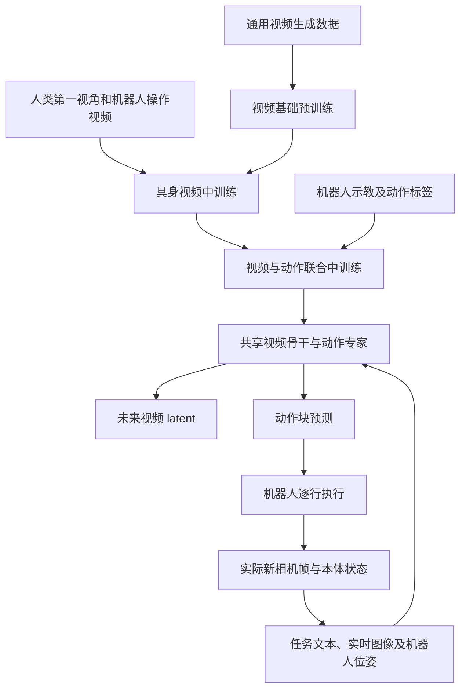
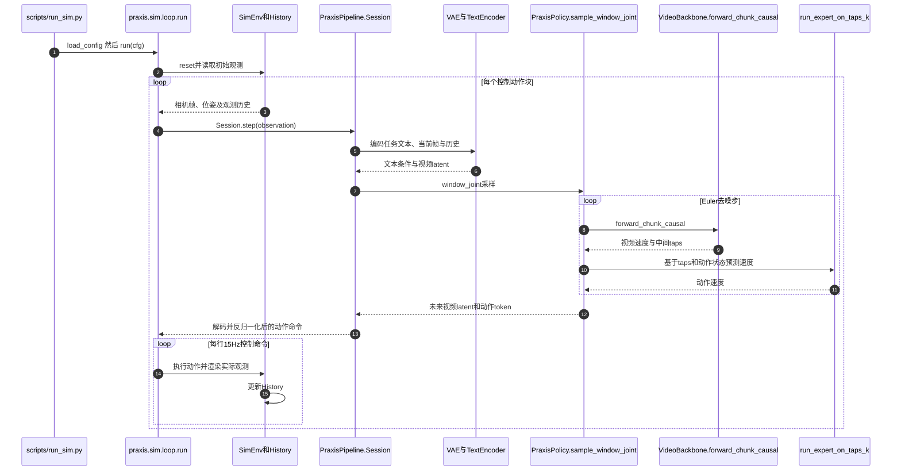

# Praxis-1：从视频预训练到机器人控制 / From Video Pretraining to Robot Control

## 一句话定义

**Praxis-1** 是 Runway 发布的视频—动作联合机器人基础模型：利用通用及具身视频学习未来世界演化，再从共享视频骨干的中间特征生成可执行动作块，并按机器人本体微调。

## 英文缩写速查

| 缩写 | 英文全称 | 简要说明 |
|---|---|---|
| WAM | World-Action Model | 在同一模型中耦合未来视频演化与动作生成 |
| MoE | Mixture of Experts | 视频骨干的稀疏专家网络 |
| VAE | Variational Autoencoder | 将图像帧编码到视频 latent 空间 |
| CFG | Classifier-Free Guidance | 在条件与无条件速度场间插值的文本引导 |
| RTC | Real-Time Chunking | 在分块控制的基础上进行提前计算与时延优化 |
| FSDP | Fully Sharded Data Parallel | 官方全参数微调采用的分布式训练机制 |

## 为什么重要

视频比带精确动作标签的机器人轨迹更容易大规模获得。Praxis-1 以视频生成能力作为物理动态先验，并通过机器人动作监督将这种先验转为操控策略。这里的关键不是单独预测视频再做逆动力学，而是**同一去噪窗口内联合生成未来视频与动作**，动作专家读取视频骨干的多层特征。

- **研究原文：** [Runway — Praxis-1: From Video Pretraining to Robot Control](https://runway.com/research/praxis-1-video-pretraining-to-robot-control)（2026-11）
- **官方代码：** [runwayml/praxis-1-oss](https://github.com/runwayml/praxis-1-oss)
- **官方模型：** [Runway Praxis-1 权重集合](https://huggingface.co/collections/runwayml/praxis-1)

## 核心原理与训练阶段

1. **通用视频预训练：** 在多任务视频/图像等生成数据上训练视频骨干，学习视觉变化及物理交互的广泛先验。
2. **具身视频中训练：** 转为分块因果（chunk-causal）时序结构，以人类第一视角和机器人操作视频强化物理交互建模，使用 teacher-forced 历史条件。
3. **视频—动作联合中训练：** 增加动作专家，对同步的未来视频 latent 与机器人动作分别进行 rectified-flow 去噪监督；保留一部分纯视频训练，缓解视频知识遗忘。
4. **本体适配：** 将共享表示迁移至特定机器人及相机布局，对本体的输入/输出投影、归一化与动作表示进行适配。

| 组件 | 原文/实现中的角色 |
|---|---|
| 视频骨干 | 约 26.9B 参数的 MoE 视频生成骨干；在 chunk-causal 窗口预测未来视频 latent |
| 动作专家 | 约 314M 参数，读取视频骨干多个深度位置的特征 taps，生成动作速度场 |
| 文本与视频编码 | 文本编码器与视频 VAE 提供任务条件、当前锚点和已执行历史的 latent |
| 分块采样 | 按窗口同步对视频与动作积分，输出当前块的动作；视频可用于可视化或分析 |
| 本体输入/输出 | 单臂、双臂采用各自的动作投影与归一化，不可直接混用 checkpoint |

**输入**为任务描述、外部/腕部相机观测、机器人本体状态与已执行历史；**输出**通常为一块 24 行、15 Hz 的动作及相应未来视频 latent。每块覆盖约 1.6 秒；初次调用在官方仿真路径中执行 21 行。默认配置使用两步 Euler 采样，但服务端可选择在最后一步省去仅用于视频可视化的 decoder。

## 流程总览

下图分别表示训练信息流与执行期观测闭环；并非把未来想象视频当作真实观测直接送入控制器。

## 源码运行时序图

此图按**已读取的官方运行入口**绘制：模拟入口为 scripts/run_sim.py → praxis.sim.loop.run；策略由 praxis.pipeline.Session 调用，核心采样在 praxis.model.PraxisPolicy.sample_window_joint 中执行，视频骨干 taps 被动作专家读取。

源码依据：[run_sim.py](https://github.com/runwayml/praxis-1-oss/blob/main/scripts/run_sim.py)、[sim/loop.py](https://github.com/runwayml/praxis-1-oss/blob/main/praxis/sim/loop.py)、[pipeline.py](https://github.com/runwayml/praxis-1-oss/blob/main/praxis/pipeline.py)、[model.py](https://github.com/runwayml/praxis-1-oss/blob/main/praxis/model.py)、[sampler.py](https://github.com/runwayml/praxis-1-oss/blob/main/praxis/sampler.py)。

## 工程实践与开源状态

**已开源。** 官方仓库包含模型及权重加载、离线推理、MuJoCo 闭环测试、WebSocket 策略服务、全参数与 LoRA 微调流程。初学者宜先在仿真与离线轨迹验证，而非直接上机。

| 路线 | 官方入口/边界 |
|---|---|
| 离线推理 | scripts/run_inference.py + configs/inference_droid.yaml；输入回放视频、机器人位姿和任务文本 |
| MuJoCo 闭环 | scripts/run_sim.py + configs/sim_droid.yaml；逐行动作以 15 Hz 执行，按块重新规划 |
| 评测 | scripts/run_sim_eval.py；固定场景种子与策略种子，支持前后模型配对比较 |
| 服务化 | python -m praxis.serve + configs/serve_droid.yaml，WebSocket 协议返回动作命令 |
| 新本体适配 | praxis/train/README.md 要求重新建立新本体动作头、归一化和相机配置，并进行全参数微调 |
| 同本体新任务 | DROID 相机/动作协议不变时可使用动作专家 LoRA；不能直接作为另一机器人本体的适配方法 |

**部署约束：** 官方默认 bf16 权重约 54.4 GB，快速开始要求高显存 GPU；报告中的单 H100 分块推理延迟约 0.55–0.6 秒，不等于以 15 Hz 每帧完整运行一次模型。NVFP4 权重与相关内核有硬件和精度边界，应在目标设备上重新测量时延与闭环成功率。

## 实验与评测

以下是**Runway 官方报告值**，不是本站独立复现，亦不可跨平台直接比较。

| 评测场景 | 报告结果 | 阅读边界 |
|---|---:|---|
| RoboLab-120 | **555/1200（46.2%）** | 120 个任务，每任务 10 次；与同一基准下对照比较 |
| 真机 Franka 操作 | **88/100** | 报告对照 FLUX 3 Action 为 80/100，十项任务各十次 |
| RT-1 / SimplerEnv | **80.0%** | 本体适配后仿真评测，非 RT-1 真实部署证明 |
| Noble Machines 场景适配 | 15/15 已知布局；6/10 陌生仓储布局 | 基于 29 分钟示教的**仿真**结果 |
| YAM RTC 与分块运行 | 24/30 vs 28/30 | RTC 更快但在该具体任务上成功次数减少 |
| NVFP4 量化感知微调 | 279/600 vs bf16 287/600 | 属该组测试，不能推广到所有低精度/硬件配置 |

## 与其他工作对比

- [VLA](../methods/vla.md)：直接把视觉与语言映射为动作；Praxis-1 还在推理窗口中显式联合生成视频未来。
- [UniWAM](./paper-uniwam-unified-world-action-model.md)：两者都联合世界预测与动作，但 UniWAM 额外采用专门的物理语言推理专家，训练数据配比和模型设计不同。
- [World Action Models](../concepts/world-action-models.md)：Praxis-1 是使用视频生成预训练并读取视频骨干 taps 的一种具体 WAM 路线。

## 结论

**Praxis-1 的核心取舍是把大规模视频知识保留在可生成未来画面的骨干中，再用较小动作专家实现机器人控制；其潜力与运行成本都需要按具体本体验证。**

1. 优先区分「视频预训练迁移」与「机器人示教微调」，两者并非同一数据规模或训练成本。
2. 本体切换涉及相机视角、动作表征、归一化及动作头，不能只更换机器人名称。
3. 24 行动作块以 15 Hz **执行**，不意味着模型以 15 Hz **推理**。
4. 进行严格对比时固定任务、场景种子、采样设置，并报告执行成功率而非仅视觉生成质量。
5. RTC/量化可改善部署效率，但要同时追踪闭环成功率与动作延迟。

## 局限与风险

- **未来视频预测不等于准确控制：** 视觉想象与真实接触动力学之间可能有误差；报告的 oracle 未来视频消融显示视觉预测是制约动作精度的因素之一。
- **复杂多阶段指令和相似物体：** 官方报告列出指令歧义、目标混淆、长程单次提示失败等情形，不能将单项 benchmark 结果理解为普适自主操作能力。
- **真实机器安全与跨本体能力：** 现有演示及测试不能证明未经安全验证就可在任意机械臂/人形机器人上运行；必须先检查坐标系、限位、碰撞、夹爪定义与延迟。
- **同名项目不混淆：** 本项目是 Runway 的 **Praxis-1**，与本库另一待核条目 [Praxis：第一视角交互先验](./paper-praxis-egocentric-interaction-priors.md) 来源不同，也不等同于 OAT 作者的 praxis-vla 仓库。

## 关联页面

- [World Action Models（WAM）](../concepts/world-action-models.md)
- [生成式世界模型](../methods/generative-world-models.md)
- [VLA](../methods/vla.md)
- [机器人操作](../tasks/manipulation.md)
- [UniWAM](./paper-uniwam-unified-world-action-model.md)

## 参考来源

- [Runway 官方技术报告原文归档](../../sources/papers/runway_praxis_1_technical_report_2026_11.md)
- [Runway 官方项目与发布说明](../../sources/sites/runway-praxis-1.md)
- [官方源码及运行入口核查](../../sources/repos/runway-praxis-1-oss.md)

## 推荐继续阅读

- [Runway：Praxis-1 官方完整技术报告](https://runway.com/research/praxis-1-video-pretraining-to-robot-control)
- [Runway GitHub 源码与安装说明](https://github.com/runwayml/praxis-1-oss)
- [Praxis-1 官方模型权重](https://huggingface.co/collections/runwayml/praxis-1)
- [LeRobot 的 Praxis 集成文档](https://huggingface.co/docs/lerobot/main/en/praxis)
