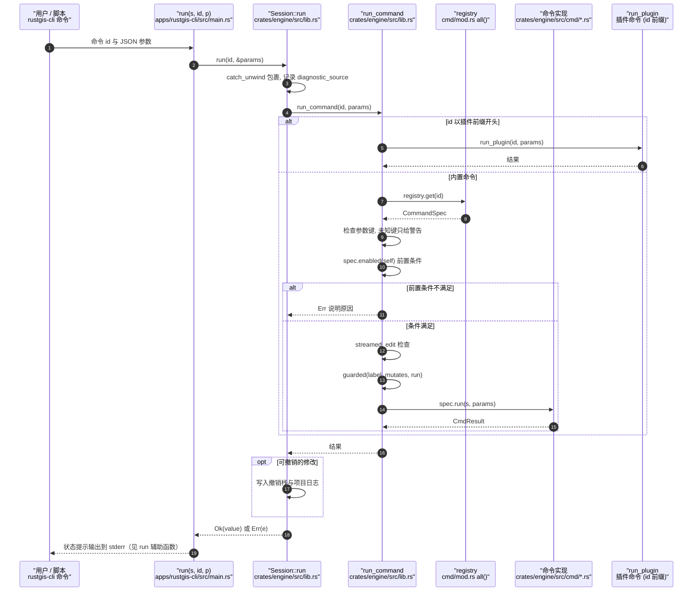

# RustGIS

**RustGIS** 是以 Rust 编写、可运行于 Windows、macOS、Linux 和浏览器的 GIS 工作台，用于地理空间数据制图、编辑与分析，并提供可脚本化命令。

## 英文缩写速查

| 缩写 | 英文全称 | 简要说明 |
|------|----------|----------|
| GIS | Geographic Information System | 地理信息系统，用于管理、分析与呈现空间数据 |
| CRS | Coordinate Reference System | 坐标参考系，定义空间坐标的地理基准与投影 |
| STAC | SpatioTemporal Asset Catalog | 时空资产目录，用于发现遥感和地理空间数据 |
| MCP | Model Context Protocol | 让外部模型或代理调用工具的协议 |

## 为什么重要

- **覆盖常见地理数据工作流**：官方资料列出矢量、栅格、数据库与 STAC 等数据源，包含 GeoJSON、GeoPackage、GeoParquet、GeoTIFF/COG、PostGIS 和 MySQL。
- **可复现与自动化**：CLI 与 Python 接口让地图数据处理可接入脚本和 notebook；MCP Server 与 WebAssembly 插件提供额外的自动化和扩展入口。
- **机器人工程中的辅助位置**：适合检查地理参考地图、地形或环境数据；对导航栈的角色是数据准备和可视化，不能取代定位、SLAM 或规划运行时。

## 核心能力

| 维度 | 能力 |
|------|------|
| 数据管理 | 导入/编辑常见矢量、栅格和表格数据；连接部分空间数据库与公开数据服务 |
| 地图表达 | 主题符号、标注、地图布局、投影、三维地球与地形呈现 |
| 空间分析 | SQL 选择、叠加和邻近分析、ModelBuilder，以及 GeoLibre / Whitebox 工具 |
| 自动化 | `rustgis-cli`、Python 包、命令式 AI Assistant、MCP Server |
| 部署 | 桌面应用与浏览器版；浏览器版本使用 WebAssembly |

## 与机器人导航栈的关系

RustGIS 可作为机器人项目中的**离线地图资料检查与空间分析工具**。例如，在已有符合支持格式的地理数据时，可用于浏览空间范围、符号化要素或制作地图输出，再将经过格式与坐标系校验的数据转换到机器人运行时所需表示。

需注意：

- 官方资料没有将 RustGIS 定位为 ROS 2 节点或 SLAM 实现，不能直接替代 [Navigation2](./navigation2.md) 或 [SLAM Toolbox](./slam-toolbox.md)。
- GIS 格式导入能力不代表支持 ROS 消息、实时传感器流、机器人占据栅格或点云管线；接入前需核对格式、CRS、分辨率、原点及时间同步要求。
- AI Assistant 会按用户选择调用模型；项目文档说明联网与数据发送取决于用户操作及所配置的数据源/模型。

## 源码运行时序图

入口有三条，最终都汇入引擎的 `Session::run(id, params)`：桌面应用 `apps/rustgis`（`main()` 调用 `eframe::run_native` 启动 `RustGisApp`）、命令行 `rustgis-cli`（`apps/rustgis-cli/src/main.rs` 的 `run()` 辅助函数）、Python 包 `rustgis`（`apps/rustgis-python/src/lib.rs` 的 `run`）。下图以 CLI 为入口，展示命令的实际分发路径。

图依据：opengeos/RustGIS@f822ef0，读过 `README.md`、`apps/rustgis-cli/src/main.rs`（`run` 辅助函数）、`apps/rustgis/src/main.rs`（`main`）、`apps/rustgis-python/src/lib.rs`（`run`）、`apps/rustgis-python/python/rustgis/__init__.py`、`crates/engine/src/lib.rs`（`Session::run`、`run_command`）、`crates/engine/src/cmd/mod.rs`（`all()`）。CLI 的 `main()` 中具体分发到 `run()` 的分支未逐行核对；撤销与日志写入只依据 `run` 中的注释与分支概括，未展开。

## 参考来源

- [RustGIS 官方仓库归档](../../sources/repos/rustgis.md)
- [RustGIS 官方项目页归档](../../sources/sites/rustgis-app.md)
- [RustGIS GitHub](https://github.com/opengeos/RustGIS)
- [RustGIS 官方文档](https://rustgis.app/)
- 源码核对（2026-11-02）：opengeos/RustGIS@f822ef0，读过 README.md、apps/rustgis-cli/src/main.rs、apps/rustgis/src/main.rs、apps/rustgis-python/src/lib.rs、crates/engine/src/lib.rs、crates/engine/src/cmd/mod.rs；时序图依据以上文件，未运行代码。

## 关联页面

- [导航·SLAM·自动驾驶开源栈总览](../overview/navigation-slam-autonomy-stack.md)
- [SLAM Toolbox](./slam-toolbox.md)
- [Geo-Sleuth](./geo-sleuth.md)

## 推荐继续阅读

- [RustGIS 支持的数据格式](https://rustgis.app/formats/)
- [RustGIS 架构文档](https://rustgis.app/architecture/)
- [RustGIS MCP Server 文档](https://rustgis.app/mcp/)
