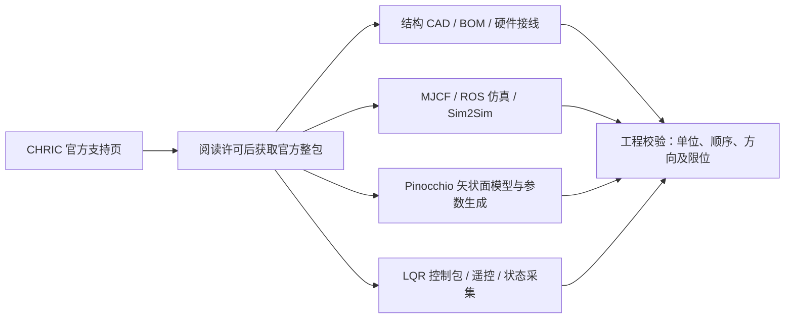
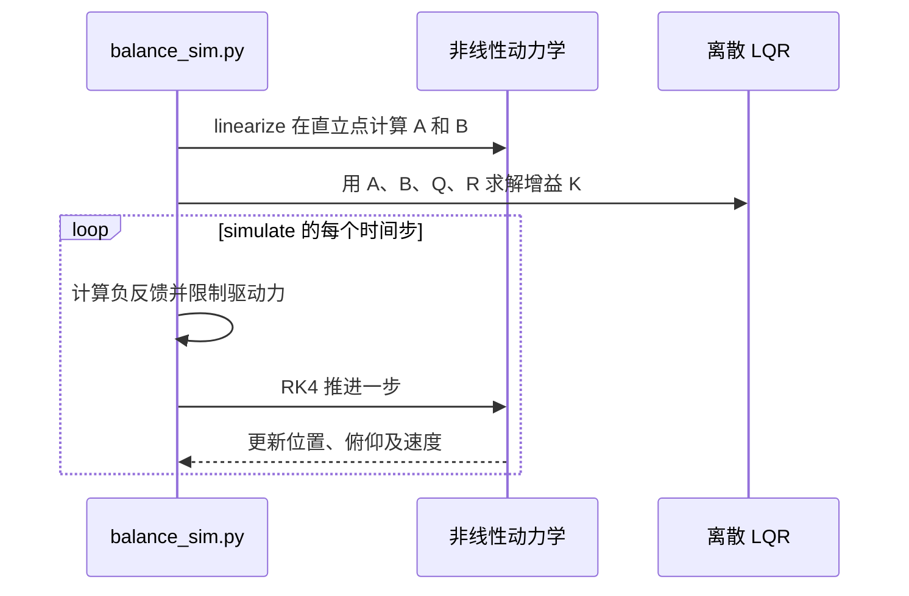

# RW-02OP：全尺寸重载双轮足开发平台｜RW-02OP Heavy-Duty Two-Wheel-Legged Robot

## 一句话定义

**RW-02OP** 是成都人形机器人创新中心（CHRIC）发布的全尺寸重载双轮足平台。官方把 CAD、BOM、电气接线说明、MJCF、ROS 仿真与 LQR 控制相关资料集中在[技术支持页](https://www.ruidiculous.com/support/)分发，而不是在 GitHub 提供独立项目仓库。

## 英文缩写速查

| 缩写 | 英文全称 | 本页含义 |
|---|---|---|
| CHRIC | Chengdu Humanoid Robot Innovation Center | 官方发布机构 |
| BOM | Bill of Materials | 物料清单；与结构及电气设计对应 |
| MJCF | MuJoCo XML File Format | 仿真模型接口 |
| ROS | Robot Operating System | 官方资料目录对仿真及控制包使用的名称；具体发行版待包内确认 |
| LQR | Linear Quadratic Regulator | 官方控制器资料使用的线性二次调节方法 |
| Sim2Sim | Simulation-to-Simulation Transfer | 在另一仿真环境复核模型与控制接口 |

## 为什么重要

它的工程参考价值在于同一底盘同时提供结构、电气、仿真资产与控制资料入口。对照这些层，可以区分「仿真模型能加载」「反馈控制能在模型上闭环」和「负载改变后实物仍能稳定」三个不同问题，而不是把一个 demo 当成整机验收。

## 核心机制：官方资料与工程链路

| 层级 | 发布方列出的内容 | 读包时优先对齐 |
|---|---|---|
| 结构与硬件 | 整机三维结构、BOM、硬件参数、系统框图、连接图和硬件功能教程 | 结构版本、轮径、质量/质心、执行器与传感器安装方向 |
| 建模与仿真 | MJCF、ROS 仿真包、Sim2Sim、Pinocchio 矢状面模型计算 | 惯量与单位、关节/执行器顺序、底盘坐标、观测与动作约定 |
| 控制与调试 | 基于 LQR 的 ROS 控制包、增益参数生成、数据采集分析、状态查看及遥控 | 状态定义、线性化点、采样周期、命令与饱和处理 |

这是按官方目录整理的**资料关系图**，不是从实际源码得出的启动顺序。资料包下载需要自行确认官网协议；本次未打开包，不填运行时序、ROS 2 发行版、节点名、话题名或实机频率。

## 实验与证据边界

官方公告给出的设计/能力数据是本体约 **1.1 m、21 kg** 和 **10 kg** 负载能力。公告中的站立、斜坡和下台阶属于仿真演示；公开页未给出可复查的负载工况、台阶高度或成功率，不宜用这些描述代替实物验证。Go2W 项目的 20 cm 声明不能移用到 RW-02OP。

## 与相关工作对比：四个独立学习资源

下列项目**不是 RW-02OP 的配套软件、模型、外设或官方镜像**：

| 学习目标 | 入口 | 适合对照什么 |
|---|---|---|
| 入门级双轮足 | [StackForce 双轮足课程](https://gitee.com/StackForce/bipedal_wheeled_robot) | 桌面级整机的模型、BOM 和逐课 PlatformIO 代码，先上手双轮平衡与模块集成。 |
| 从仿真到实物 | [RC WheelLeg 的版本标签](https://github.com/zeitvex/RC_WheelLeg/tags) | 16 DoF **四轮足**工程从 MJCF/mjlab、Sim2Sim 到 ROS 2/C++ 实物部署；按标签区分 ROS 2 导航原型与主分支后续版本。 |
| 控制算法 | [AI_Self-Balance_Robot / Roly](https://github.com/SteveZC8537/AI_Self-Balance_Robot) | 小型双轮平台的平衡动力学、线性化和 LQR 增益设计；读数学与实现，不搬用增益。 |
| RL 越障仿真 | [Go2W SuperMimic](https://github.com/uwvwko-zzz/go2w-supermimic) | **四轮足**，比较有地形特权输入的世界模型与只用本体观测的盲走策略。20 cm 为该仓库自报的仿真能力，未独立复现。 |

### 独立源码时序示例：Roly（不是 RW-02OP）

Roly 的双轮倒立摆示例用正向差分在线性化点构造矩阵，再用离散 Riccati 迭代求增益，最后以饱和反馈跑非线性仿真。本次运行其 NumPy 单文件示例，12° 初始倾角场景末态约 0.021°；仅验证 Roly 的简化仿真入口，不是实物结果。

## 工程实践

1. 先读[轮腿双足](../concepts/wheel-legged-biped.md)和[混合运动](../tasks/hybrid-locomotion.md)，明确两轮倒立摆与四轮足支撑条件不同。
2. 在自己具备资料使用权限后，以同一版本的 BOM、MJCF、控制配置建立对照表。用 [LQR/iLQR](../methods/lqr-ilqr.md) 的状态、输入、代价及工作点框架核对增益生成，不从独立项目抄系数。
3. 先在 [MuJoCo](mujoco.md) 对齐模型惯量、关节方向、执行器极限与时序；再对照 [Sim2Real](../concepts/sim2real.md) 按空载与载荷场景分别做低速和安全检查，不以 10 kg 公告数代替工程安全限位。

## 局限与风险

- 官方公告中的「开源」是发布方表述；下载页同时有专门的资料许可。实际使用、再发布及包内第三方组件，应核对对应协议。
- 本页没有下载或镜像官方整包，也未验证软件依赖、包内许可证、硬件版本、Sim2Sim、量产和真机性能。

## 结论

RW-02OP 的官方入口是 CHRIC 支持页；对照资料按学习目标选读，不能拼成 RW-02OP 的官方软件栈或互相代用。

## 关联页面

- [轮腿双足](../concepts/wheel-legged-biped.md)、[四轮足](../concepts/wheel-legged-quadruped.md)
- [Pinocchio](pinocchio.md)、[StackForce](stackforce.md)

## 参考来源

- [CHRIC 官方公告](https://www.ruidiculous.com/news/202602280000001)与[支持页](https://www.ruidiculous.com/support/)
- [官方页面及许可核查记录](../../sources/sites/chric-rw-02op.md)
- [四个独立项目的来源索引](../../sources/sites/wheel-legged-independent-learning-references.md)

## 推荐继续阅读

- [LQR / iLQR](../methods/lqr-ilqr.md)：从近似模型到反馈控制。
- [混合运动](../tasks/hybrid-locomotion.md)：对照轮式与腿式切换怎样改变任务和评测。
