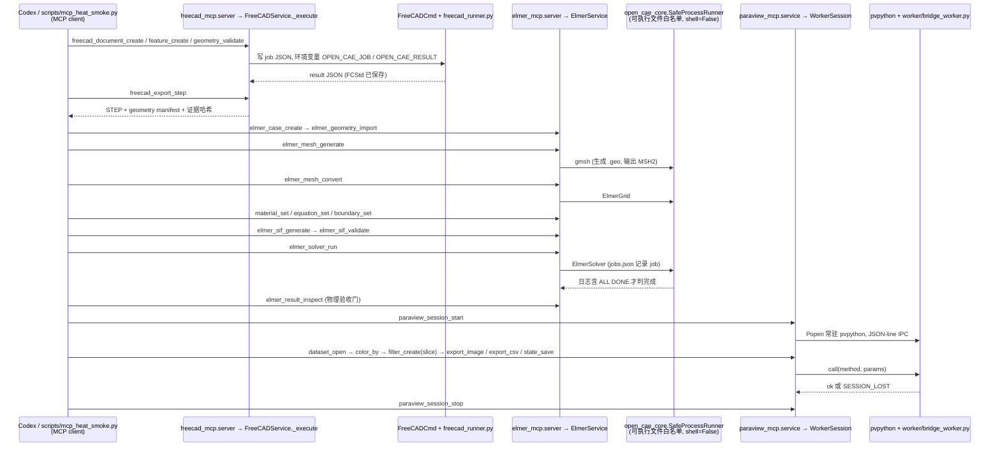

# FEP Agent Hub（S2mon123/FEP-Agent-Hub）

## 一句话定义

FEP Agent Hub（S2mon123/FEP-Agent-Hub）是将 FreeCAD 参数化 CAD、Elmer FEM 网格/求解和 ParaView 无头后处理串成免费三件套，并以多个独立 MCP 与共享内核管理工作区隔离、进程白名单、任务状态和证据哈希。

## 英文缩写速查

| 缩写 | 英文全称 | 简要说明 |
|------|----------|----------|
| FEA | Finite Element Analysis | 有限元分析工作流 |
| FEM | Finite Element Method | 有限元离散求解方法 |
| V&V | Verification and Validation | 数值验证与模型确认 |

## 为什么重要

对 CAE 自动化而言，代理能否稳定完成任务，取决于工程步骤是否清楚、工具边界是否明确、结果是否保留可审查证据。将 FreeCAD 参数化 CAD、Elmer FEM 网格/求解和 ParaView 无头后处理串成免费三件套，并以多个独立 MCP 与共享内核管理工作区隔离、进程白名单、任务状态和证据哈希。

## 核心原理

**项目自身范围：** Evidence-first FreeCAD, Elmer FEM, ParaView MCP automation stack.

**工作流：** 由 FreeCAD 产生模型，Elmer 负责网格/求解，ParaView 提供结果处理；共享内核对工具调用与证据进行隔离、状态跟踪和完整性记录。

## 工程实践

1. 从目标问题识别所需的 Skill、MCP、CLI 或软件接口，不把指导文件当成求解器。
2. 依照仓库 README 检查安装前提、软件/许可证、输入文件和输出证据。
3. 小规模运行并逐项核对几何、网格、边界、求解状态和物理量，再决定是否扩大任务。

文章所述的项目特征：将 FreeCAD 参数化 CAD、Elmer FEM 网格/求解和 ParaView 无头后处理串成免费三件套，并以多个独立 MCP 与共享内核管理工作区隔离、进程白名单、任务状态和证据哈希。

## 局限与风险

文章列举的 49 工具调用、52 契约测试、热传导及 Re=100 槽道验证均是作者摘要中的项目证据，应按当前 README/测试版本复核；求解结果仍需领域审查。

源码状态核验：该 GitHub 仓库于 2026-10-07 可公开访问。仓库 API 报告许可证为 MIT。 涉及商业软件时，安装包和有效许可证需由使用者自行提供。

## 源码运行时序图

入口：三个独立 stdio MCP 服务，由 `pyproject.toml` 的 `[project.scripts]` 注册为 `open-cae-freecad-mcp`、`open-cae-elmer-mcp`（`elmer_mcp.server:main`）、`open-cae-paraview-mcp`，`scripts/register-codex.ps1` 以 `codex mcp add … -- python -m freecad_mcp.server`（elmer_mcp.server、paraview_mcp.server 同理）注册到 Codex；端到端冒烟脚本为 `python scripts/mcp_heat_smoke.py`（用 MCP `stdio_client` 依次连接三个服务）。

图依据：S2mon123/FEP-Agent-Hub@e617037，读过 README.md、docs/architecture.md、scripts/mcp_heat_smoke.py、mcp/freecad/src/freecad_mcp/service.py、mcp/elmer/src/elmer_mcp/server.py、mcp/elmer/src/elmer_mcp/service.py、mcp/paraview/src/paraview_mcp/service.py、packages/open-cae-core/src/open_cae_core/process.py、scripts/register-codex.ps1，以及 mcp/freecad、mcp/elmer、mcp/paraview 三个 pyproject.toml 的 [project.scripts] 段。

## 关联页面

- [CAE / CFD 代理工具项目总览](../overview/cae-cfd-agent-skills-landscape.md)
- [FreeCAD Engineering](./v0v1kkk-freecad-engineering.md)

## 参考来源

- [公众号文章原始资料归档](../../sources/blogs/wechat_cae_cfd_agent_skills_2026-10-07.md)
- [GitHub 仓库资料归档](../../sources/repos/s2mon123-fep-agent-hub.md)
- [S2mon123/FEP-Agent-Hub 官方仓库](<https://github.com/S2mon123/FEP-Agent-Hub>)
- 源码核对（2026-11-02）：S2mon123/FEP-Agent-Hub@e617037，读过 README.md、docs/architecture.md、scripts/mcp_heat_smoke.py、mcp/freecad/src/freecad_mcp/service.py、mcp/elmer/src/elmer_mcp/server.py、mcp/elmer/src/elmer_mcp/service.py、mcp/paraview/src/paraview_mcp/service.py、packages/open-cae-core/src/open_cae_core/process.py、scripts/register-codex.ps1、三个 mcp/*/pyproject.toml 的 [project.scripts] 段；时序图依据以上文件，未运行代码。

## 推荐继续阅读

- [项目 README](<https://github.com/S2mon123/FEP-Agent-Hub/blob/main/README.md>)