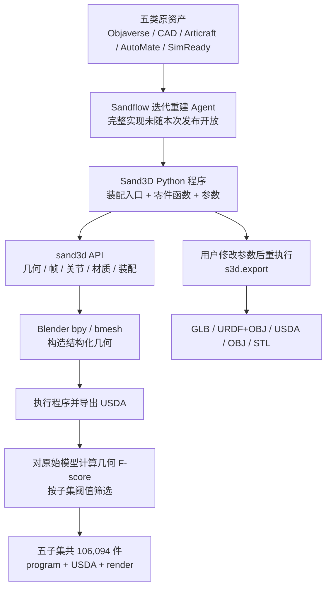
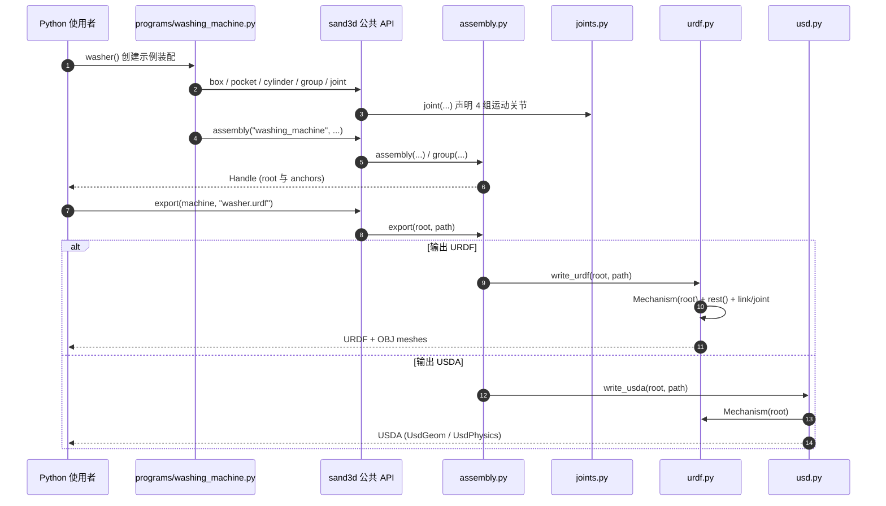

# Sand3D: 106,094 个可编辑 3D-as-Code 资产 · 用 Python 统一描述几何与关节

**Sand3D: 106,094 3D Objects in One Code Substrate for Language Models / Sand3D：面向语言模型的十万级可编辑 3D 程序资产库**。由 Sandflow 发布的 [Python 建模库](https://github.com/Sandflow-ai/sand3d)与 [五类 HF 数据集](https://huggingface.co/collections/Sandflow/sand3d)组成；官方完整说明发表于 **2026-11-05**。这是 **资产重建后的代码数据集 + 通用建模 API**，不是已公开权重的端到端文本生成 3D 基座模型。

## 一句话定义

用一套建立在 Blender `bpy` 之上的 `s3d.<verb>` 词汇，把静态物体、机械 CAD 与关节化机构都表示为具名零件、尺寸参数、坐标系、材质、装配与关节组成的 **短 Python 程序**，并能重新执行后导出网格或机器人描述。

## 英文缩写速查

| 缩写 | 英文全称 | 简要说明 |
|------|----------|----------|
| CAD | Computer-Aided Design | 计算机辅助设计；包含机械件与装配源 |
| LLM | Large Language Model | 语言模型；Sand3D API 的代码生成/编辑目标使用者 |
| USD | Universal Scene Description | 支持 USD/UsdPhysics 生态；Sand3D 直接输出文本 USDA |
| URDF | Unified Robot Description Format | 导出的 link/joint 机器人结构描述，不等于完整可仿真动力学 |
| GLB | glTF Binary | 带材质与约定元数据的二进制网格 |
| F-score | F-measure | 在指定几何阈值下衡量重建与源表面的相近程度 |

## 为什么重要

- **给模型提供同一种“可写的结构”**：原始 Objaverse 三角网格、CAD 零件、Articraft 关节机构、AutoMate 装配和 SimReady 资产被编译成同一种 Python API，能按“部件函数 + 参数 + 装配入口”编辑，而非直接操作顶点。
- **面向机器人资产工程**：关节轴和运动限位是代码中的显式定义；可导出 `URDF` 或 `USDA` 作为 ROS/MuJoCo/Isaac 的几何与关节起点。
- **将数据与生成模型分开看**：106K 是可读取的重建资产，不是 106K 个在线实时生成结果；自动重建 agent 的完整训练/推理流水线没有在本次开放范围中发布。

## 核心信息

| 维度 | 官方一手资料 |
|------|--------------|
| 发布方 | Sandflow（作者：Thibault Neveu、Andréa Loy；仓库 CITATION.cff） |
| 主要发布 | [作者文章，2026-11-05](https://huggingface.co/blog/Sandflow/sand3d-106094-3d-objects-in-one-code-substrate-for) |
| 规模 | **106,094 对象**，**10,456 articulated** |
| 子集 1 | Objaverse：**66,887**（日常/硬表面对象） |
| 子集 2 | CAD：**24,495**（Zero-To-CAD 16,766 + CADFS 7,729） |
| 子集 3 | Articraft：**9,209**（可关节对象） |
| 子集 4 | AutoMate：**3,169**（872 assemblies + 2,297 parts） |
| 子集 5 | NVIDIA SimReady：**2,334** |
| 每行资产 | `program`（Python）、`entry`、`render`、`usda_path`、`n_joints`、`f_score`、`source_license`、`attribution` 等（以具体卡为准） |
| 环境 | `pip install sand3d`；Python 3.11/3.13 + Blender `bpy` |
| 许可证 | 库 **Apache-2.0**；数据集 **CC BY 4.0**，**每个对象仍保留原资产许可** |
| 开源状态 | 建模库与数据已开放；作者所用迭代重建 agent 管线待进一步公开 |

五子集数目合计恰好为 106,094；子集内部数据质量阈值各异，不能将“数量多”直接理解为所有模型可直接用于真实机器人仿真。

## 核心原理

### 1. 一件物体是“装配入口 + 部件函数”

- 多部件程序的**第一个函数是装配目录**：明确调用各个零件函数及放置关系；之后再展开零件的形状细节。官方 [writing guidelines](https://github.com/Sandflow-ai/sand3d/blob/main/docs/guidelines.md) 提供八条约束，如每件独立零件一个函数、参数只定义一次、局部坐标系中放置、关节对应一个 frame。
- `s3d.rect/circle → extrude/revolve/box → hole/fillet/cut → at/group/assembly`：用少量语义化几何操作构造零件。
- `s3d.joint` 在运动件与 frame 上声明 revolute/prismatic/continuous 及轴、范围；`s3d.pose` 可在给定限位内调整关节姿态。

官方示例 `programs/weight_stack.py` 用 `weight_stack(n_plates, selected)` 先组装配重板，再用 `add_bumpers/add_guide_rods/add_selector` 附加细节；`programs/washing_machine.py` 声明门铰、滚筒转动、抽屉滑动、旋钮转动四个关节。

### 2. 为什么是“代码资产”而非模型训练结果

作者把 Objaverse/CAD/Articraft/AutoMate/SimReady 的原始 3D 资产交给未完整公开的 **iterative agentic reconstruction** 流程重建为 sand3d 程序；再执行程序生成 `USDA` 与渲染图。每件有表面重建 F-score；阈值为原物体 bounding-box diagonal 的 1%，并按子集采用 0.70 或 0.90 的入库最低标准（可关节对象逐件部件筛选并要求关节正确）。

博客称 **30 个 CAD 零件**上的人工 sand3d 代码对比 LLM 所写 Blender Python 代码 **token 少约 3.8 倍**；该数据是小样本作者测量，**不是模型成功率、重建精度或推理速度提升 3.8 倍**。

## 流程总览



图为作者发布稿给出的**资产重建、筛选、公开与重用流程**；不臆造尚未发布的重建 agent 内部模型和训练步骤。

## 源码运行时序图

对照官方 `programs/washing_machine.py`、`src/sand3d/__init__.py`、`assembly.py`、`joints.py`、`urdf.py`、`usd.py` 的实际入口（并非猜测性模型训练链路）：



官方实现：`assembly.export` 按后缀分派；`write_urdf` 创建运动树并写 OBJ 网格；`write_usda` 复用 `urdf.Mechanism`。项目**没有**发布可核验的“重建 Agent”完整源码入口，因此图仅覆盖**已开源的构造/导出运行时**。

## 工程实践

```python
import sand3d as s3d

def bracket(w=80, d=40, t=6, hole_d=6.6, pitch=50):
    plate = s3d.extrude("plate", s3d.rect(w, d, r=4), t)
    s3d.hole(plate, hole_d, on=s3d.grid(2, 1, pitch, 0))
    s3d.fillet(plate, 1, edges="top")
    return plate

s3d.export(bracket(), "bracket.glb")
```

上述是官方 README 的可核对示例；尺寸默认为**毫米**，导出文件长度为**米**。Python 建议 3.13 或 3.11，须安装兼容的 `bpy`，Python 3.12 缺对应 wheel。不同导出物携带内容不同：

| 格式 | 能做什么 | 不能假定 |
|------|----------|----------|
| GLB | 当前姿态的网格、材质、关节 extras | 无标准物理引擎自动识别/驱动保证 |
| URDF + OBJ | link/joint 结构、axis 与 limits、初始 rest pose | **不含惯量/质量、碰撞几何与有效 effort/velocity 驱动参数** |
| USDA | OpenUSD 文本几何与 UsdPhysics joints | **未自动补 mass、drive、collider**；不是完整 sim-ready 物理资产 |
| OBJ / STL | 当前姿态网格 | 不保留可动结构 |
| USD/USDC/USDZ | 需从 USDA 用官方 USD 工具转换 | **不能直接调用 s3d.export 写二进制 USD** |

**机器人使用建议（仿真适配就绪度）：** 可将 Sand3D 用作合成场景几何、可关节柜门/抽屉、机械件或 URDF 初稿；导入 MuJoCo、Isaac Sim、ROS 前需补质量与惯量、碰撞近似、驱动/关节限制、接触材质并完成工具级实测。此建议基于源码导出内容的工程推论，**不是作者宣称已经验证的仿真 benchmark**。

## 局限与风险

1. **适用域**：以家具、工具、机械、家电等硬表面对象为主；人物、动物、复杂有机外形尚缺相应 API 表达。
2. **重建损失**：0.70/0.90 是官方按来源设定的几何筛选底线，不代表完全复刻小零件、拓扑与物理属性。
3. **数据许可是双层**：库 Apache-2.0 + 数据 CC BY 4.0，但源资产许可与署名仍需逐项核查数据列 `source_license` 和 `attribution`；**开源可商用 ≠ 无限制复用全部素材**。
4. **无需夸大“生成式”**：10 万多对象是离线重建公布的数据，不代表开放了可从任意文本实时生成的模型权重或原始 agentic reconstruction pipeline。
5. **机器人导出不等于 dynamics-ready**：官方导出没有质量、驱动与碰撞设定；不可在未补足与实测前把 URDF/USDA 直接用于接触仿真或控制评测。

## 关联页面

- [3D-as-Code、网格与机器人仿真描述选型](../comparisons/3d-as-code-to-robot-simulation.md) — 分辨可编辑代码资产、网格与动力学完整的物理仿真模型。
- [Articraft](./articraft.md) — Sand3D 五子集之一来源；Articraft 强调 agent + SDK + harness 的可关节资产生成，Sand3D 强调**统一表达语言及跨源代码重写数据**。
- [Zero-To-CAD](./zero-to-cad.md) — 是 Sand3D CAD 子集的部分上游来源；两者建模 API、任务和授权需分别核对。
- [文字生成 CAD（Text-to-CAD）](../concepts/text-to-cad.md) — 上游文字/视觉条件生成与下游可编辑程序建模的区别。
- [URDF-Studio](./urdf-studio.md) — 适合 Sand3D 导出后继续检查/编辑机器人关节与模型属性。
- [robot_descriptions.py](./robot-descriptions-py.md) — 提供现成机器人模型包与加载；Sand3D 侧重生成/修改物件的 3D geometry。
- [PhysForge](./paper-physforge-physics-grounded-3d-assets.md) — 关注物理接地的 3D 资产生成，与 Sand3D 的语义零件、重建数据互补。

## 参考来源

- [Sandflow 官方技术博客（已通读归档）](../../sources/blogs/sandflow_sand3d_release_2026_11_05.md)
- [Sand3D 官方主页核查](../../sources/sites/sandflow-sand3d.md)
- [Sand3D GitHub 与源码入口核查](../../sources/repos/sandflow-sand3d.md)
- [五个官方 Hugging Face 数据集](https://huggingface.co/collections/Sandflow/sand3d)

## 推荐继续阅读

- [官方 API 文档](https://github.com/Sandflow-ai/sand3d/blob/main/docs/api.md) 与 [建模规范八条](https://github.com/Sandflow-ai/sand3d/blob/main/docs/guidelines.md)
- [washing_machine.py — 四关节模型示例](https://github.com/Sandflow-ai/sand3d/blob/main/programs/washing_machine.py)
- [官方 Explorer 在线浏览程序与 USDA](https://huggingface.co/spaces/Sandflow/sand3d-explorer)
