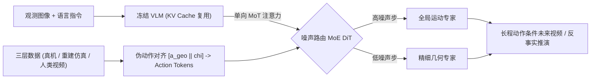

# Scalabot / HERON-World Model（松延动力）

## 一句话定义

**Scalabot（缩放机器人）** 是 [松延动力（Noetix Robotics）](https://github.com/Noetix-Robotics) 于 2026-09-08 发布的通用具身智能 **技术子品牌**（非独立研究实验室，官网 `parentOrganization` 为北京松延动力科技集团股份有限公司）；**HERON** 是其技术架构，**HERON-World Model** 是该架构下首个世界模型。

## 英文缩写速查

| 缩写 | 英文全称 | 简要说明 |
|------|----------|----------|
| HERON | （官方未展开） | Scalabot 的技术架构体系，后续计划发布更多模型 |
| CRA | （官方未展开） | 官网关键词 HERON-CRA，本次未找到可核实细节 |
| MoT | Mixture-of-Transformers | 分离 VLM 与生成参数，单向注意力以保留 VLM 世界知识 |
| MoE | Mixture-of-Experts | DiT 去噪拆为高噪声 / 低噪声两类专家 |
| DiT | Diffusion Transformer | 扩散 Transformer 生成骨干 |
| VLM | Vision-Language Model | 视觉–语言模型 |

## 为什么重要

- 松延动力此前以本体（N2 / E1 / Bumi）为主，Scalabot 标志其向「本体 + 具身大脑」扩展（Gasgoo 报道 + 创始人访谈转述）。
- 世界模型输入「当前图像 + 动作」，预测后续画面并含多智能体交互；可与本库 [World Action Models](../concepts/world-action-models.md) 对照阅读。

## 核心原理

依据 Scalabot 官网一手技术博客（`https://scalabot.noetixrobotics.com/blog/wm`），**HERON-World Model** 采用「三层异构数据 + 统一几何伪动作表征 + VLM/DiT 单向解耦生成架构」建模动作条件长程视频推演：

- **三层数据金字塔与分级监督**：混合真机遥操作数据、真实场景三维重建仿真数据与人类第一视角（egocentric）视频，赋予组件级置信度并划分 `full-action`、`partial-action` 与 `action-free` 三种监督模式。
- **统一伪动作提取（Pseudo-Action）**：从人类/机器人视频恢复头部相机轨迹、双手腕 6DoF 与 10 指尖 3D 坐标，统一变换到锚定首帧局部坐标系下的相对位姿增量序列 `[a_geo || chi]`，再经统一 Action Encoder 编码为定长 Action Tokens，并通过掩码与置信度防止重度遮挡帧被误标为静止动作。
- **冻结 VLM + 单向 MoT + 噪声路由双专家 MoE DiT**：冻结预训练 VLM 作为高层语义与物理先验分支，以 **单向 Mixture-of-Transformers (MoT)** 联合注意力向视频生成骨干注入条件（VLM 侧梯度零回传，且同一观测的 VLM KV Cache 可在多组候选动作间直接复用）；扩散骨干按信噪比阈值路由至 **高噪声专家**（$\lambda(\tau) \le \gamma$，主导全局运动与交互拓扑）与 **低噪声专家**（$\lambda(\tau) > \gamma$，专注几何纹理与接触细节），每步仅激活单专家，全模态共用 **3D Multimodal RoPE**。

> 图依据：Scalabot 官方技术博客 [`scalabot.noetixrobotics.com/blog/wm`](https://scalabot.noetixrobotics.com/blog/wm)（抓取归档自 SPA bundle `/assets/index-wQMifLdw.js`）。

| 评测维度（官方公布） | 指标 / 说明 |
|----------------------|-------------|
| **WorldArena 1.0 Track 1（离线）** | 综合 `EWMScore_P` **75.80**（物理交互 95.60 / 空间视角 99.20 / 运动动力学 92.61 / 轨迹精度 56.66） |
| **分数据集基准** | 在 EgoDex、AgiBot、RoboTwin 报告 13 项组件评测指标（页面榜单注释明确标注 Track 1 分数为团队离线自测提交） |

## 工程实践

1. **官方规划的四类下游使用范式**：（a）给定动作序列做闭环长程 Rollout 验证物理演化；（b）复用冻结 VLM 的 KV Cache 对多条候选动作快速评分排序；（c）结合模型预测控制（MPC / 滑动视界重规划）驱动真机执行；（d）合成反事实轨迹用于策略闭环 RL 评测（与底盘/人形实体连接层可对照 [noetix_sdk_bumi](./cn-os-noetix-sdk-bumi.md)）。
2. **数据与表征复用启发**：工程侧复刻跨平台伪动作管道时，需坚持「首帧相对坐标锚定 + 遮挡置信度门控」双约束，避免手部出框或遮挡导致世界模型学习到错误静止先验。

## 源码运行时序图

- **不适用**：截至 2026-11-21，松延动力 / Scalabot 仅公开官网互动演示及技术博客 [`/blog/wm`](https://scalabot.noetixrobotics.com/blog/wm)，**尚未开源 HERON-World Model 的训练/推理代码仓库、技术论文 PDF 或模型权重**（其已公开仓库 [`URDream-project/URDream`](https://github.com/URDream-project/URDream) 对应同系列 HERON-Spatial Intelligence，非本页世界模型实体），故无法绘制代码级函数调用时序图。

## 局限与风险

- **闭源且无第三方独立复现**：模型权重、训练脚本与推理引擎均未公开；WorldArena 1.0 Track 1 综合 **75.80**（及 13 项分量）明确为官方离线自测口径，第三方暂无法同协议复核。
- **规划与未展开项边界**：官网关键词提到的 `HERON-CRA` 目前尚无公开技术白皮书或规格参数；博客展示的真机 MPC 与反事实闭环 RL 仍属品牌系统报告，交付成熟度需待后续权重或论文公开验证。

## 关联页面

- [World Action Models](../concepts/world-action-models.md)
- [Generative World Models (生成式世界模型)](../methods/generative-world-models.md)
- [noetix_sdk_bumi](./cn-os-noetix-sdk-bumi.md)
- [Model Predictive Control (MPC，模型预测控制)](../methods/model-predictive-control.md)：了解 HERON-World Model 规划的滑窗推演与多候选动作评分如何与模型预测控制结合以驱动真机执行。

## 参考来源

- [Scalabot 官网与技术博客归档](../../sources/sites/scalabot_noetixrobotics_com.md)（<https://scalabot.noetixrobotics.com/blog/wm>）
- [Gasgoo：Noetix Robotics Launches Embodied Intelligence Sub-brand Scalabot](https://autonews.gasgoo.com/articles/news/noetix-robotics-launches-embodied-intelligence-sub-brand-scalabot-2097870821795381249)
- [量子位：HERON-World Model 发布](https://www.qbitai.com/2026/09/486291.html)

## 推荐继续阅读

- [Scalabot 官方博客：HERON-World Model（中文）](https://scalabot.noetixrobotics.com/blog/wm)
- [Scalabot Official Blog: HERON-World Model (English)](https://scalabot.noetixrobotics.com/en/blog/wm)
- [Scalabot 官网门户](https://scalabot.noetixrobotics.com/)
