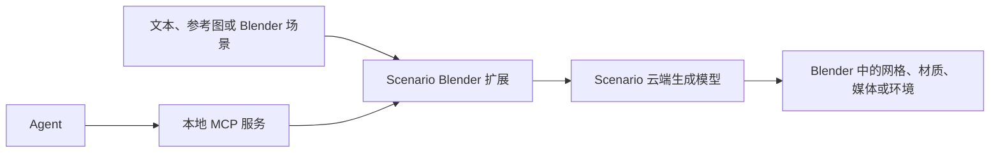

# Scenario for Blender

## 一句话定义

**Scenario for Blender** 是 Scenario Labs 的实验性 Blender Python 扩展，能把场景截图、相机视图、动画 playblast、选中网格和文本提示发送给 Scenario 模型，生成图像、视频、3D 网格、PBR 材质、音频与 360 环境，也能把结果放回当前 Blender 工作流。它另提供本地 MCP 服务，供兼容代理读取场景、执行 Blender 工具并调用生成能力。

## 英文缩写速查

| 缩写 | 英文全称 | 简要说明 |
|------|----------|----------|
| PBR | Physically Based Rendering | 插件生成的材质纹理集可回填至 Blender 材质槽 |
| MCP | Model Context Protocol | 本地服务接口，允许代理读取场景并调用插件工具 |
| API | Application Programming Interface | Scenario 云端模型通过账户凭据/API访问 |
| UV | UV Mapping | 网格编辑任务之一，用于展开纹理坐标 |
| CU | Creative Units | Scenario 生成服务使用的额度单位，生成前显示费用估算 |

## 为什么重要

它把生成式图像、视频和网格工作流嵌进已有 DCC 场景，可用于快速构造视觉素材、布局草模、外观变体和展示内容；MCP 接口也为代理驱动 Blender 场景操作提供入口。对于机器人团队，它适合作为 [Blender](./blender.md) 资产工作流中的生成式扩展，与 [3D Gen Studio](./3dgenstudio.md) 这类独立网格生成编排工具互补。

## 核心机制

官方手册描述的主要数据流如下：

输入可来自文本提示、参考文件、视口捕获、场景相机视图、动画 playblast 或选中网格。扩展按任务类型触发 Scenario 模型：生成图片/视频/3D/PBR/音频/360 环境，执行网格 remesh、retexture、UV 展开、绑定、动画或拆分，或进行 Render Image、Render Video 与 Blockout。输出可回到 Blender 的 datablock、场景网格、材质槽、Sequencer、World 或独立 Blockout collection。MCP 服务允许代理查看场景、调用 Blender 工具（例如规划相机移动）并请求生成；手册列出的本地工具共 88 个（场景 11、生成与放置 18、资产库与上传 9、工作流 7、作业恢复 5、Blockout 5、实验性 Film 33）。

3D 编辑任务为 Remesh、Retexture、UV Unwrap、Rigging、Animate、Parts；导入支持 GLB、glTF、FBX、OBJ 与 mesh PLY（单文件最大 256 MiB）。Animate 的 Apply animation 只把人形动作重定向到骨骼名属于 Meshy、Mixamo、SMPL 或 Unreal 风格的人形骨架上，其他骨架会被拒绝；Gaussian splat 世界只能以彩色点云导入（手册）。

## 工程实践

- 官方手册列出的条件：Blender 5.0 或更新版本（手册称针对 5.0、5.1、5.2）、Scenario 账户及 API 访问权限、联网并开启 Blender 的 Allow Online Access。当前版本 0.13.0，包约 19 MB，支持 Linux、Windows 与 macOS（arm64、x64）。
- 可通过官方 Blender 扩展仓库安装并接收更新，也可从 GitHub Releases 安装 ZIP。
- 每次生成前检查 Creative Units（CU）费用估算（超过偏好里的阈值，默认 500 CU，还会再确认一次）；凭据可用浏览器登录、保存在 Blender 偏好设置的 API key，或启动 Blender 的环境变量。保存的 key 是明文存在 `userpref.blend`，不进系统钥匙串。
- 本地 MCP 服务只绑定 127.0.0.1，手册与仓库文档都写它**不要求凭据，本机任何程序都能连**；`execute_python` 默认关闭，且仓库文档称其黑名单只是护栏而非安全边界；生成需要本会话报价与用户批准的精确费用，但文档也写明工具描述不是服务端强制的花费批准。skills 仓库里的 `scenario-blender` 技能却写本地服务带 bearer token，两处不一致，本库未运行扩展，不能判定当前行为（见 [Scenario Agent Skills](./scenario-labs-skills.md)）。
- 价格检查会在编辑时把提示词和参数发往 `api.cloud.scenario.com`；匿名使用数据默认关。
- 生成结果进入仿真前，应自行校验坐标系、比例、拓扑、碰撞几何和材质；外观网格不能直接视为仿真就绪资产。与 [Sim2Real](../concepts/sim2real.md) 中的资产与环境一致性要求相同。

## 局限与风险

- **实验性软件**：官方手册明确标注 experimental，功能可能随开发变化，使用前需查阅已知限制和对应版本发布说明；Trained models、语音转文字与视频转动作也被标为实验性，HY World 尚无真机验证（手册，#494）。仓库的已知限制文档还写明，合成探针与无头测试不等于真机或付费验收。
- **云端依赖**：插件源码开放，但模型推理、生成模型权重和云端服务不因此开源；使用需要联网、API 凭据、账户权限与额度。
- **仿真适配需另行验证**：3D 生成结果用于仿真前，仍需检查碰撞几何、质量/惯量、单位尺度和关节结构；手册列出的网格编辑能力不等于提供了这些物理属性。
- **许可分层**：GitHub 仓库标注 GPL-3.0-or-later（README 解释：导入 `bpy` 的加载项须与 GPL 兼容）；插件许可不自动决定云服务条款或生成资产的许可与使用边界。
- **分发在官方商店之外**：README 称 extensions.blender.org 条款限制依赖外部账号与密钥的扩展，所以通过自有仓库 `blender.scenario.com/repo/index.json` 或 GitHub Releases 分发。
- **本库读取范围**：读完 0.13.0 手册整页与仓库 README，`docs/MCP.md` 只读了概览、安全模型与标题（约 140 KB 的逐工具契约未读），`scenario/` 约 232 个源文件与 `tests/` 未读，故对实现细节的描述均来自文档，来源归档的仓库部分标「通读：未完成」。

## 关联页面
- [Scenario Agent Skills](./scenario-labs-skills.md)

- [Blender（开源 3D 创作套件）](./blender.md) — 插件宿主与资产编辑层。
- [3D Gen Studio](./3dgenstudio.md) — 独立 AI 网格工作台与编排层。
- [ComfyUI](./comfyui.md) — 可自托管的节点式生成后端；Scenario 插件则依赖 Scenario 云端模型。
- [Sim2Real](../concepts/sim2real.md) — 生成资产进入仿真前的物理一致性检查。

## 参考来源

- [Scenario for Blender 官方用户指南](../../sources/sites/blender-scenario-com.md)
- [Scenario Labs 官方扩展仓库](../../sources/repos/scenario-labs-blender-plugin.md)

## 继续阅读

- [Scenario for Blender 用户指南](https://blender.scenario.com/)
- [Scenario for Blender 源码仓库](https://github.com/scenario-labs/blender-plugin)
- [Blender 官方扩展仓库索引](https://blender.scenario.com/repo/index.json)
