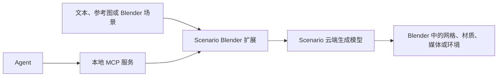

# Scenario for Blender

**Scenario for Blender** 是 Scenario Labs 的实验性 Blender Python 扩展，能把场景截图、相机视图、动画 playblast、选中网格和文本提示发送给 Scenario 模型，生成图像、视频、3D 网格、PBR 材质、音频与 360 环境，也能把结果放回当前 Blender 工作流。它另提供本地 MCP 服务，供兼容代理读取场景、执行 Blender 工具并调用生成能力。

## 英文缩写速查

| 缩写 | 英文全称 | 简要说明 |
|------|----------|----------|
| PBR | Physically Based Rendering | 插件生成的材质纹理集可回填至 Blender 材质槽 |
| MCP | Model Context Protocol | 本地服务接口，允许代理读取场景并调用插件工具 |
| API | Application Programming Interface | Scenario 云端模型通过账户凭据/API访问 |
| UV | UV Mapping | 网格编辑任务之一，用于展开纹理坐标 |
| CU | Creative Units | Scenario 生成服务使用的额度单位，生成前显示费用估算 |

## 为什么对机器人栈有用

它把生成式图像、视频和网格工作流嵌进已有 DCC 场景，可用于快速构造视觉素材、布局草模、外观变体和展示内容；MCP 接口也为代理驱动 Blender 场景操作提供入口。对于机器人团队，它适合作为 [Blender](./blender.md) 资产工作流中的生成式扩展，与 [3D Gen Studio](./3dgenstudio.md) 这类独立网格生成编排工具互补。

## 核心机制

官方手册描述的主要数据流如下：

输入可来自文本提示、参考文件、视口捕获、场景相机视图、动画 playblast 或选中网格。扩展按任务类型触发 Scenario 模型：生成图片/视频/3D/PBR/音频/360 环境，执行网格 remesh、retexture、UV 展开、绑定、动画或拆分，或进行 Render Image、Render Video 与 Blockout。输出可回到 Blender 的 datablock、场景网格、材质槽、Sequencer、World 或独立 Blockout collection。MCP 服务允许代理查看场景、调用 Blender 工具（例如规划相机移动）并请求生成。

## 工程实践

- 官方手册列出的条件：Blender 5.0 或更新版本、Scenario 账户及 API 访问权限、联网并开启 Blender 的 Allow Online Access。
- 可通过官方 Blender 扩展仓库安装并接收更新，也可从 GitHub Releases 安装 ZIP。
- 每次生成前检查 Creative Units（CU）费用估算；API 凭据可保存在 Blender 偏好设置，或使用启动 Blender 的环境变量。
- 生成结果进入仿真前，应自行校验坐标系、比例、拓扑、碰撞几何和材质；外观网格不能直接视为仿真就绪资产。与 [Sim2Real](../concepts/sim2real.md) 中的资产与环境一致性要求相同。

## 局限与风险

- **实验性软件**：官方手册明确标注 experimental，功能可能随开发变化，使用前需查阅已知限制和对应版本发布说明。
- **云端依赖**：插件源码开放，但模型推理、生成模型权重和云端服务不因此开源；使用需要联网、API 凭据、账户权限与额度。
- **仿真适配需另行验证**：3D 生成结果用于仿真前，仍需检查碰撞几何、质量/惯量、单位尺度和关节结构；手册列出的网格编辑能力不等于提供了这些物理属性。
- **许可分层**：GitHub 仓库标注 GPL-3.0-or-later；插件许可不自动决定云服务条款或生成资产的许可与使用边界。

## 关联页面

- [Blender（开源 3D 创作套件）](./blender.md) — 插件宿主与资产编辑层。
- [3D Gen Studio](./3dgenstudio.md) — 独立 AI 网格工作台与编排层。
- [ComfyUI](./comfyui.md) — 可自托管的节点式生成后端；Scenario 插件则依赖 Scenario 云端模型。
- [Sim2Real](../concepts/sim2real.md) — 生成资产进入仿真前的物理一致性检查。

## 参考来源

- [Scenario for Blender 官方用户指南](../../sources/sites/blender-scenario-com.md)
- [Scenario Labs 官方扩展仓库](../../sources/repos/scenario-labs-blender-plugin.md)

## 推荐继续阅读

- [Scenario for Blender 用户指南](https://blender.scenario.com/)
- [Scenario for Blender 源码仓库](https://github.com/scenario-labs/blender-plugin)
- [Blender 官方扩展仓库索引](https://blender.scenario.com/repo/index.json)
