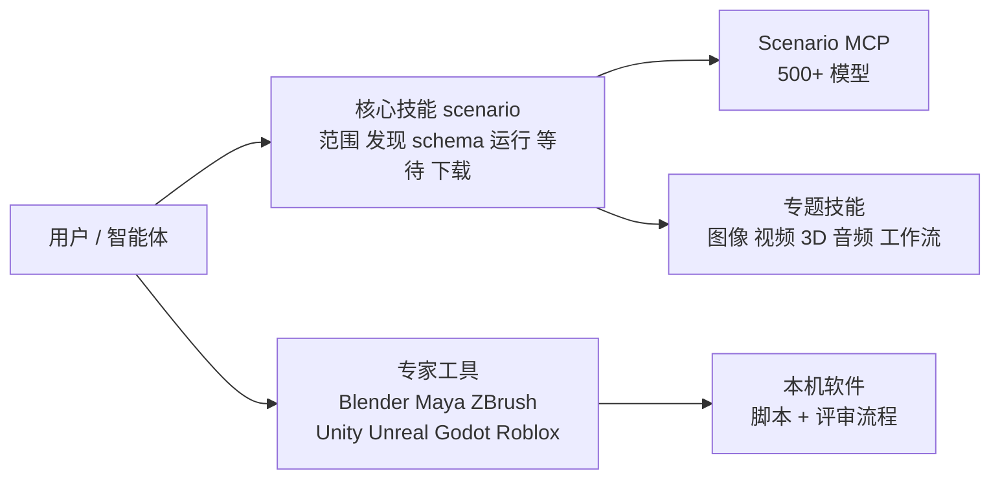

# Scenario Agent Skills（scenario-labs/skills）

## 一句话定义

**scenario-labs/skills** 是 Scenario Inc. 发布的 Agent Skills 合集（MIT）：把「如何用 Scenario 生成并交付内容」写成 `SKILL.md`，让 Claude Code、Cursor、Codex 等智能体按需加载，通过 [Scenario MCP](https://mcp.scenario.com/mcp) 生成图像、视频、音频、纹理、天空盒、3D 与定制模型；另有一组不依赖 Scenario、直接驱动本机 DCC 软件与游戏引擎的「专家工具」技能（仓库 README 与 `AGENTS.md`，作者表述）。

## 英文缩写速查

| 缩写 | 含义 | 说明 |
|------|------|------|
| MCP | Model Context Protocol | 智能体连接外部工具的协议；Scenario 提供 HTTP 端点 |
| DCC | Digital Content Creation | Blender、Maya、ZBrush 等内容创作软件 |
| SKILL.md | Agent Skill 文件 | 智能体按需加载的流程说明，遵循 Agent Skills 规范 |
| CU | Creative Units | Scenario 的计费额度；`dry_run` 可先查某次调用的精确价格 |
| LoRA | Low-Rank Adaptation | 轻量微调，技能里涉及定制模型 |
| PBR | Physically Based Rendering | 基于物理的材质贴图集，纹理与 3D 技能的常见输出 |

## 为什么重要

- 是一份规模较大的「技能即文档」样本：175 个 SKILL.md、带测试的辅助脚本、CI 校验与按角色分组的安装清单，可对照本库其他技能页（如 [Addy Osmani 技能库](./agent-skills-addyosmani.md)）。
- 写作契约很具体，值得借鉴：描述只写触发条件；正文 1,000 词为目标、2,500 词为硬上限（理由是 Claude Code 压缩后只回灌每个技能前 5000 token）；不点名生成模型、先 `recommend` 再 `model_schema_get` 再 `dry_run`；每个审批或计费步骤要写明无人值守时怎么办（`AGENTS.md`、`docs/decisions.md`）。
- 与 [Scenario for Blender](./scenario-blender-plugin.md) 同属 Scenario Labs；那个是 Blender 扩展，这里的 `scenario-blender` 技能教智能体通过扩展的本地 MCP 操作 Blender 场景。
- **与机器人的关系很弱，且是推测：** 全仓库没有 URDF、MJCF、MuJoCo、Isaac、ROS、强化学习等词，`robot` 只是玩具机器人道具；可借用的是 3D 资产生成、视频转人体动作、Blender / 引擎自动化，且进仿真前都要自己补物理属性（见「局限」）。

## 核心原理

- **三组共 175 个 SKILL.md（实测）：** 核心技能 81 个（`skills/scenario*`）；专家工具 87 个（Blender 15、Maya 11、ZBrush 9、Unity 14、Unreal 10、Godot 14、Roblox 14）；仓库自用开发技能 7 个（`.agents/skills/`，不对外发布）。README 技能表列 168 个，即前两组。
- **核心循环（`scenario` 技能全文已读）：** 先解析 `team_id` 与 `project_id`，再 `recommend`（按能力）或 `search`（按名字）找模型，`model_schema_get` 读字段，`model_run`（先 `dry_run` 报价），`jobs_wait` 等待，`asset_display` / `asset_download` 取回；上传走 `upload_asset` 分片；429、403、传输错误各有恢复规则，失败任务退款但被 xAI 审核拦截的除外。
- **专题技能：** 图像、视频、音频、3D 四类各有按模型家族分的技能（如 `scenario-meshy`、`scenario-rodin`、`scenario-sparc3d`），还有一致性与定制模型、质量门、格式适配、工作流、团队管理、故障与上报等；个别带脚本（16 个核心技能带 `scripts/`，20 个带 `references/`）。
- **专家工具：** 每个家族是一个 lead 加若干专科技能，专科导入 lead 的 `scripts/`，所以一个家族要整体安装；家族 README 记录构建方式与验证程度，不随安装分发。
- **技能与 Blender 扩展的关系：** `scenario-blender` 技能教智能体连扩展的本地 MCP（默认 `127.0.0.1:9876`），先估价、拿到用户确认再生成；无人值守时只报价并停止。该技能写本地服务需要 bearer token，而扩展 0.13.0 的 README 与 `docs/MCP.md` 写服务不要凭据，两处不一致，见 [Scenario for Blender](./scenario-blender-plugin.md)。

## 工程实践

- 安装：`npx skills add scenario-labs/skills --skill <名称>`；固定版本用 `npx skills@1.7.4 add scenario-labs/skills#<commit>`；MCP：`claude mcp add --transport http scenario https://mcp.scenario.com/mcp`，OAuth 优先，也可用 API key。`INSTALL.md` 按角色（2D 美术、3D 美术、环境美术、美术指导、声音设计、视频制作、营销、技术总监、制作人、游戏开发）与按目标给出一行命令。
- 密钥策略：`scenario` 与 `setup.md` 要求不让智能体收集、编码或回显密钥；API key 的接线由人手工完成；`SECURITY.md` 称仓库只含技能文档与少量辅助脚本、不运行服务。
- 本库静态检查脚本的观察：核心技能脚本共 78 个文件，不少经 `subprocess` 调 ffmpeg；`pillow_render.py` 会从 `fonts.gstatic.com` 取字体，`audio_analysis.py` 会下载一个模型权重并调用 demucs。**未运行任何脚本。**
- 更新靠 GitHub release（release-please 出版本，读到 `version.txt` 为 0.60.1）与 `npx skills update`；`docs/decisions.md` 说明了不给「装全部」命令、技能里不写安装命令的原因。
- 专家工具家族 README 的验证口径（均为作者自述）：Unity 在 Unity 6000.3.21f1 上 447 项实测，12 个书面场景盲评 63% 到 97%；Blender 7 战全胜、12 个套件在 Blender 5.2.1 无头通过；Godot 79% 到 92%；Roblox 60% 到 97%；Maya 61% 到 91%；ZBrush 43% 到 91%（完整真机测试被卡死挡住）；**Unreal 10 个技能没在引擎里跑过**，只有 1,534 项用假 `unreal` 模块的离线检查。盲评每场景一位评分者，评的是书面方案，不是成品。

## 局限

- **本库的通读范围：** 读完 `README.md`、`AGENTS.md`、`docs/decisions.md`、`INSTALL.md`、`SECURITY.md`，`scenario`、`scenario-video-to-motion`、`scenario-blender`、`scenario-3d` 四个 SKILL.md 全文，以及家族 README 的状态段；其余约 171 个 SKILL.md 正文（约 2.6 MB）、`references/`、脚本正文、测试和 CI 未逐字读，只做了目录、frontmatter、字数和关键词的静态统计。所以来源归档标「通读：未完成」。**没有运行任何脚本，也没有连接 Scenario MCP。**
- 生成能力依赖 Scenario 商业服务与账号；技能里反复强调先 `dry_run` 报价，实际费用、模型清单与可用性会按团队与时间变化，本库未核实。
- 评分数字来自作者自述，未回原始评测核对；技能教的是智能体该怎么调用，不保证产出质量。
- **用于机器人仿真的缺口（原文佐证）：** 输出格式是 GLB、FBX、OBJ、USD、STL 等内容创作格式，没有 URDF / MJCF；`scenario-3d` 自己写明生成网格不等于游戏可用，部件、关节、材质、动画各是单独一步；AI 生成的 GLB 比例任意；碰撞只到引擎的凸包碰撞网格，没有质量与惯量。视频转动作针对人体，非双足需逐帧检查。
- `scenario-blender` 技能与扩展文档对本地服务是否需要 token 的描述不一致，本库没有运行扩展，无法判断哪个是当前行为。

## 关联页面

- [Scenario for Blender](./scenario-blender-plugin.md)
- [Blender](./blender.md) · [Blender 技能](./blender-skills.md)
- [ComfyUI](./comfyui.md)
- [Addy Osmani Agent Skills](./agent-skills-addyosmani.md)

## 参考来源

- [scenario-labs/skills 来源归档](../../sources/repos/scenario-labs-skills.md)

## 继续阅读

- 仓库 `skills/<家族>/README.md`（专家工具的构建方式与验证清单）与 `.agents/skills/skills-validate` 的应用测试流程；`docs/application-test.md`、`docs/expert-tools.md` 本次未读。
