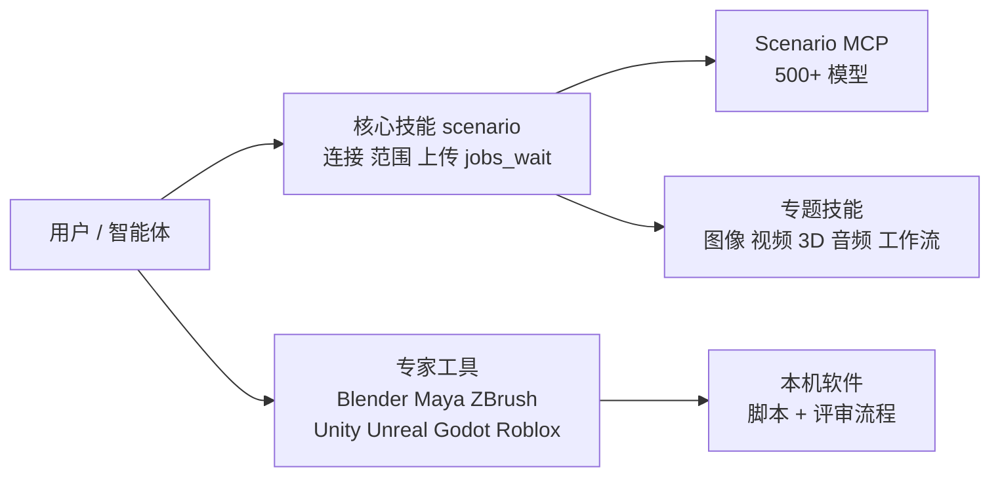

# Scenario Agent Skills（scenario-labs/skills）

## 一句话定义

**scenario-labs/skills** 是 Scenario Inc. 发布的 Agent Skills 合集（MIT）：把「如何用 Scenario 生成并交付内容」写成 `SKILL.md`，让 Claude Code、Cursor、Codex 等智能体按需加载，通过 [Scenario MCP](https://mcp.scenario.com/mcp) 生成图像、视频、音频、纹理、天空盒、3D 与定制模型（仓库 README，作者表述）。

## 英文缩写速查

| 缩写 | 含义 | 说明 |
|------|------|------|
| MCP | Model Context Protocol | 智能体连接外部工具的协议；Scenario 提供 HTTP 端点 |
| DCC | Digital Content Creation | Blender、Maya、ZBrush 等内容创作软件 |
| SKILL.md | Agent Skill 文件 | 智能体按需加载的流程说明，遵循 Agent Skills 规范 |
| LoRA | Low-Rank Adaptation | 轻量微调，技能里涉及定制模型 |

## 为什么重要

- 是一份规模较大的「技能即文档」样本：175 个 SKILL.md、带测试的辅助脚本、CI 校验与按角色分组的安装清单，可对照本库其他技能页（如 [Addy Osmani 技能库](./agent-skills-addyosmani.md)）。
- 与 [Scenario for Blender](./scenario-blender-plugin.md) 同属 Scenario Labs；那个是 Blender 扩展，这里是智能体侧的操作手册。
- 与机器人的关系是推测：视频转 3D 动作（`scenario-video-to-motion`）、3D 资产生成和 Blender / Unity 自动化可服务仿真资产与动作素材；README 无机器人用例。

## 核心原理

- **核心技能（81 个顶层目录）：** 以 `scenario` 为入口，按用途拆出图像、视频、3D、音频、一致性与定制模型、质量门、工作流、团队管理，以及按模型家族分的技能。
- **专家工具（实测 82 个 SKILL.md）：** Blender 15、Maya 11、ZBrush 9、Unity 14、Godot 14、Roblox 14、Unreal 10；每个家族 README 记录构建方法与验证程度，需要本机软件、不需要 Scenario MCP。
- **作者自述验证（未独立复核）：** Unity 家族 447 项实测，12 个书面场景盲评无技能 63%、有技能 97%（单评分者）；Blender 家族 7 战全胜。作者明确这些是书面方案评分，不是成品。

## 工程实践

- 安装：`npx skills add scenario-labs/skills --skill <名称>`；MCP：`claude mcp add --transport http scenario https://mcp.scenario.com/mcp`，OAuth 或 API key。
- 技能不含密钥；`scenario` 技能要求不让智能体收集或回显秘密。
- 更新靠 GitHub release / `npx skills update`；需要固定版本可 pin。

## 局限

- **通读未完成：** 只读 README、两个 SKILL.md 开头和家族 README 状态段；约 170 个技能、约 1,900 个文件未读，**没有运行任何脚本，也没有连接 Scenario MCP**。
- 生成能力依赖 Scenario 商业服务与账号；成本和模型清单未核实。
- 评分数字来自作者自述，未回原始评测核对。

## 关联页面

- [Scenario for Blender](./scenario-blender-plugin.md)
- [Blender](./blender.md) · [Blender 技能](./blender-skills.md)
- [ComfyUI](./comfyui.md)
- [Addy Osmani Agent Skills](./agent-skills-addyosmani.md)

## 参考来源

- [scenario-labs/skills 来源归档](../../sources/repos/scenario-labs-skills.md)

## 继续阅读

- 仓库 `AGENTS.md` 与 `docs/decisions.md`（技能写作契约与规则来由，本次未读完）。
