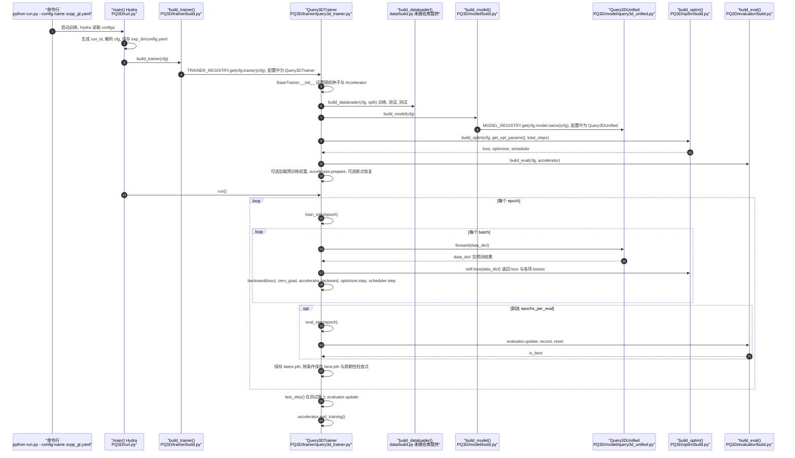

# SceneVerse++

**SceneVerse++** 是一套面向 **3D 场景理解** 的互联网级训练数据：从海量无标注网络视频中重建相机位姿与稠密几何，再自动生成实例级分割与高层语义标注（含空间问答与导航指令），用于端到端模型在低层感知与高层空间推理上的联合扩展。

## 英文缩写速查

| 缩写 | 英文全称 | 简要说明 |
|------|----------|----------|
| RGB | Red-Green-Blue | 彩色图像通道，常与深度 (RGB-D) 配合 |
| LiDAR | Light Detection and Ranging | 激光雷达，地形感知与建图主传感器 |
| VLA | Vision-Language-Action | 视觉-语言-动作多模态基础策略方向 |
| VLM | Vision-Language Model | 视觉-语言多模态理解模型，VLA 的上游 |

## 为什么重要？

- **标注 3D 场景数据昂贵**：传统路径依赖 RGB-D / LiDAR 采集与人工稠密标注，难以像 2D 图像那样随互联网规模扩展；SceneVerse++ 代表「用 **数据引擎** 消化网页视频」的路线。
- **与具身智能衔接**：输出的 **3D 空间 VQA** 与 **视觉–语言导航（VLN）** 数据直接关联「看懂室内几何关系」和「跟随语言在空间中移动」，可反哺 VLA / 导航策略的上层语义能力。
- **可复现**：论文（CVPR 2026）、项目页、GitHub 与数据发布并列，适合作为自动标注流水线设计的参照案例。

## 核心内容（抽象层级）

| 层级 | 内容 |
|------|------|
| 输入 | 互联网长视频（策展、切镜、过滤） |
| 几何 | SfM 稀疏重建 + 度量稠密深度融合（TSDF 网格） |
| 实例 | 2D 分割提升到 3D + 开放词汇语义对齐 |
| 高层 | 场景图上的空间 QA；室内漫游轨迹 → R2R 风格离散动作 + 多风格指令 |

论文报告约 **6687** 个室内场景；并给出面向 **3D 检测/分割**、**VSI-Bench 类 3D 空间 VQA**、**Room-to-Room 导航** 等基准的实验结论（含零样本与微调、域差距讨论）。

## 与其他页面的关系

- **概念**：[3D 空间 VQA](../concepts/3d-spatial-vqa.md) 依赖此类数据才能把 VLM 的「空间关系推理」从少数基准推到网页规模。
- **任务**：[视觉–语言导航（VLN）](../tasks/vision-language-navigation.md) 需要大量「指令–轨迹–观测」对；SceneVerse++ 从真实 tour 视频合成该类监督。
- **方法**：[自动化标注流水线](../methods/auto-labeling-pipelines.md) 的多模块串联与质量权衡，与本工作的「数据引擎」思路同族。
- **方法**：[VLA](../methods/vla.md) 若要在复杂室内几何中稳健跟随语言，往往需要除 2D 网页图像之外的 **3D 空间监督**；本数据集是近年代表性来源之一。
- **同类几何基础模型参照**：[LingBot-Map](../methods/lingbot-map.md) 侧重流式 3D 重建模型；SceneVerse++ 侧重 **数据集构建与多任务监督**，问题域互补。

## 数据速查

- **许可证：** BIGAI 发布，研究用途；商用以官方页面为准。
- **重定向就绪度：** 场景级 3D + R2R 风格离散动作；用于具身导航 / VQA，迁移到具体本体需按目标形态适配。

## 源码运行时序图

入口：`PQ3D/run.py` 的 `main()`（Hydra 装饰器），训练命令见 `PQ3D/README.md`：`python run.py --config-path configs --config-name svpp_gt.yaml`。注意：仓库中未包含 PQ3D 的 `data/` 包（`data.build.build_dataloader`、`data.datasets` 等），因此下图按源码 import 与调用链绘制，该数据模块本仓库不可直接运行。

图依据：sv-pp/SceneVersepp@8764b79，读过 `README.md`、`PQ3D/README.md`、`PQ3D/run.py`、`PQ3D/trainer/build.py`、`PQ3D/trainer/default_trainer.py`、`PQ3D/trainer/query3d_trainer.py`（`train_step`、`eval_step`、`run`）、`PQ3D/model/build.py`、`PQ3D/model/query3d_unified.py`（类注册）、`PQ3D/optim/build.py`、`PQ3D/evaluator/build.py`、`PQ3D/configs/svpp_gt.yaml`。`build_dataloader` 的实现不在仓库内，图中仅依据其调用点；`test_step` 与检查点保存的细节只按调用关系概括，未逐行核对；未运行代码。

## 参考来源

- [SceneVerse++ 原始资料归档](../../sources/repos/sceneverse-pp.md)
- Chen et al., *Lifting Unlabeled Internet-level Data for 3D Scene Understanding* (arXiv:2604.01907, CVPR 2026)
- 项目主页：<https://sv-pp.github.io/>
- 代码仓库：<https://github.com/sv-pp/SceneVersepp>
- 源码核对（2026-11-02）：sv-pp/SceneVersepp@8764b79，读过 README.md、PQ3D/README.md、PQ3D/run.py、PQ3D/trainer/build.py、PQ3D/trainer/query3d_trainer.py、PQ3D/model/build.py、PQ3D/optim/build.py、PQ3D/evaluator/build.py、PQ3D/configs/svpp_gt.yaml；时序图依据以上文件，未运行代码。

## 关联页面

- [3D 空间 VQA](../concepts/3d-spatial-vqa.md)
- [视觉–语言导航（VLN）](../tasks/vision-language-navigation.md)
- [Auto-labeling Pipelines](../methods/auto-labeling-pipelines.md)
- [VLA](../methods/vla.md)

## 推荐继续阅读

- VSI-Bench（论文中用于 3D 空间 VQA 评测的基准之一）原始论文与数据说明
- Matterport3D / R2R（VLN 经典基准）项目页
