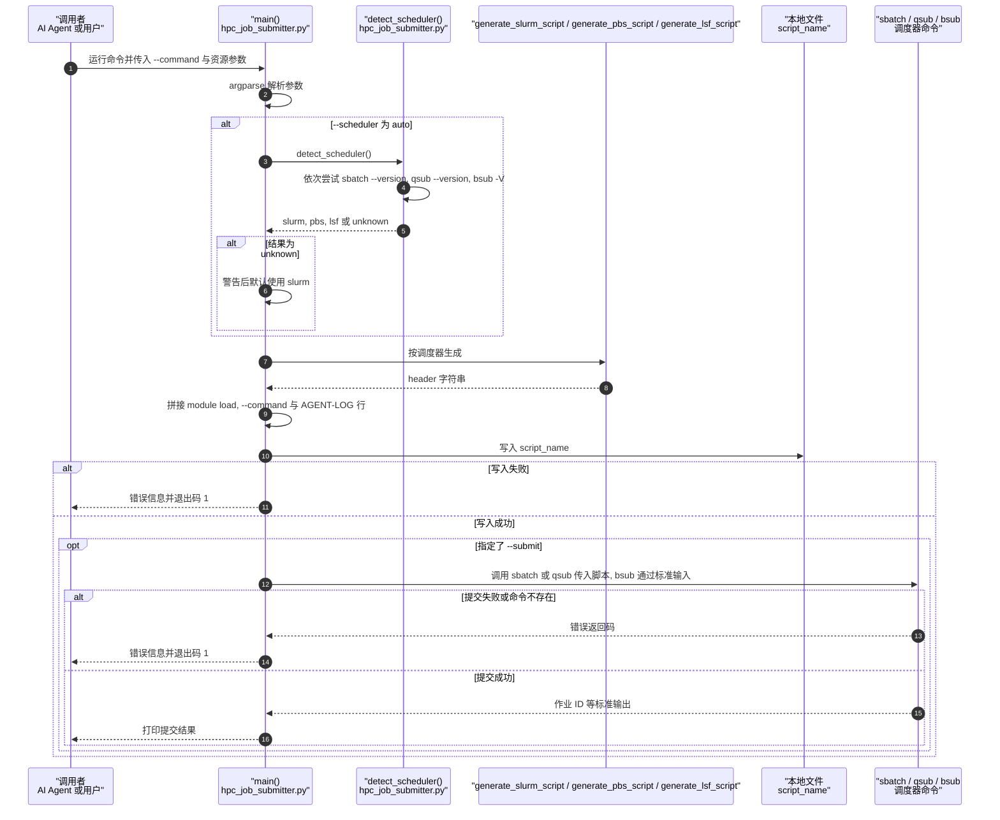

# HPC-Skills（SciMate-AI/HPC-Skills）

## 一句话定义

HPC-Skills（SciMate-AI/HPC-Skills）是覆盖 OpenFOAM、SU2、LS-DYNA、FEniCS、CalculiX、ElmerFEM、LAMMPS、GROMACS、VASP、ParaView、Gmsh 等二十余个求解器/工具，并延伸到 MPI、GPU、Spack、集群调度。

## 英文缩写速查

| 缩写 | 英文全称 | 简要说明 |
|------|----------|----------|
| AI | Artificial Intelligence | 以代理调用工程工具的人工智能能力 |
| CAE | Computer-Aided Engineering | 计算机辅助工程工具与工作流 |
| API | Application Programming Interface | 软件之间调用功能的接口 |

## 为什么重要

对 CAE 自动化而言，代理能否稳定完成任务，取决于工程步骤是否清楚、工具边界是否明确、结果是否保留可审查证据。覆盖 OpenFOAM、SU2、LS-DYNA、FEniCS、CalculiX、ElmerFEM、LAMMPS、GROMACS、VASP、ParaView、Gmsh 等二十余个求解器/工具，并延伸到 MPI、GPU、Spack、集群调度。

## 核心原理

**项目自身范围：** Portable agent skills for HPC workflows across solvers and cluster tooling.

**工作流：** 标准目录 `skills/<name>/SKILL.md` 将具体软件说明与执行流程拆开，可作为 Codex 或 Claude Code 的代理指引；文章点名的 hpc-ls-dyna、hpc-calculix、hpc-fenics、hpc-elmerfem 都是同一仓库内技能，不另立项目节点。

## 工程实践

1. 从目标问题识别所需的 Skill、MCP、CLI 或软件接口，不把指导文件当成求解器。
2. 依照仓库 README 检查安装前提、软件/许可证、输入文件和输出证据。
3. 小规模运行并逐项核对几何、网格、边界、求解状态和物理量，再决定是否扩大任务。

文章所述的项目特征：覆盖 OpenFOAM、SU2、LS-DYNA、FEniCS、CalculiX、ElmerFEM、LAMMPS、GROMACS、VASP、ParaView、Gmsh 等二十余个求解器/工具，并延伸到 MPI、GPU、Spack、集群调度。

## 局限与风险

SKILL.md 只提供代理指引；实际计算仍要求本机/集群具备对应求解器、依赖、资源与授权。

源码状态核验：该 GitHub 仓库于 2026-10-07 可公开访问。仓库 API 报告许可证为 MIT。 

## 源码运行时序图

本仓库以 `skills/<name>/SKILL.md` 与 `references/` 文档为主，可执行代码集中在 `skills/hpc-orchestration/scripts/` 的 4 个 Python 工具。下图只画其中的作业生成与提交工具 `hpc_job_submitter.py`，不代表整个技能集合的运行时。

入口：`python3 skills/hpc-orchestration/scripts/hpc_job_submitter.py --command "<求解命令>" [--scheduler auto|slurm|pbs|lsf] [--submit]`。

图依据：SciMate-AI/HPC-Skills@4ea8069，读过 `README.md`、`skills-index.md`（开头部分）、`skills/hpc-orchestration/SKILL.md`（开头部分）、`skills/hpc-orchestration/references/tools-and-scripts.md`、`skills/hpc-orchestration/scripts/hpc_job_submitter.py`（全文）；`hpc_job_monitor.py`、`hpc_log_tracker.py`、`hpc_slurm_deploy.py` 仅核对了入口与参数，未画入图中。未运行代码。

## 关联页面

- [CAE / CFD 代理工具项目总览](../overview/cae-cfd-agent-skills-landscape.md)
- [Awesome AI CAE](./kimimgo-awesome-ai-cae.md)

## 参考来源

- [公众号文章原始资料归档](../../sources/blogs/wechat_cae_cfd_agent_skills_2026-10-07.md)
- [GitHub 仓库资料归档](../../sources/repos/scimate-ai-hpc-skills.md)
- [SciMate-AI/HPC-Skills 官方仓库](<https://github.com/SciMate-AI/HPC-Skills>)
- 源码核对（2026-11-02）：SciMate-AI/HPC-Skills@4ea8069，读过 README.md、skills/hpc-orchestration/SKILL.md、skills/hpc-orchestration/references/tools-and-scripts.md、skills/hpc-orchestration/scripts/hpc_job_submitter.py；时序图依据以上文件，未运行代码。

## 推荐继续阅读

- [项目 README](<https://github.com/SciMate-AI/HPC-Skills/blob/main/README.md>)