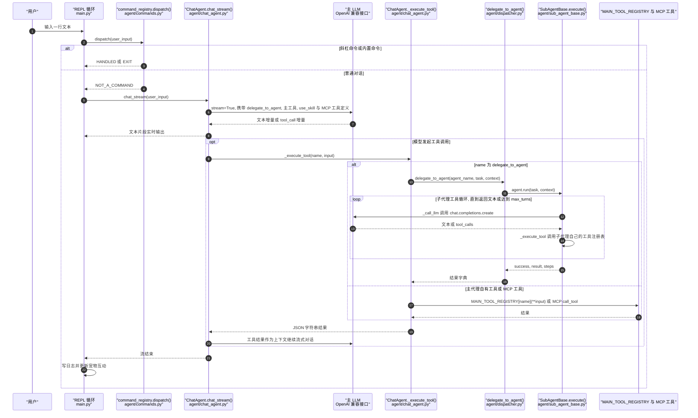

# AnsysAgent（sduwby/AnsysAgent）

## 一句话定义

AnsysAgent（sduwby/AnsysAgent）是不是单个 Skill 或 MCP，而是包含专业子代理和大量工具的工程助手。

## 英文缩写速查

| 缩写 | 英文全称 | 简要说明 |
|------|----------|----------|
| MCP | Model Context Protocol | 代理与工程软件工具的交互协议 |
| CAE | Computer-Aided Engineering | 计算机辅助工程软件与分析 |
| API | Application Programming Interface | 软件可供自动化调用的接口 |

## 为什么重要

对 CAE 自动化而言，代理能否稳定完成任务，取决于工程步骤是否清楚、工具边界是否明确、结果是否保留可审查证据。不是单个 Skill 或 MCP，而是包含专业子代理和大量工具的工程助手；文章列出的范围从电机到整车碰撞，覆盖电磁、热、流体、结构、NVH、疲劳、动力学与网格。

## 核心原理

**项目自身范围：** Engineering assistant with specialist agents and tools around Ansys product APIs.

**工作流：** 由高层代理理解任务后分派给专业代理，并调用 PyAEDT、PyFluent、PyMotorCAD、PyMAPDL、PyDyna 等工具。

## 工程实践

1. 从目标问题识别所需的 Skill、MCP、CLI 或软件接口，不把指导文件当成求解器。
2. 依照仓库 README 检查安装前提、软件/许可证、输入文件和输出证据。
3. 小规模运行并逐项核对几何、网格、边界、求解状态和物理量，再决定是否扩大任务。

文章所述的项目特征：不是单个 Skill 或 MCP，而是包含专业子代理和大量工具的工程助手；文章列出的范围从电机到整车碰撞，覆盖电磁、热、流体、结构、NVH、疲劳、动力学与网格。

## 局限与风险

代理数量和工具数量是范围描述，不是正确率指标；仍需检查安装许可、任务边界、证据与人工复核。

源码状态核验：该 GitHub 仓库于 2026-10-07 可公开访问。仓库 API 未报告 SPDX 许可证，应检查仓库内 LICENSE 与依赖许可。 

## 源码运行时序图

入口：安装后的命令 `ansys-agent`（`main.py` 中的 click 命令，见其文件头说明），进入交互式 REPL；非斜杠命令的输入交给主代理 `ChatAgent.chat_stream()` 流式处理，主代理可通过 `delegate_to_agent` 把任务交给专业子代理。图中仅展示代理调度链路；真实仿真依赖本机 Ansys 软件与许可证，未运行代码。

图依据：sduwby/AnsysAgent@5c56ad1，读过 `README.md`（开头部分）、`main.py`（文件头、`_stream_response`、REPL 中 `command_registry.dispatch` 分支、click 命令入口）、`agent/chat_agent.py`（`_execute_tool`、`chat_stream`、工具定义的组装）、`agent/dispatcher.py`（`delegate_to_agent`）、`agent/sub_agent_base.py`（`execute`、`run`、`_call_llm`、`_execute_tool`）。工作流循环的停止条件由 `OmAgentWorkflow` 驱动，该运行时未读，图中只依据注释与分支概括；`command_registry` 的内部分发未读。

## 关联页面

- [CAE / CFD 代理工具项目总览](../overview/cae-cfd-agent-skills-landscape.md)
- [COMSOL Multiphysics MCP](./wjc9011-comsol-multiphysics-mcp.md)

## 参考来源

- [公众号文章原始资料归档](../../sources/blogs/wechat_cae_cfd_agent_skills_2026-10-07.md)
- [GitHub 仓库资料归档](../../sources/repos/sduwby-ansysagent.md)
- [sduwby/AnsysAgent 官方仓库](<https://github.com/sduwby/AnsysAgent>)
- 源码核对（2026-11-02）：sduwby/AnsysAgent@5c56ad1，读过 README.md、main.py、agent/chat_agent.py、agent/dispatcher.py、agent/sub_agent_base.py；时序图依据以上文件，未运行代码。

## 推荐继续阅读

- [项目 README](<https://github.com/sduwby/AnsysAgent/blob/main/README.md>)