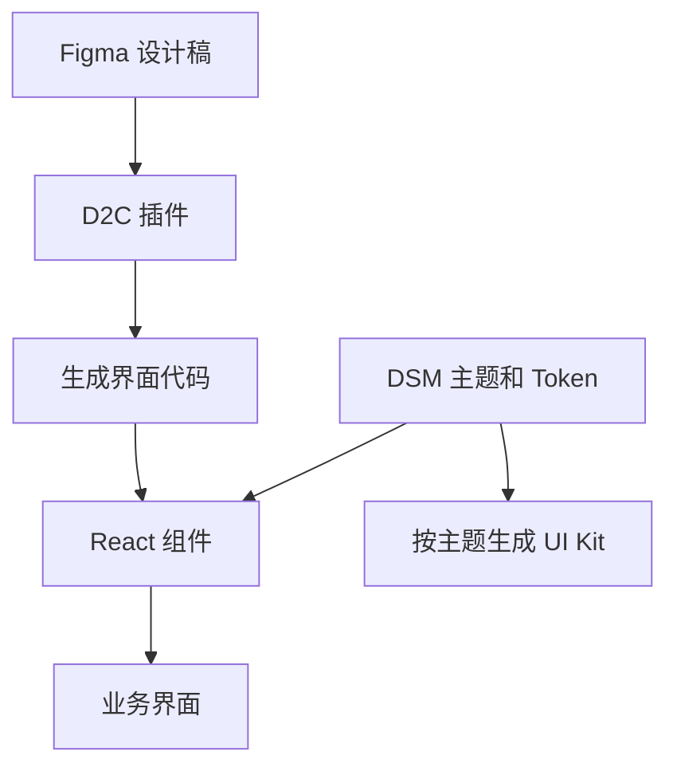
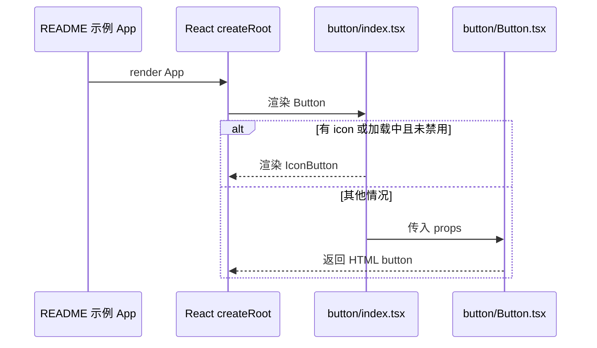

# Semi Design

## 一句话定义

**Semi Design** 是由抖音前端与 UED 团队维护的设计系统，提供 React 组件、主题定制与设计工具。

## 英文缩写速查

| 缩写 | 英文全称 | 简要说明 |
|------|----------|----------|
| UI | User Interface | 用户界面 |
| D2C | Design to Code | 设计稿转换为代码 |
| DSM | Design System Management | 设计系统管理 |
| SSR | Server-Side Rendering | 服务端渲染 |
| RTL | Right-to-Left | 从右向左排版 |

## 核心能力

官方 README 称提供 80 多个组件、3000 多个 Design Token、Figma 设计转代码以及按主题生成 UI Kit 的 Code to Design。支持多语言、时区、RTL 与 SSR；代码以 TypeScript 编写，Semi UI 采用 MIT 许可。语言数量在所核对的 README 中仅表述为数十种，不能据此确定超过 50 种。

## 项目流程图

图概括官方 README 的功能，具体业务和交互逻辑需开发者补充。

## 源码运行时序图

范围仅为 README 示例中的 Button 分支；基础组件将 `onClick` 等传给 HTML button。源码核对版本见[仓库归档](../../sources/repos/semi-design.md)。

## 工程实践与局限

- 使用 `npm install @douyinfe/semi-ui` 安装，参照官方示例引入组件；管理后台仍须实现业务数据、权限和交互。
- D2C 输出可作为起点，生成结果需要人工核对语义、可维护性和业务行为；主题定制与设计同步也需按实际工作流验证。
- 官方声明提供无障碍能力，并不等于使用该库的整站自动满足特定合规标准；应对最终界面进行键盘、焦点与辅助技术测试。
- 和 Tailwind 同用时，上游文档提示要检查生产构建的 CSS layer 顺序。
- **待完成：** 尚未通读完整官方技术文档，也未逐项核对 D2C 与主题工具的实现，当前为草稿。

## 关联页面

- [shadcn-admin](shadcn-admin.md) — 提供后台页面布局的另一种复用方式。
- [Impeccable](impeccable.md) — 用于界面设计与检查。

## 参考来源

- [官方仓库归档](../../sources/repos/semi-design.md)
- [官网归档](../../sources/sites/semi-design.md)

## 推荐继续阅读

- [快速开始](https://semi.design/en-US/start/getting-started)
- [主题定制](https://semi.design/en-US/start/customize-theme)
