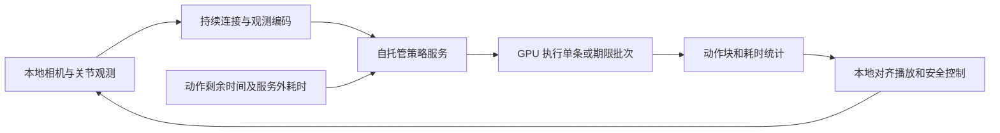
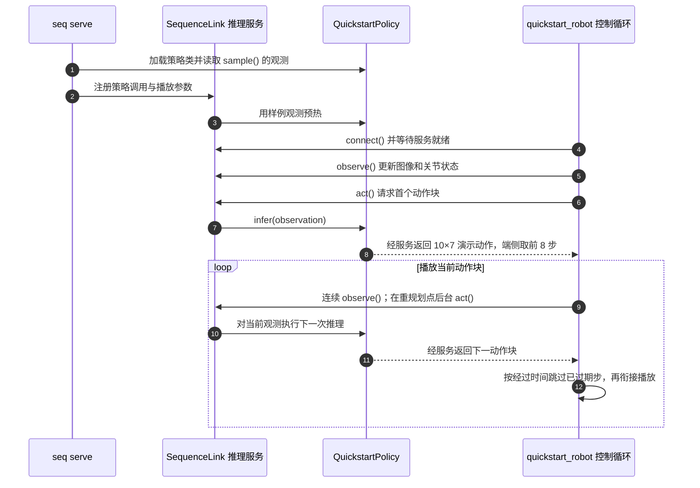

# SequenceLink: Serving Robot Policies over WANs · 机器人策略广域网推理

## 一句话定义

SequenceLink 是 General Sequences 的开源策略推理与网络库：机器人保留本地控制循环，远端 GPU 返回下一段关节或末端动作；系统用当前动作块的剩余时间判断请求还能等多久。

## 英文缩写速查

| 缩写 | 英文全称 | 简要说明 |
|---|---|---|
| WAN | Wide Area Network | 机器人与远端 GPU 之间的广域链路 |
| RTT | Round-Trip Time | 来回耗时；调度用的 `outside_ms` 还关注端侧编码、解码等服务外成本 |
| VLA | Vision-Language-Action | 输入视觉和语言、输出控制动作的策略类型 |
| TCP | Transmission Control Protocol | 连接型传输；长连接空闲后的重新爬升可能消耗动作预算 |

## 核心信息

| 项目 | 内容 |
|---|---|
| 机构 | General Sequences |
| 代码版本 | `sequence-ai` 0.66.3，固定提交见[源码归档](../../sources/repos/sequence-ai.md) |
| 开放边界 | Apache-2.0 的推理服务与网络客户端可自托管；资源路由、托管任务和计费控制面不在此开源包 |
| 策略入口 | 自定义类通过 `@seq.policy` 声明播放参数、`@seq.sample` 准备样例、`@seq.infer` 返回动作；官方列有 openpi、LeRobot、GR00T、Octo 的接入方式，不等于换模型可免除观测/动作对齐 |

## 为什么重要

多机器人共用一块 GPU 时，选择更大的批次可能提高吞吐，也可能让控制端用尽动作。这个项目把网络、编解码和推理排队共同纳入动作期限，提供可在迁移硬件前量化的容量指标。

## 核心原理

- **动作预算不是吞吐。** 若以频率 `h` 执行 `N` 个有效动作，到第 `k` 步请求下一块，名义预算为 `(N - k) / h` 秒。Quickstart 的声明 `N=8, k=5, h=15` 给出名义 200 ms 预算。排队、GPU 推理、编解码与链路都吃掉预算；实际循环还需检查下标、时间戳与执行偏移。
- **有期限的合批。** 服务端可以同时回答多个机器人，按测出的批推理耗时、每台机器的服务外耗时与安全余量决定是否等待或分批。文档明确：普通固定等待的 `Batcher` 和知道机器人期限的 `slack` 是不同构件；策略需要提供播放和 sample 等信息才有相应调度条件。
- **网络不更改控制协议语义。** 客户端复用连接，按配置发送压缩图像/视频和数组；服务端还原后推理。即使传输减少延迟，动作单位、关节顺序、越界保护与失联停机仍由机器人集成者负责。

## 流程总览

## 源码运行时序图

以 [官方 Quickstart 和 CLI](../../sources/repos/sequence-ai.md) 为入口。图展示单条示例，不把可选批处理当作默认路径。

## 工程实践与局限

1. 先在隔离本机用占位策略确认观测键、张量形状与动作块编号。Quickstart 的关节输出与 hold 函数是空实现；示例的 Future 在动作段结束后取结果可能等待，不能据此声称它具有真机硬实时保底。
2. 复现实验分开记录模型时间、端到端 P50/P95/P99、到期未返回率、被拒请求比例及动作失效后的本地控制行为。准备接实物时先断开动力输出，验证失联、迟到、关节限位与急停走本地路径。
3. 官方报告表 4 在 **GR00T N1.6、A100-40GB、CUDA Graph** 条件下，单条执行至少维持 9 个仿真客户端按期，批处理维持 24 个。这个数字不是实体机器人数量通用上限；变更模型、动作块、无线链路、主机或 GPU 后要重测。

## 与其他工作对比

- [LeRobot](./lerobot.md) 自带数据、策略训练与部署生态，SequenceLink 把重心放在远端推理数据面和期限调度；它也提供与 LeRobot 远程推理相关的 Zenoh 连接设置，而不是替代整套 LeRobot。
- [Real-Time Chunking](./paper-real-time-chunking.md) 主要处理新旧动作块交界处的运动连续性；SequenceLink 主要改变请求的到达与计算时机。减少迟到不代表相邻动作天然连续。

## 关联页面

- [动作块](../methods/action-chunking.md)：有效动作数量与重规划频率决定可等待时间。
- [Octo 通用策略](./paper-octo.md)：可作为接入对象，但仍需核对输入、输出及时间基准。
- [VLA 纵深路线](../../roadmap/depth-vla.md)：从模型能力到部署系统的学习路径。

- [机器人控制架构](../methods/robot-control-architecture.md)：远端策略层与本地控制、保护层分责。

## 参考来源

- [SequenceLink 固定版本资料和代码入口](../../sources/repos/sequence-ai.md)
- [GS-WAN 官方技术报告归档](../../sources/papers/gs-wan-scaling-robot-policies.md)
- [General Sequences 官方站点与托管边界](../../sources/sites/general-sequences-sequencelink.md)

## 推荐继续阅读

- [官方 Slack 调度文档](https://github.com/General-Sequences/sequence-ai/blob/05fec493005f7d76708afb00deca73c59e1ca87e/docs/slack.md)
