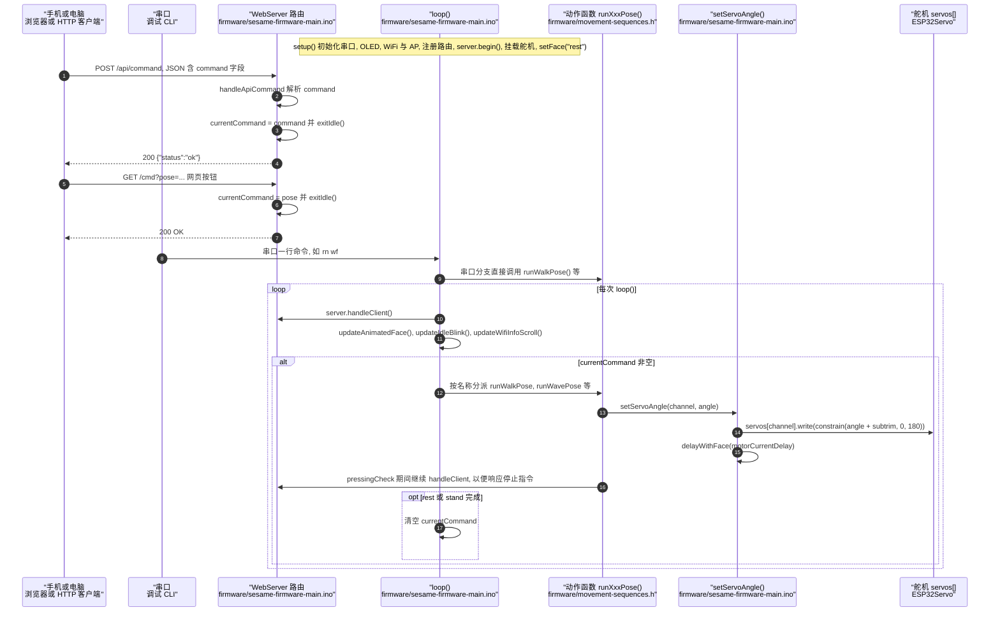

# Sesame Robot

**Sesame Robot**（[GitHub](https://github.com/dorianborian/sesame-robot)）来自 [古月居转载的四足机器人开源项目综述](https://mp.weixin.qq.com/s/pRGoPm41qYCNyHPWR6Dl6A)，属「其他」组。

## 一句话定义

**Sesame Robot 是基于 ESP32 的开源创客四足机器人：强调表情与动作，8 个舵机（每腿 2 个），含 CAD / STL、制作与接线指南、基础与扩展固件及调试固件。**

## 英文缩写速查

| 缩写 | 英文全称 | 简要说明 |
|------|----------|----------|
| ESP32 | ESP32 Microcontroller | 乐鑫 Wi-Fi/蓝牙 MCU |

## 为什么重要

- 综述把它放在「其他」这条技术路线下，作为可读源码的参照项目；横向对比见 [四足机器人开源项目技术地图：从极简运动学到研究级硬件（36 个 GitHub 项目）](../overview/quadruped-open-source-projects-technology-map.md)。
- 文中星标：1309（文章表述，入库日未复核）。

## 核心信息

| 项 | 内容 |
|----|------|
| **仓库** | [dorianborian/sesame-robot](https://github.com/dorianborian/sesame-robot) |
| **最近提交** | 2026-10-15 |
| **可达性** | `git ls-remote` 可达（2026-11-01） |
| **文章归类** | 其他 |

## 文章说法核对

- **文章：** 文章仅在附录清单列出（1309 星）。
- **README / 核查：** README 称制作需基础焊接、约 50–60 美元硬件与 3D 打印机，使用 Arduino IDE；含 LICENSE 文件。
- **差异与保留：** 未发现与已读 README 的冲突。

## 源码运行时序图

入口：`firmware/sesame-firmware-main.ino` 的 `setup()`（Arduino IDE 编译烧录到 ESP32 后自动执行），之后 `loop()` 持续运行。控制指令有三条来源：HTTP 接口（`/api/command`、`/cmd`）、串口调试命令（如 `rn wf`），以及循环中按 `currentCommand` 分派的动作函数。

图依据：dorianborian/sesame-robot@f328ed3，读过 `README.md`（开头部分）、`firmware/sesame-firmware-main.ino`（函数列表、`setup`、`loop`、`handleCommandWeb`、`handleApiCommand`、`setServoAngle`、串口命令分支）、`firmware/movement-sequences.h`（`runWalkPose` 片段）、`firmware/README.md`（烧录环境）。`pressingCheck` 与各动作的具体步序只看到开头部分，未逐一核对；WiFi 配网分支未画入图中。未运行代码。

## 关联页面

- [quadruped-robot](../entities/quadruped-robot.md)
- [open-quadruped](../entities/open-quadruped.md)
- [quadruped-open-source-projects-technology-map](../overview/quadruped-open-source-projects-technology-map.md)

## 参考来源

- [sesame_robot.md](../../sources/repos/sesame_robot.md)
- [wechat_guyueju_quadruped_opensource_deep_dive_2026-11-01.md](../../sources/blogs/wechat_guyueju_quadruped_opensource_deep_dive_2026-11-01.md)
- [原文（微信公众号）](https://mp.weixin.qq.com/s/pRGoPm41qYCNyHPWR6Dl6A)
- 源码核对（2026-11-02）：dorianborian/sesame-robot@f328ed3，读过 README.md、firmware/sesame-firmware-main.ino、firmware/movement-sequences.h、firmware/README.md；时序图依据以上文件，未运行代码。

