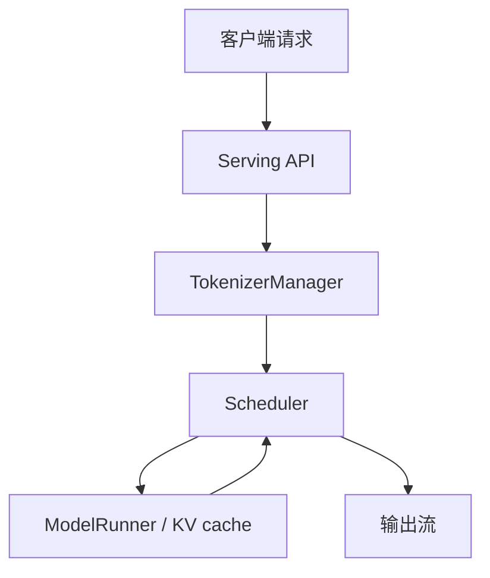
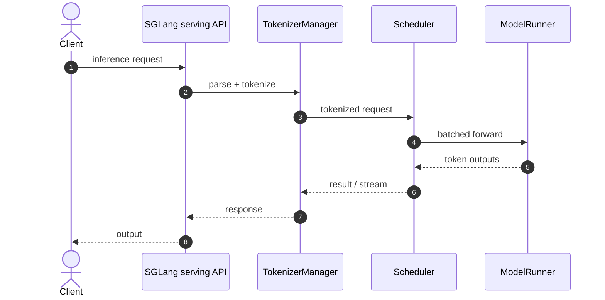

# SGLang｜大规模语言与多模态模型推理服务框架

## 一句话定义

SGLang 是为 LLM、多模态及 agentic workloads 的服务框架；与精简的 Mini-SGLang 区别在于完整的生产调度、硬件适配和丰富的服务组件。官方仓库把 Mini-SGLang 列为教学生态工具。

## 英文缩写速查

| 缩写 | 英文全称 | 简要说明 |
|---|---|---|
| LLM | Large Language Model | 本页服务的自回归语言模型类型 |
| KV | Key-Value Cache | 用于增量推理的历史注意力键值缓存 |
| GPU | Graphics Processing Unit | 计算和 kernel 执行的硬件 |
| CI | Continuous Integration | 贡献审核时运行的自动验证 |
| PR | Pull Request | 提交测试、代码变更、性能证据的上游审查单 |

## 为什么重要

SGLang 是为 LLM、多模态及 agentic workloads 的服务框架；与精简的 Mini-SGLang 区别在于完整的生产调度、硬件适配和丰富的服务组件。官方仓库把 Mini-SGLang 列为教学生态工具。

## 核心原理

SGLang 的 `python/sglang/srt/managers/tokenizer_manager.py` 在请求入口负责 tokenize/任务管理，`managers/scheduler.py` 的 Scheduler 管理 GPU worker 和批处理；模型执行层与 KV cache 等子系统集成。该生产框架与教学版是独立仓库。

### 流程总览

## 源码运行时序图

**已核对执行入口：** 官方 README 给出 `docker pull lmsysorg/sglang:latest` 与文档 quickstart；源码 `python/sglang/srt/managers/tokenizer_manager.py` 和 `scheduler.py` 明确 TokenizerManager / Scheduler 角色。 此图仅覆盖所列实际入口的主干路径，不代表全部异步/多卡细节。

## 工程实践

- **可执行入口：** 官方 README 给出 `docker pull lmsysorg/sglang:latest` 与文档 quickstart；源码 `python/sglang/srt/managers/tokenizer_manager.py` 和 `scheduler.py` 明确 TokenizerManager / Scheduler 角色。
- **贡献切口：** 先从 README 的 Development and Contributing、dev Docker 镜像、editable `python` 安装、Issue/PR 和回归测试进入；只选一个可证明失败的 case，附测试和可复现的前后性能。
- **回归要求：** 说明 GPU/驱动/依赖、模型版本、输入与输出 token 长度分布、预热次数与 batch/并发；保留正确性对拍，再报告 tokens/s、TTFT 或 TPOT（按服务模式选择）。
- **开源状态：** 官方 [GitHub 仓库](https://github.com/sgl-project/sglang) 与 README/源码可访问；对特殊 GPU kernel、训练与数据等子组件是否完全开放，不能从主页自动推断。

## 局限与风险

支持多类硬件但具体 CUDA、TPU、NPU 支持随版本/模型而不同。Mini-SGLang 的约 5000 行代码不能视为 SGLang 全量实现。

- **视频事实界限：** “学生 / 1–2 年 / 资深”是用户提供的视频观点，不是上游官方招聘标准；未验证作者或 Discord 时间。别把开源贡献与 PR 合并结果视为确定承诺。

## 关联页面

- [LLM 推理开源贡献分阶段路线](../roadmaps/llm-inference-open-source-contribution-by-stage.md)
- [LLM 推理显存估算](../concepts/llm-inference-vram-estimation.md)
- [Mini-SGLang｜精简但完整的在线 LLM Serving 系统](./mini-sglang.md)
- [FlashInfer｜跨框架 GPU 推理 Kernel 库](./flashinfer.md)
- [vLLM｜生产级大模型推理与持续批处理](./painode-103-vllm.md)
- [TensorRT-LLM｜NVIDIA 大模型推理运行时与 LLM API](./tensorrt-llm.md)

## 参考来源

- [SGLang｜大规模语言与多模态模型推理服务框架：一手文档和代码核验归档](../../sources/repos/sglang-official.md)
- [六项目对照与原视频证据边界](../../sources/repos/llm-inference-open-source-contribution-primary-docs-2026-11.md)
- [官方 README](https://github.com/sgl-project/sglang/blob/main/README.md)

## 推荐继续阅读

- [官方仓库与最新文档](https://github.com/sgl-project/sglang)
- [推理开源贡献路线](../roadmaps/llm-inference-open-source-contribution-by-stage.md)
