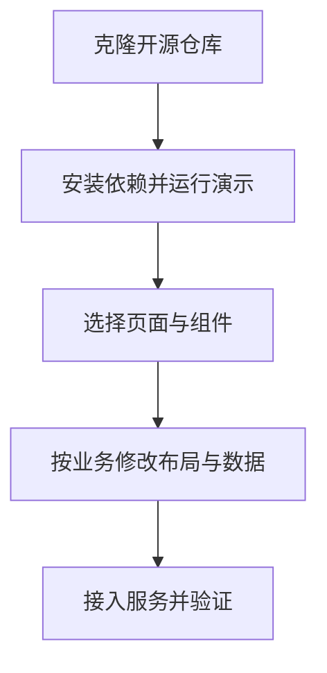

# shadcn-admin

## 一句话定义

**shadcn-admin** 是基于 Shadcn UI 和 Vite 的 MIT 开源管理后台界面集合，提供可修改的页面与组件。

## 英文缩写速查

| 缩写 | 英文全称 | 简要说明 |
|------|----------|----------|
| UI | User Interface | 用户界面 |
| RTL | Right-to-Left | 从右向左的界面排版 |
| CLI | Command-Line Interface | 命令行工具 |
| API | Application Programming Interface | 前端对接业务服务的接口 |

## 为什么重要

制作机器人实验管理、设备台账或内部运营页面时，可参考现成的导航、表格和页面布局，减少重复搭建界面的工作；这些机器人场景是使用建议，不是上游声明的专用功能。

## 核心结构

| 部分 | 内容 |
|------|------|
| 界面 | 侧边栏、全局搜索、10 个以上页面及自定义组件 |
| 适配 | 明暗主题、响应式、无障碍设计与 RTL 支持 |
| 技术栈 | Shadcn UI、Vite、TanStack Router、TypeScript |
| 认证 | README 标注 Clerk 为部分认证方案 |

## 使用流程

这是依据 README 运行步骤整理的建议开发流程，业务服务接入需自行实现。

## 工程实践

1. 按 [README](https://github.com/satnaing/shadcn-admin) 克隆仓库，运行 `pnpm install` 和 `pnpm run dev`。
2. 选择需要的布局、导航和表格，根据设备状态或实验数据调整页面，再接入自己的业务接口。
3. 更新上游已定制的 Shadcn 组件时检查差异；README 提醒部分组件的 RTL 或其他修改可能需要手动合并。
4. 按实际业务验证权限、数据处理、响应式与无障碍表现。

## 局限与风险

- 作者明确称其不是 starter project；它侧重管理后台 UI，实际业务、后端和权限策略需要按项目补全。
- README 将认证标为部分支持，不能据此认为已覆盖完整生产认证和授权。
- MIT 许可允许复用，分发时应遵守许可文本及依赖项各自的许可要求。

## 关联页面

- [Semi Design](semi-design.md) — 提供 React 组件与主题工具的设计系统。

- [Impeccable](impeccable.md) — 界面设计与检查工具，可辅助打磨复用后的页面。
- [frontend-design](anthropic-frontend-design-skill.md) — 用于规划和审查前端设计的技能。

## 参考来源

- [shadcn-admin 仓库归档](../../sources/repos/shadcn-admin.md)

## 推荐继续阅读

- [上游 README 与源码](https://github.com/satnaing/shadcn-admin)
- [在线演示](https://shadcn-admin.netlify.app/)
