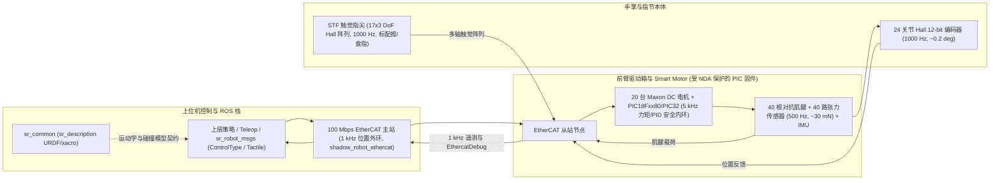
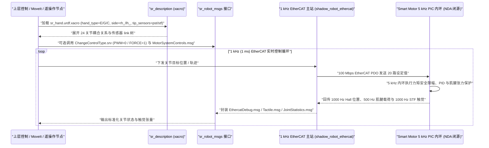

# Shadow Hand（Shadow Dexterous Hand）

## 一句话定义

**Shadow Dexterous Hand**（本文主覆 2025 版 Electric 旗舰系列及其 Lite 家族）是英国 Shadow Robot Company 研发的高拟真肌腱驱动灵巧手平台：旗舰版拥有接近人手尺寸的 **5 指 24 关节 / 20 个主动可控自由度**（含 2 DoF 腕部与小指掌弯），通过前臂内 20 台 **Smart Motor** 与成对对抗肌腱驱动，结合 **1 kHz 100 Mbps EtherCAT** 通信与高密度多模态传感，长期作为高自由度灵巧操作与触觉策略研究的标杆硬件。

## 英文缩写速查

| 缩写 | 英文全称 | 简要说明 |
|---|---|---|
| DoF | Degrees of Freedom | 自由度；Electric 旗舰手含 20 个主动 DoF 与 4 个机械耦合远端关节（共 24 关节） |
| EtherCAT | Ethernet for Control Automation Technology | 100 Mbps 实时工业以太网总线，用于上位机与 Shadow Hand 间 1 kHz 周期数据交换 |
| STF | Shadow Tactile Fingertip | Shadow 原厂 Hall 效应三维力触觉指尖（每指尖 17×3 DoF 测点，1000 Hz） |
| PST | Pressure Sensor Tactile | 早期 Shadow Hand 及 `sr_description` 默认 URDF 参数中常见的气压式触觉指尖 |
| URDF | Unified Robot Description Format | 描述机器人运动学链与传感器挂载的 ROS 标准模型文件（`sr_description` 核心输出） |
| NDA | Non-Disclosure Agreement | 保密协议；Smart Motor 板载 PIC 固件与电路原理图受 NDA 保护不开源 |

## 为什么重要

在五指人手遥操作映射与精巧工具使用研究中，许多低自由度灵巧手因缺少手腕独立摆动、拇指全对掌运动链或小指掌部对掌弯曲（opposition），被迫在重定向阶段大幅简化人类手势。Shadow Hand 从解剖学尺度保留了人手最核心的包络与对掌自由度：

- **几乎无失真的高维拟人运动学：** 在标准人手包络尺寸内布局 24 个旋转关节，不仅覆盖食/中/无名指的远端耦合弯曲、拇指 5 自由度全对掌，还提供小指掌部弯曲（`LF5` 0–45°）与 2 自由度手腕，使其能够自然执行双手协同倒水、握持工具与魔方在手重定向等极高难度[灵巧操作](../tasks/manipulation.md)任务。
- **密集本体与指尖多模态感知：** 在传统关节角度外，旗舰手同时提供 40 路独立肌腱张力感知与可选 1 kHz **STF 三轴 Hall 触觉阵列**（最多扩展至全部 5 指），使强化学习与[触觉阻抗控制](../methods/tactile-impedance-control.md)同时获得接触位置与三维受力分布线索。
- **跨仿真与标准生态的模型基线：** 开源仓库 `shadow-robot/sr_common` 长期为 Gazebo、MoveIt、Isaac Gym/Lab 及大量开源学术基准提供标准的五指灵巧手 URDF/xacro 与消息契约。

## 核心原理

### 旗舰 Electric 系列与 Lite 家族规格

根据 2025 年 9 月发布的官方规格书（`Shadow Dexterous Hand (Electric)` 与 `Shadow Hand Lite` 系列；注：Shadow 早期曾推出过气动版，当前现行主力规格全面围绕电动 Smart Motor + EtherCAT）：

| 型号 | 手指与自由度 | 整机重量 | 抓持负载 | 手腕 / 供电 | 核心定位 |
|---|---|---|---|---|---|
| **Dexterous Hand (Electric)** | **5 指 24 关节 / 20 主动 DoF**（FF/MF/RF 各 3 DoF+4 关节 `J1<=J2` 耦合；LF 4 DoF+5 关节含 `LF5` 0–45°；TH 5 DoF；腕 WR1–WR2 2 DoF） | **4.3 kg**（含前臂电机箱） | **4 kg**（包络抓持） | 2 DoF / **48 V @ 2.5 A** | 全自由度旗舰平台（空载全行程约 1.0 Hz） |
| **Shadow Hand Lite** | 4 指（3 指 + 拇指）**13 DoF / 16 关节** | **2.4 kg** | **4 kg** | 无 / **24 V @ 2.5 A** | 约省电 35%，减重适合轻型机械臂 |
| **Shadow Hand Extra Lite** | 3 指 **10 DoF / 12 关节** | 2.1 / 1.8 kg | — | 无 / 24 V | 轻量三指通用操作 |
| **Shadow Hand Super Lite** | 2 指 **7 DoF / 8 关节** | 1.8 / 1.2 kg | — | 无 / 24 V | 紧凑多自由度双指夹爪 |

### 肌腱驱动、双闭环控制与感知架构

1. **Smart Motor 5 kHz 内环 vs 上位机 1 kHz 外环：** 旗舰手前臂内排布 20 台 **Maxon 直流电机**，通过正反成对对抗肌腱（40 根）跨越手腕与指骨通道拉动各主动关节。每台电机配有基于 PIC（PIC18Fxx80 / PIC32）微控制器的 Smart Motor 控制器，以 **5 kHz** 高频执行电流/肌腱力矩安全保护环（支持零力背驱选项）；**需要特别注意：硬件不直接对用户开放底层关节力矩控制接口**，上位机通过 **100 Mbps EtherCAT** 以 **1 kHz** 运行外环位置指令或基于上层反馈的混合调控。
2. **多维度本体与触觉融合：**
   - **关节编码：** 24 关节全部配备 12 位 Hall 效应角传感器，以 **1000 Hz** 上报，角度分辨率约 **0.2°**；前臂另含 1 颗 IMU。
   - **肌腱张力：** 40 个独立 load sensor 以 **500 Hz** 采样（分辨率约 **30 mN**；注意规格书指出其出厂输出为**未标定差分读数**）。
   - **STF 触觉指尖：** 现行 E 系列默认标配拇指与食指 2 枚 **STF**（最多可选装全 5 指），单枚指尖含 **17 个 3-DoF Hall 效应测点**（12 位 ADC，**1000 Hz** 采样），能同时解析法向压入与切向滑移趋势。

## 源码运行时序图

需要说明：**真机 1 kHz EtherCAT 实时主机驱动位于独立的 `shadow_robot_ethercat` 栈，而前臂/电机板内部 PIC 固件与电路受 NDA 保密协议保护不开源**。官方仓库 `shadow-robot/sr_common` 负责开源运动学描述与统一 ROS 消息契约。以下时序对齐 `sr_common`（`sr_description/robots/sr_hand.urdf.xacro`、`hand/xacro/hand.urdf.xacro` 与 `sr_robot_msgs`）：

## 工程实践

1. **`sr_description` 参数化建模与静态校验：** 仓库 `robots/sr_hand.urdf.xacro` 支持通过参数灵活切换型号与传感套件（`hand_type` 默认 `hand_e`，`hand_version` 默认 `E3M5`，`side` 控制 `rh_`/`lh_` 前缀，以及 `tip_sensors` / `mid_sensors` / `prox_sensors` / `palm_sensor`），并自带基于 `xacro` + `check_urdf` 的 `test_sr_description_urdf.cpp` 自动化校验；在搭建 RL 仿真环境时需确保耦合远端关节 `J1 <= J2` 约束与真实肌腱传动特性一致。
2. **真机调参与 `MotorSystemControls` 运维：** `sr_robot_msgs/MotorSystemControls.msg` 暴露了工程上极为关键的在线运维动作：开关电机级齿隙补偿（`enable_backlash_compensation`）、微调左右肌腱应变片追踪偏置（`increase/decrease_sgl/sgr_tracking`）、触发电机自抖动校准（`initiate_jiggling`）及写入板载 EEPROM（`write_config_to_eeprom`）。
3. **机械臂承载与供电核算：** 旗舰 Electric 手含前臂驱动箱重达 **4.3 kg**（供电 **48 V @ 2.5 A**），无法直接装在轻型 3 kg 负载桌面臂上，需匹配 UR10e、KUKA iiwa14 或更高承载机械臂；若臂端负载受限，可考虑降配 **2.4 kg / 24 V** 的 Shadow Hand Lite 系列。
4. **肌腱标定与温度漂移应对：** 40 路肌腱张力计为未标定差分读数，且肌腱本身存在摩擦、蠕变及温度漂移；高精度力控策略宜优先结合 STF 指尖传感器信号或联合视觉（[视触觉融合](../concepts/visuo-tactile-fusion.md)）而非裸信任肌腱张力绝对值。

## 局限与风险

- **极高采购与维护成本：** 复杂的 20 电机前臂箱与 40 根高强度细肌腱带来高昂购置价格，长周期剧烈交互后容易出现肌腱松弛、磨损乃至断腱，需要定期重新张紧与传感器标定。
- **闭源底层固件与未开放直接力矩控制：** Smart Motor 板载固件与硬件图纸受 NDA 限制不开放源码，且用户侧 EtherCAT 接口主要面向 1 kHz 外环位置控制，底层 5 kHz 保护内环不可自由篡改，对极端纯力矩透明性研究存在限制。
- **前臂体积与 4.3 kg 末端惯量：** 独立电机箱增加了前臂轴向长度与质量矩，在高速机械臂运动中显著放大腕部惯量，限制快速动态甩动类技能。

## 与其他页面的关联

- 核心任务与控制方法：[Manipulation](../tasks/manipulation.md)、[Bimanual Manipulation](../tasks/bimanual-manipulation.md)、[In-Hand Reorientation](../methods/in-hand-reorientation.md)、[Tactile Impedance Control](../methods/tactile-impedance-control.md)、[PPO](../methods/ppo.md)
- 灵巧手与 EtherCAT 生态：[Allegro Hand](./allegro-hand.md)、[ORCA Hand](./orca-hand.md)、[RUKA v2](./ruka-v2-hand.md)、[mimic hand M1](./mimic-hand-m1.md)、[PySOEM](./pysoem.md)
- 运动学与触觉概念：[Dexterous Kinematics](../concepts/dexterous-kinematics.md)、[Tactile Sensing](../concepts/tactile-sensing.md)、[Dexterous Hand Payload Core Metrics](../concepts/dexterous-hand-payload-core-metrics.md)

## 参考来源

- 官方技术规格书归档：[shadow-dexterous-hand-specs.md](../../sources/sites/shadow-dexterous-hand-specs.md)（通读 Sep 2025 Electric 旗舰手与 Lite 系列规格书及官网总览）
- ROS 模型与消息栈归档：[shadow-robot-sr-common.md](../../sources/repos/shadow-robot-sr-common.md)（通读 `sr_description` xacro/gtest 与 `sr_robot_msgs` 定义）
- Shadow Robot 产品页：<https://www.shadowrobot.com/dexterous-hand-series/>
- 官方基础模型仓：<https://github.com/shadow-robot/sr_common>

## 推荐继续阅读

- 遥操作灵巧手阶段：[Teleoperation Depth Roadmap](../../roadmap/depth-teleoperation.md)（Stage 4：手指与灵巧手遥操作）
- 全球灵巧手产业谱系：[Dexterous Hand Industry Core Players](../concepts/dexterous-hand-industry-core-players.md)
