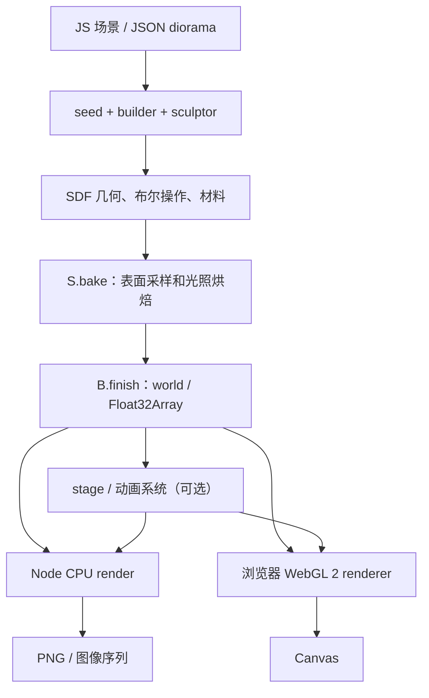
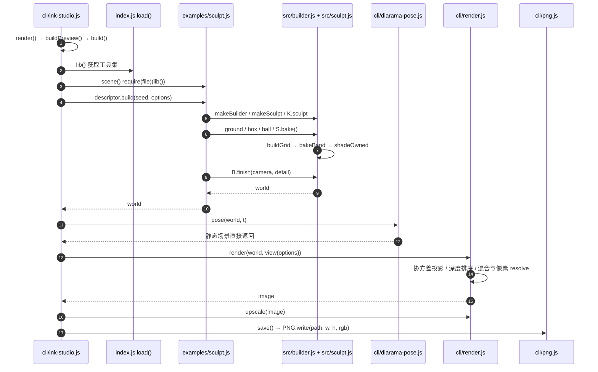

# Shapeshift Labs Ink Studio: SDF Sculpting and Pixel-Art Gaussian Splats（SDF 雕刻与像素风高斯渲染）

## 一句话定义

Ink Studio 将程序化带符号距离场几何采样并烘焙为高斯 splat，通过可控调色板、光照与动画生成像素风三维场景；它既可作为 Node/CLI 工具，也可嵌入浏览器应用。

## 英文缩写速查

| 缩写 | 英文全称 | 简要说明 |
|---|---|---|
| SDF | Signed Distance Function | 以有符号距离描述固体边界 |
| 3DGS | 3D Gaussian Splatting | 用三维高斯进行投影和渲染的表示方式 |
| CLI | Command-Line Interface | 无浏览器的命令行入口 |
| CPU | Central Processing Unit | Node 离屏渲染的计算设备 |
| GPU | Graphics Processing Unit | 浏览器图形与计算管线的计算设备 |
| GLB | Binary glTF | 可交换的二进制三维资产文件 |
| PLY | Polygon File Format | 支持导入的高斯资产格式之一 |

## 为什么重要

- 不依赖图像优化训练即可从显式几何创作高斯场景，适合快速制作教学图、可交互演示和程序化视觉素材。
- 对机器人可视化的潜在价值是轨迹、传感器数据或几何模型的风格化展示，而不是直接产出可训练的机器人动力学环境。
- 浏览器与无头渲染并存，可用固定 seed 和时间步建立可回放的视觉实验。

## 核心原理

1. JavaScript 场景以 seed、palette 创建 builder，再由 sculptor 定义球、盒、地面、减材及布尔组合；JSON 场景也可经 diorama 校验和构建。
2. `S.bake()` 采样固体表面并烘焙光照、颜色与 splat；`res` 是采样间距，减小它通常增加 splat 数量与成本。
3. `B.finish()` 固定 world 数据跨度；需要预留的粒子、布料等系统在 finish 之前分配。
4. `world.data` 为 Float32Array，每个 splat 的 16 个浮点字段按四组保存：位置与密度、协方差与打包 RGB、剩余协方差与类型、动画参数。
5. 动画系统由 stage 顺序更新，可用固定前向步长复现；状态型世界需要经历中间时间步。
6. CPU 渲染输出图像；浏览器默认 WebGL 2 renderer，由宿主负责编辑界面和推进场景。构建模式区分完整创作、轻量烘焙、Node 与已烘焙帧回放。

### SDF 采样与数据布局（源码核对）

- `src/sculpt.js` 的 `S.bake()` 先构建空间网格，遍历正/负固体并进入 `bakeBand`；利用复合 SDF 的数值梯度把候选点迭代投影到表面，超过半个采样间距的残差被丢弃，再按表面归属选材质、法向和光照。独立移动部件使用自身 SDF，保留接触区域完整性。
- `src/sculpt-sampling.js` 使用相对切平面的距离偏离量估计弯曲程度。默认均匀采样；启用自适应后，宽平面间距为 `res × 1.8`、细节间距为 `res × 0.7`，曲率阈值默认 0.15，过渡区域粗细重叠并收缩粗 splat。透明、发光或毛发等材质不适用该分支。额外候选扫描增加烘焙开销。
- `src/builder.js` 的 `finish()` 输出 `data.subarray(0, n * 16)`。每个 splat 的主体占 16 × 4 = 64 字节，不含附加材质数据、索引或 GPU 缓冲；因此评估内存不能只按主体大小估计总占用。
- `cli/render.js` 将三维协方差投影为屏幕椭圆，排序并从远到近合成覆盖，再执行像素风 resolve；`raw` 跳过 palette styling。浏览器由 `webgl.mjs` 导出 `createRenderer`，可按 512-splat 纹理行更新数据，初次上传及数量变化仍需全量更新。

### 流程总览

## 源码运行时序图

以 `node cli/ink-studio.js render examples/sculpt.js --colored` 为例。对应 CLI 的 render、buildPreview、build、scene、pose、save 函数及官方示例。

该图只描述已核对的静态雕刻示例调用路径，不将其他物理、动画和 WebGPU 分支假定为同一实现。

## 工程实践

- 所属维护者：GitHub 账号 [siliconjungle](https://github.com/siliconjungle)（官方仓库 owner，未核实公司或研究机构身份）。

| 项目 | 入口或参数 |
|---|---|
| 运行环境 | Node >= 18；package.json 未声明运行时依赖 |
| 安装 | `npm install github:siliconjungle/shapeshift-labs-ink-studio` |
| 离屏渲染 | `npx ink-studio render watcher --t 2.6 --colored` |
| JSON 检查 | `npx ink-studio validate examples/scene.json` |
| 模型观测 | `npx ink-studio stats examples/sculpt.js` |
| 构建 | `npm run build` |
| 官方测试入口 | `npm test`（未实际执行） |

初次集成建议从单个 SDF 球或盒开始，固定 seed、相机和 palette，改变 res 后记录 splat 数量、耗时和输出尺寸；再评估浏览器与 CPU 渲染差异。若用于机器人教学，可将已知关节位姿或外部传感器记录映射为可视化输入，但需要另外实现数据适配和坐标转换（本页建议，非官方机器人集成能力）。

### 回归与工程选型

| 验证目标 | 官方命令 / 对照方法 |
|---|---|
| 采样间距的影响 | `render examples/adaptive-lantern.js --w 48 --h 48 --px 1 --raw --adaptive-sampling off` 与启用自适应对照；同时 `stats` 记录数量与构建成本 |
| 动态场景复现 | 固定 seed 和从零开始的前向时间步；`clip` 与 `perf` 分别观察画面、更新工作量 |
| 图像回归 | `snap watcher --t 0,2` 后 `check watcher`；同一渲染后端、相机与时间 |
| 调试通道 | `passes` 输出覆盖、深度、法线、对象 ID、发光等诊断预览 |
| 跨后端 | `environment-parity` 输出对应 CPU/WebGL 帧、差异图及 JSON；共享契约不代表逐像素等价 |

物理扩展包括 `K.mpm`（材料点）、`K.xpbd`（约束点、布料、绳索）、`K.sandbox`（材料网格）和 `K.voxels`（持久单元属性）；这些是可创作与回放的场景系统，不构成机器人物理精度验证。

## 局限与风险

- 代码公开且声明 MIT，版本号 0.1.0；npm package 的 private 标记意味着安装以 GitHub/本地 checkout 为准。
- 风格化采样、调色板和像素效果并不等于真实传感器成像；没有核实机器人策略训练、接触动力学和 sim2real 精度。
- GLB 导出不自动生成 URDF/MJCF 或可验证的碰撞、惯量与关节参数；应在目标仿真器独立验收。
- CPU 与 WebGL 共享相机、时间和部分外观契约，但渲染特性与像素精度不同。WebGL 的场景调色板 resolve 使用最多 64 个色槽，超限普通模式警告并截取，strictContract 可拒绝不兼容输入。精确回归应使用同一后端。
- 已通读固定版本 README 和核心采样、构建、浏览器文档，核对核心运行路径；未执行上游测试或性能基准，不将官方功能说明冒充实测。

## 关联页面

- [CRISP Real2Sim](../methods/crisp-real2sim.md) — 对照真实场景转为可仿真资产的工作流；Ink Studio 仅作为可视化参考，不代替物性与碰撞校验。
- [生成式世界模型](../methods/generative-world-models.md) — 对照学习式场景生成与显式程序化建模；Ink Studio 不属于学习式世界模型。

- [Spark：Web 3DGS 渲染器](./spark-3dgs-renderer.md) — 偏大规模重建资产浏览；Ink Studio 偏程序化创作与风格化渲染。
- [4D Gaussian Splatting](./paper-4d-gaussian-splatting-wu.md) — 学习式动态场景表示，与手工定义动画不同。
- [SplatSim](./paper-splatsim-gaussian-splatting-sim2real.md) — 面向机器人视觉策略迁移的另一类应用。

## 参考来源

- [官方源码归档与核对记录](../../sources/repos/shapeshift_labs_ink_studio.md)
- [官方仓库](https://github.com/siliconjungle/shapeshift-labs-ink-studio)
- [构建模式](https://github.com/siliconjungle/shapeshift-labs-ink-studio/blob/b2e76c70618f2616cdbed048ccc180094dd76969/docs/build-profiles.md)

- [自适应采样说明](https://github.com/siliconjungle/shapeshift-labs-ink-studio/blob/b2e76c70618f2616cdbed048ccc180094dd76969/docs/adaptive-sculpt-sampling.md)
- [浏览器渲染契约](https://github.com/siliconjungle/shapeshift-labs-ink-studio/blob/b2e76c70618f2616cdbed048ccc180094dd76969/docs/browser-renderer.md)
- [SDF 采样实现](https://github.com/siliconjungle/shapeshift-labs-ink-studio/blob/b2e76c70618f2616cdbed048ccc180094dd76969/src/sculpt.js)
- [CPU 渲染实现](https://github.com/siliconjungle/shapeshift-labs-ink-studio/blob/b2e76c70618f2616cdbed048ccc180094dd76969/cli/render.js)

## 推荐继续阅读

- [官方雕刻示例](https://github.com/siliconjungle/shapeshift-labs-ink-studio/blob/b2e76c70618f2616cdbed048ccc180094dd76969/examples/sculpt.js)
- [官方 README](https://github.com/siliconjungle/shapeshift-labs-ink-studio/blob/b2e76c70618f2616cdbed048ccc180094dd76969/README.md)
