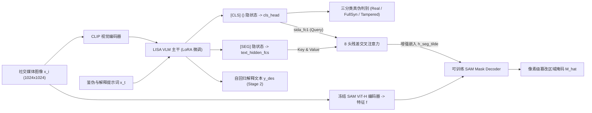
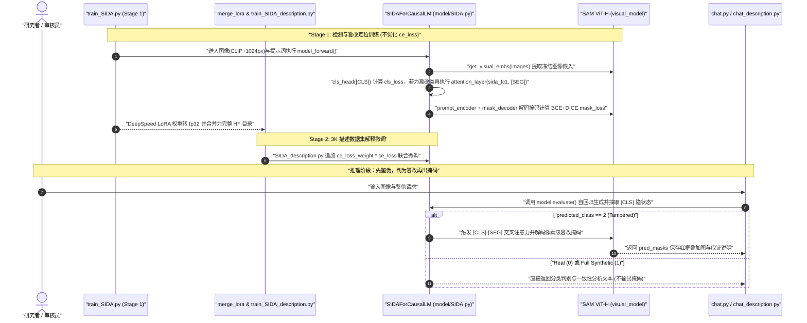

# SIDA（Social Media Image Detection Assistant）

> 来源：[arXiv:2412.04292 (v3)](https://arxiv.org/abs/2412.04292) · [Project Page](https://hzlsaber.github.io/projects/SIDA/) · [GitHub (`hzlsaber/SIDA`)](https://github.com/hzlsaber/SIDA) · [HuggingFace (`saberzl/SIDA-13B`)](https://huggingface.co/saberzl/SIDA-13B) · CVPR 2025

## 一句话定义

**SIDA**（Liverpool、NTU、Warwick、CUHK-SZ，CVPR 2025）是一套面向社交媒体图像的**伪造检测 + 篡改区域定位 + 自然语言取证解释**多模态大模型框架：它基于 LISA 扩展检测词元（论文记 `<DET>`，代码实现 `[CLS]`）与分割词元 `[SEG]`，通过交叉注意力将“真实 / 全合成 / 局部篡改”三分类判别耦合至 SAM ViT-H 掩码解码，并构建了 30 万样本的 **SID-Set** 通用场景鉴伪基准。

## 英文缩写速查

| 缩写 | 英文全称 | 简要说明 |
| :--- | :--- | :--- |
| **SIDA** | Social media Image Detection, localization, and explanation Assistant | 集三分类鉴伪、像素级篡改定位与取证解释于一体的 VLM 助手 |
| **SID-Set** | Social media Image Detection dataSet | 本文构建的 300K 社交媒体图像数据集（真实/全合成/篡改各 100K） |
| **IFDL** | Image Forgery Detection and Localization | 图像伪造检测与像素级篡改定位任务 |
| **SAM** | Segment Anything Model | SIDA 用来从图像视觉特征与 `[SEG]` 隐状态联合解码篡改掩码的基础分割模型 |

## 为什么重要

1. **填补非人脸社交媒复杂篡改基准空白**：传统鉴伪数据集高度集中于人脸换脸或早期 GAN 物体合成，且很少同时支持多分类（真实 vs 全生成 vs 局部修改）、精细掩码与文字解释。SID-Set 联合 OpenImages V7 真实图、FLUX 全合成与 GPT-4o + Language-SAM + Latent Diffusion 构建的局部替换/属性篡改，首次把评测推进到通用复杂场景。
2. **用分类特征显式引导篡改定位**：不同于 LISA 只做通用指代分割，SIDA 设计了“检测 Query (`sida_fc1`) × 分割 Key/Value”的 8 头交叉注意力交互，在检测判断后将其伪造模式先验注入掩码解码器，解决常规分割模型难以捕获微弱伪迹边界的痛点。
3. **在机器人视觉与感知栈中的迁移参考**：在机器人多模态安全核验与课程 6.2.3 体系中，SIDA 展示了一种把“离散合规判别 + 局部异常定位 + 结构化语言解释”挂接在同一条多模态主干的工程接口范式，与[机器人视觉感知栈选型闭环](../queries/robot-perception-stack-selection-loop.md)中②层分割接口的语义扩展一脉相承。

## 核心原理

### 核心信息

| 属性 | 内容 |
| :--- | :--- |
| **作者与机构** | Zhenglin Huang、Guangliang Cheng（Liverpool）、Xiangtai Li（NTU）、Xingyu Zhao（Warwick）、Baoyuan Wu（CUHK-SZ）等 |
| **发表与开源** | CVPR 2025；代码、SIDA-7B/13B 与 `*-description` 权重、SID-Set (300K) 与 3K 描述子集均已公开 |
| **模型底座** | `LISA-7B-v1` / `LISA-13B-llama2-v1`（CLIP ViT-L/14 + LLaMA + SAM ViT-H），输入图像统一填充缩放至 $1024 \times 1024$ |
| **训练参数** | LoRA（`r=8, alpha=16, dropout=0.05`）微调 LLM，冻结 SAM Image Encoder，可训练 Mask Decoder、`cls_head`、`sida_fc1` 与 `attention_layer` |
| **训练硬件** | 2× NVIDIA A100 40GB（DeepSpeed），7B 训练约 48 h、13B 约 72 h（lr $10^{-4}$，有效 batch 20，7:1:2 划分） |

### 关键机制拆解

1. **SID-Set 30 万数据集四阶段局部篡改流水线**：
   - 真实图（100K）来自 OpenImages V7；全合成图（100K）由 5 位人工专家从 Kandinsky 3.0 / SDXL / AbsoluteReality / FLUX 中盲评优选的 **FLUX.1-dev** 基于 Flickr30k 与 COCO 文本生成。
   - 局部篡改图（100K，含 80K 物体替换 + 20K 局部属性改写，并混合过滤后的 MagicBrush）按四阶段构建：**Stage 1** 用 GPT-4o 从图注抽取出对齐 COCO 类别的核心名词；**Stage 2** 用 Language-SAM 切分目标真值掩码；**Stage 3** 建立替换/属性字典构造对抗描述；**Stage 4** 用 Latent Diffusion 局部重绘生成以假乱真但带精确掩码的篡改图像。另抽 3,000 张均衡样本由 GPT-4o + 5 名专家质控生成多角度取证说明。
2. **`[CLS]`—`[SEG]` 交叉注意力引导的篡改定位架构**：
   - 将多模态输入喂入 LISA 主干抽取末层隐状态：检测头 $F_{\mathrm{det}}$（代码为 `cls_head`）读取 `[CLS]`（论文记 `<DET>`）隐状态输出 3 类 logits（`0: real, 1: full_synthetic, 2: tampered`）。
   - 若判定为篡改类，将 3 维类别表示通过投影层 `sida_fc1` 升维至 256 作为 **Query**，将 `[SEG]` 经 `text_hidden_fcs` 投影后的 256 维嵌入作为 **Key & Value**，经过 8 头多头注意力加残差连接增强（$\tilde{h}_{\mathrm{seg}} = \mathrm{MSA}(\tilde{h}_{\mathrm{det}}, h_{\mathrm{seg}}) + h_{\mathrm{seg}}$），再联合冻结 SAM ViT-H 图像特征由 `mask_decoder` 解码像素级篡改区域掩码。
3. **两阶段解耦训练目标**：
   - **Stage 1（检测与定位主训练）：** 仅联合优化分类交叉熵与掩码分割损失 $L = \lambda_{\mathrm{det}} L_{\mathrm{det}} + \lambda_{\mathrm{mask}} (\lambda_{\mathrm{bce}} L_{\mathrm{BCE}} + \lambda_{\mathrm{dice}} L_{\mathrm{DICE}})$，消融最优权重为 $\lambda_{\mathrm{det}}=1.0, \lambda_{\mathrm{bce}}=2.0, \lambda_{\mathrm{dice}}=0.5$。
   - **Stage 2（取证解释指令微调）：** 合并 Stage 1 LoRA 权重后，在 3,000 条多维度图文取证描述上追加文本交叉熵 $L_{\mathrm{txt}}$ 联合训练 `SIDA-*-description` 模型，输出光学一致性、边缘过渡、透视与材质自然度等结构化解释。

### 流程总览

## 实验与评测

核对自原文 Table 2–7，SIDA 在 SID-Set、跨库迁移（DMimage）与退化扰动下的关键评测如下：

### 1. SID-Set 三分类检测性能（Table 2, % ↑）

| 方法 | Real Acc / F1 | Fully Synthetic Acc / F1 | Tampered Acc / F1 | Overall Acc / F1 | 说明 |
| :--- | :---: | :---: | :---: | :---: | :--- |
| **AntifakePrompt**（未微调 / SID-Set 微调增益） | `64.8` / `78.6` | `93.8` / `96.8` | `30.8` / `47.2` | `63.1` / `74.2` | 微调后总体 Acc 仍受局部篡改混淆制约 |
| **UnivFD** | `68.0` / `67.4` | `62.1` / `64.0` | `87.5` / `85.3` | `64.7` / `80.0` | 原文 F1 与 Acc 跨类不均 |
| **LGrad**（重训偏斜） | `64.8` / `78.6` | `83.5` / `91.0` | `6.8` / `12.7` | `51.7` / `60.7` | 重训后将其他类别过度判为 Tampered |
| **SIDA-7B** | `89.1` / `91.0` | **`98.7`** / `98.6` | `92.7` / `91.0` | `93.5` / **`93.5`** | 7B 规模即全面覆盖三类 |
| **SIDA-13B** | **`89.6`** / **`91.1`** | `98.5` / **`98.7`** | **`92.9`** / **`91.2`** | **`93.6`** / **`93.5`** | 全场最高综合检测准确率 |

### 2. 篡改定位、扰动鲁棒性与跨域消融（Table 3–6）

- **篡改区域定位（Table 3，Tampered AUC / F1 / IoU）：** `SIDA-7B` 达 **`87.3 / 73.9 / 43.8`**，显著优于同在 SID-Set 上微调的通用推理分割模型 `LISA-7B-v1`（`78.4 / 69.1 / 32.5`）以及传统取证网络 `PSCC-Net`（`82.1 / 71.3 / 35.7`）、`HIFI-Net*`（`64.0 / 45.9 / 21.1`）、`MVSS-Net*`（`48.9 / 31.6 / 23.7`）。
- **社交媒体常见退化鲁棒性（Table 4，零增强微调直接测试）：** 面对 JPEG 70/80 压缩、0.5×/0.75× 缩放与方差 5/10 高斯噪声，`SIDA-7B` 检测 Acc 维持在 **`86.9%–89.9%`**（干净图 `93.5%`），定位 IoU 维持 **`41.0–43.5`**（干净图 `43.8`）。
- **跨域泛化至 DMimage（Table 5）：** 使用原权重零样本评测，`SIDA-7B` 取得 **`91.8%` Acc / `92.0%` F1**（优于 AntifakePrompt `90.3% / 91.8%` 与 UnivFD `67.2% / 74.8%`）。
- **注意力交互消融（Table 6）：** 移除 `<DET>-<SEG>` 注意力模块后检测 Acc/F1 从 `93.5 / 93.5` 降至 `90.3 / 89.9`；替换为简单 FC 降为 `91.1 / 90.3`。

## 结论

**在社交媒体图像安全场景中，将大语言模型的三分类语义判断（`[CLS]`）通过残差交叉注意力显式注入专业像素分割器（`[SEG]` + SAM），能够同时兼顾全图生成检测与局部物体/属性篡改定位，克服传统伪迹分类器易在部分篡改上崩溃的瓶颈。**

1. **非人脸复杂场景需要显式的三分类与定位协同建模**：单纯二分类（Real vs Fake）会在高度真实的局部替换图像上失效；将“全合成”与“局部篡改”拆分建模并用检测引导掩码，检测与定位能互相强化。
2. **检测与定位应先于语言解释完成解耦优化**：先用大权重在全量 300K 数据上收敛 `[CLS]` 与 SAM Mask Decoder，再单独用少量高精度 3K 专家解释微调文本生成（Stage 2），可避免自由文本损失稀释底层像素取证特征。
3. **微调超参需显式覆盖仓库默认设置**：论文最优定位来自 $\lambda_{\mathrm{bce}}=2.0, \lambda_{\mathrm{dice}}=0.5$，而非脚本默认的 `1.0 / 1.0`；且单靠 `SIDA-7B` 已足够接近 `13B` 精度，对实时服务更友好。
4. **文字解释适合审计辅助而非唯一仲裁依据**：GPT-4o 生成的视觉不一致分析能提高人工核查效率，但在极端细微局部修饰上仍可能出现“有文字、无掩码”或描述错位，须与掩码 IoU 和人工复核联动使用。

## 与其他工作对比

| 维度 | SIDA | LISA (`lisa.md`) | ARGUS (`paper-argus-deepfake-forensics.md`) | FakeShield / ForgeryGPT |
| :--- | :--- | :--- | :--- | :--- |
| **输入模态** | 单帧社交媒体图像（支持自然物体/场景局部篡改） | 单帧自然图像（通用指代推理分割） | 视频流（四观测流 + Judge 多 Agent 协同） | 单帧图像（MLLM 取证定位） |
| **任务输出** | 三分类（Real / FullSyn / Tampered）+ 篡改掩码 + 解释 | 指代语义分割掩码 + 文本回复 | 视频真伪判定 + 时空线索综合评判 | 伪造定位掩码 + 语言解释 |
| **核心交互** | `[CLS]` 检测概率经 `sida_fc1` 作为 Query 交叉注意 `[SEG]` | 单 `[SEG]` token 直连 SAM Mask Decoder | 多专家观察器分流（人脸/背景/唇音/全局） | Mask-aware 特征提取或外接分割头 |
| **开源数据集** | **SID-Set (300K)** + 3K 解释样本（FLUX + 局部替换） | ReasonSeg（推理分割） | FaceVid-Forensics-100K | 局部或较小规模伪造数据集 |

## 源码运行时序图

以下时序严格对齐官方仓库 `hzlsaber/SIDA` 两阶段训练脚本（`train_SIDA.py` → `merge_lora_weights_and_save_hf_model.py` → `train_SIDA_description.py`）与推理入口（`chat.py` / `chat_description.py` 调用 `SIDAForCausalLM`）：

## 工程实践

1. **特殊词元与脚本超参对齐**：论文中的 `<DET>` 对应仓库词表与源码中的 **`[CLS]`**（`cls_token_idx`），推理提示需按 `README.md` 规范引导模型以 `[CLS]` 起始输出；另请注意 `train_SIDA.py` 默认 `--bce_loss_weight=1.0 --dice_loss_weight=1.0`，若需复现论文 §5.5 最优配置请手动指定 `--bce_loss_weight 2.0 --dice_loss_weight 0.5`。
2. **Stage 1 与 Stage 2 的模型分工**：纯跑大规模三分类评测与精确篡改掩码生成时，使用 Stage 1 的 `SIDA-7B` / `SIDA-13B` 配合 `chat.py`（其 `evaluate()` 会将输出文本强制规范为确定性分类模板）或 `test.py` 更稳；仅在需要多维取证文字解释时再加载 Stage 2 的 `SIDA-*-description` 配合 `chat_description.py`。
3. **多卡 DDP 训练梯度防死锁**：在 `model/SIDA.py` 第 385–393 行可见，若一个 batch 内全为真实图或全合成图而无任何篡改掩码（`seg_token_mask.sum() == 0`），代码会显式构造 `p.sum() * 0.0` 虚拟残差接入 `mask_loss`，自建训练循环或魔改损失时务必保留该逻辑以免分布式训练梯度挂死。
4. **7B vs 13B 选型权衡**：`SIDA-7B` 在 SID-Set 综合准确率已达 `93.5%`，与 `SIDA-13B`（`93.6%`）仅差 0.1 个百分点；吞吐敏感场景可首选 7B，而官方 README 推荐复杂边缘分割和详细取证解释优先选用 `13B` / `13B-description`。

## 常见误区与局限

1. **误区：把文字解释当作零误差的取证依据**：语言生成受限于 LLM 先验与 3,000 条微调语料，可能输出看似通顺但与像素真实伪迹不符的“幻觉分析”，不能替代像素级取证报告或法律凭证。
2. **全合成训练域单源偏置风险（原文 §6 局限）**：SID-Set 的 100K 全合成部分完全由 **FLUX.1-dev** 单一模型生成；尽管在 DMimage 上跨测取得 91.8% 准确率，面对后续更新闭源商业扩散模型或迥异高频指纹时仍需持续扩充新生成器样本。
3. **极微小局部编辑容易漏检或边界欠拟合（原文 Appendix C 局限）**：Figure 11 展示当篡改仅涉及数十像素或半透明遮挡物边缘时，模型可能出现“无掩码输出”或掩码颗粒度偏粗的问题。
4. **不要与图像编辑指令模型混淆**：尽管依赖 Latent Diffusion 与 MagicBrush 构造反事实训练数据，SIDA 仅负责被动**检测、定位与鉴伪解释**，不执行任何图像生成或正向编辑操作。

## 关联页面

- [多模态基础](../concepts/multimodality-basics.md)
- [多模态 LLM 发展路线](../overview/multimodal-llm-development.md)
- [LISA（Reasoning Segmentation）](./lisa.md)
- [Sa2VA](./sa2va.md)
- [ARGUS 深度伪造鉴伪](./paper-argus-deepfake-forensics.md)
- [Transformer CV 课程策展](./transformer-cv-curriculum.md)
- [机器人视觉感知栈选型闭环知识链](../queries/robot-perception-stack-selection-loop.md) — 以 `[SEG]` 词元同时输出掩码与文字解释，属②层分割接口的多模态变体

## 参考来源

- [Transformer 视觉应用课程大纲](../../sources/courses/transformer_cv_applications_syllabus.md)
- [SIDA 原文精读归档（arXiv:2412.04292 v3 全文核对）](../../sources/papers/sida_arxiv_2412_04292.md)
- [hzlsaber/SIDA 源码结构与两阶段训练归档](../../sources/repos/hzlsaber_sida.md)

## 推荐继续阅读

- [LISA：基于大语言模型的推理分割](./lisa.md)
- [ARGUS：多 Agent 视频深度伪造取证](./paper-argus-deepfake-forensics.md)
- [Sa2VA：统一图像视频分割与多模态理解](./sa2va.md)
