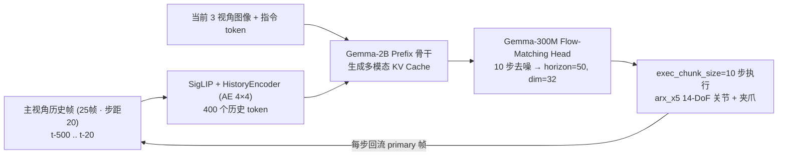
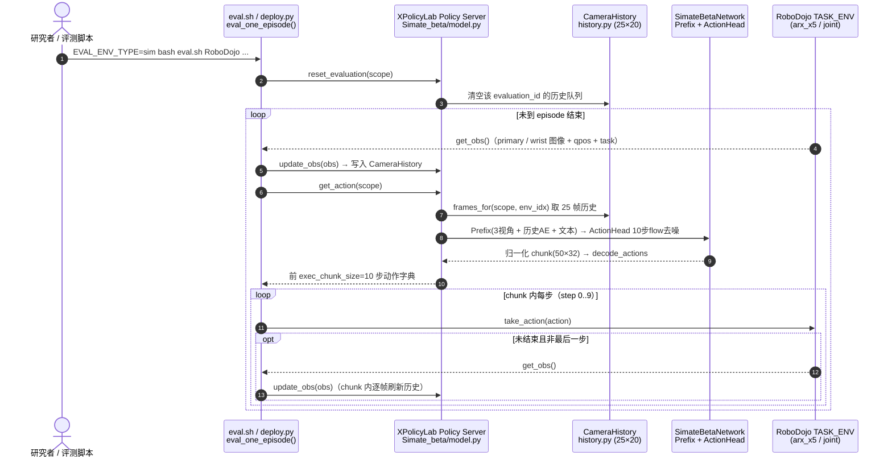

# Simate-beta（Simate 首版通用物理快系统）

**Simate-beta** 是 [Simate](./simate.md)（硅基伙伴，Silicon Mate）在成立约三个月后发布的第一款具身视觉记忆策略模型，2026-09-23 提交至 [RoboDojo](./robodojo.md) 仿真榜（当时未随榜单公开代码或报告）；随后官方通过 [`SIPAILab/simate-beta`](https://github.com/SIPAILab/simate-beta)（MIT）、Hugging Face [`SIPAILab`](https://huggingface.co/SIPAILab/simate-beta-init) 与 [XPolicyLab](./xpolicylab.md)（`policy/Simate_beta`）公开了模型结构、初始化/评测权重、训练配方与训练数据集，但截至 2026-11-21 仍无正式 arXiv 技术论文。

| 项目 | 内容 |
|------|------|
| 机构 | [Simate](./simate.md)（开源组织名 `SIPAILab`） |
| 上榜日期 | 2026-09-23（RoboDojo News） |
| 榜单类别 | RoboDojo 前端标注为 `vla` |
| 开源状态（2026-11-21 核查） | **训练与评测代码/权重/数据已开源**（`SIPAILab/simate-beta` MIT、`XPolicyLab/policy/Simate_beta`、HF `simate-beta-init` / `sipai-robodojo-eval-ae` / `simate-beta-training-data`）；**仍无正式技术论文** |

## 一句话定义

**一个做大参数的「快系统」（System 1）策略：用 4D 物理感知理解时空动态、用分层时序记忆支撑长程与连续操作，目标是向零样本 / 少样本的通用物理操作推进。**

## 英文缩写速查

| 缩写 | 英文全称 | 简要说明 |
|------|----------|----------|
| VLA | Vision-Language-Action | RoboDojo 前端给 Simate-beta 标的模型类别 |
| SR | Success Rate | RoboDojo 的任务成功率 |
| RSI | Recursive Self-Improvement | Simate 把长期路线称为 Physical RSI（与 [港大 MMLab 同名项目](./physical-rsi.md) 无关） |
| 4D | 3D space + time | 同时建模空间结构与时间动态的感知表征 |

## 为什么重要

- **「快系统做大」是一条明确的路线选择：** 多数分层方案把容量放在慢系统（规划 / 推理），Simate 反过来把参数压在实时动作侧，希望零样本泛化在快系统里涌现，再与 GPT-6 等通用推理模型协同（公司表述）。
- **长程项突出、开放任务偏弱：** 榜单分项显示 long-horizon Score 57.84 / SR 43.42 为六项最高，open 仅 9.12 / 8.5——和它强调的「分层时序记忆」一致，也说明开放指令泛化仍是短板。
- **研发方式是卖点之一：** 公司称 Simate-beta 是其 AutoResearch（人定假设、引擎自动跑实验）体系的第一个产物，从成立到上榜约三个月。

## 核心原理

从 `SIPAILab/simate-beta` 源码（`configs/simate-beta_mem20_ae_80k.yaml`）与 `XPolicyLab/policy/Simate_beta/network.py` 可直接核对出模型的完整架构与时序记忆实现（总参数量 `3,374,422,288`，FP32 推理）：

### 模型结构与时空记忆机制

| 组件 | 开源源码实现 | 关键超参与作用 |
|------|--------------|----------------|
| **视觉与历史压缩编码（`Prefix`）** | `SigLIPVisionEncoder`（`siglip_so400m_patch14_224`）+ `HistoryEncoder`（AE 压缩） | 编码当前 3 路相机（`primary` / `left_wrist` / `right_wrist`）；主视角按间隔 `20` 步采样 `25` 帧历史（`t-500 .. t-20`），经 `4×4` AE 网格与 `512` 维隐藏层压缩为 `25 × 16 = 400` 个历史 token |
| **多模态前缀骨干（`Prefix`）** | `Gemma-2B`（`width=2048, depth=18, heads=8, kv_heads=1`） | 拼接压缩历史 token、当前多视角视觉 token 与 SentencePiece 指令 token（`max_token_len=200`），生成前向 KV cache |
| **Flow-Matching 动作头（`ActionHead`）** | `Gemma-300M`（`width=1024, depth=18, intermediate=4096, adaptive_norm=True`） | 以正弦时间编码 + 2 层 SiLU MLP 条件化 AdaRMSNorm，对 `horizon=50, action_dim=32` 噪声执行 `10` 步 Euler 去噪，输出相对关节角（双臂 14 维 `arx_x5`）与绝对夹爪开度；默认每次执行 `exec_chunk_size=10` 步 |
| **训练配方与反事实监督** | `simate-beta_mem20_ae_80k.yaml` | 冻结 SigLIP 与 AE 编码器；`80k` 步、`4×8` GPU（全局 batch 128）、BF16 HSDP、EMA 0.99；采用 `25%` 记忆事件采样与反事实成对流损失（`counterfactual_pair_flow`），数据源 `robodojo_all : make_kong : play_tic_tac_toe = 5 : 0.7 : 1` |

### RoboDojo 仿真榜分项（2026-09-23 提交）

| 维度 | Score | SR (%) |
|------|-------|--------|
| Generalization（标准） | 40.54 | 33.22 |
| Generalization（随机） | 29.63 | 22.67 |
| Precision | 34.35 | 26.92 |
| Long horizon | 57.84 | 43.42 |
| Memory | 33.33 | 33.00 |
| Open | 9.12 | 8.50 |
| **平均** | **33.95** | **27.96** |

## 源码运行时序图

对齐 `SIPAILab/simate-beta@8ae595c`（训练）与 `XPolicyLab/XPolicyLab/policy/Simate_beta`（`eval.sh` / `deploy.py` / `model.py` / `network.py` 评测）：

图依据：`XPolicyLab/XPolicyLab` `policy/Simate_beta/`（`README.md`、`eval.sh`、`deploy.py`、`model.py`、`network.py`、`history.py`）及 `SIPAILab/simate-beta@8ae595c`（`README.md`、`configs/simate-beta_mem20_ae_80k.yaml`、`tools/train.py`），未实际下载权重或运行训练/仿真。

## 工程实践

| 场景 | 可执行入口（核查自开源仓） |
|------|---------------------------|
| **RoboDojo 评测** | 在 `XPolicyLab/policy/Simate_beta/` 运行 `bash install.sh` → `bash download_checkpoint.sh`（拉取 `SIPAILab/sipai-robodojo-eval-ae`）→ `EVAL_ENV_TYPE=debug` 或 `sim` 执行 `bash eval.sh RoboDojo stack_bowls simate-beta-robodojo-eval arx_x5 joint 0 0 1 simate-beta-eval RoboDojo` |
| **从初始化权重复训** | 拉取 `SIPAILab/simate-beta-init` 与数据集 `SIPAILab/simate-beta-training-data`；按 `SIPAILab/simate-beta` 配置 `SIMATE_INIT_CHECKPOINT` / `SIMATE_TOKENIZER` / `SIMATE_STATISTICS` 后运行 `bash tools/run_distributed_train.sh --config configs/simate-beta_mem20_ae_80k.yaml` |
| **工程注意点** | 1）仅支持 `arx_x5 / joint`（双臂 6+6 关节 + 1+1 夹爪）与 **FP32 AE 权重**（pooling checkpoint 会直接报错）；2）即使在 `exec_chunk_size=10` 的 chunk 内执行期间，每一物理步仍必须调用 `update_obs` 更新 `CameraHistory`，否则 20 步采样间隔会错位。 |

## 局限与风险

- **「登顶」有时效：** 上榜当日公司称排名第一；2026-09-28 港大 MMLab × Kinetix 的 [Physical RSI 1.0](./physical-rsi.md) 以 Score 36 / SR 31% 列 Overall 第一。引用名次时注明日期。
- **仍缺正式技术论文：** 截至 2026-11-21 虽已开源代码与权重，但仍无公开 arXiv 论文系统报告消融实验（如反事实监督与不同记忆长度的影响）和真机定量成功率。
- **硬件与形态受限：** 开源推理适配器硬编码校验 `arx_x5 / joint`（双 6-DoF 臂 + 夹爪）及 FP32 权重；3.37B FP32 推理与 `4×8` GPU 80k 步训练配方算力门槛较高。
- **「未针对榜单优化」与数据源组成：** 公开训练配置 `simate-beta_mem20_ae_80k.yaml` 明确以 `robodojo_all`（权重 5）为主数据源并辅以 `make_kong`（0.7）与 `play_tic_tac_toe`（1），复现与跨模型对比时需同时核对训练数据分布与 RoboDojo protocol 口径。

## 关联页面

- [机器人操作](../tasks/manipulation.md) — 从杂乱操作任务理解压缩视觉记忆的用途与评测范围。
- [Simate](./simate.md) — 公司总览：Sinfra / Sipai / RoboScientist / AutoResearch
- [RoboDojo](./robodojo.md) — 评测基准与上榜规则
- [Physical RSI 1.0](./physical-rsi.md) — 同榜后来者，港大 MMLab × Kinetix（不同机构）
- [VLA](../methods/vla.md) — 方法族背景

## 参考来源

- [SiPAI / Simate-beta 官方开源代码与 HF 权重归档](../../sources/repos/simate_beta.md)
- [Simate-beta 与 RoboDojo 上榜：媒体报道与榜单数据归档](../../sources/blogs/simate_beta_robodojo_2026-09.md)

## 推荐继续阅读

- [SIPAILab/simate-beta 官方 GitHub 仓库](https://github.com/SIPAILab/simate-beta) — SiPAI 训练框架与 `simate-beta_mem20_ae_80k.yaml` 配置
- [XPolicyLab `policy/Simate_beta` 评测适配器](https://github.com/XPolicyLab/XPolicyLab/tree/main/policy/Simate_beta) — RoboDojo 独立推理与评测脚本
- [SIPAILab/simate-beta-init（Hugging Face）](https://huggingface.co/SIPAILab/simate-beta-init) — 初始化权重与参数布局说明
- [RoboDojo Leaderboard](https://robodojo-benchmark.com/leaderboard) — 查看最新名次与分项
- [量子位报道（36氪转载）](https://eu.36kr.com/zh/p/3999916051157129) — 设计思路与 AutoResearch 介绍
