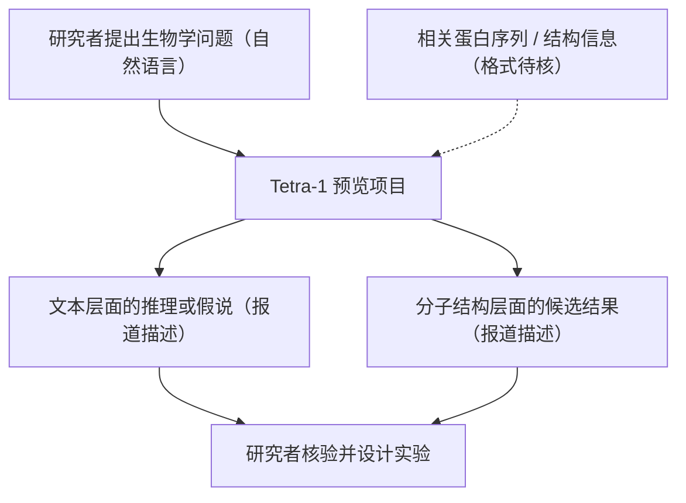

# Tetra-1：SimpleX 生物科学推理模型预览

## 一句话定义

**Tetra-1** 是 [SimpleX](https://simplexfoundry.com/tetra-1/) 的生物科学 AI 模型预览项目。据 2026-11-10 第三方采访报道，它尝试连接研究者的自然语言问题与蛋白质结构层面的推理；**本次尚未完整读取官方博客，以下技术细节均需回到原文确认**。它不是机器人运动控制或 VLA 模型。

## 英文缩写速查

| 缩写 | 英文全称 | 简要说明 |
|---|---|---|
| AI4S | AI for Science | 以机器学习辅助科学发现，本项目属于生物科学方向 |
| PTP1B | Protein Tyrosine Phosphatase 1B | 第三方报道中用于解释隐藏变构口袋的蛋白靶标案例 |
| AF3 | AlphaFold 3 | 第三方测试简讯所引述的蛋白结构预测比较基线 |
| API | Application Programming Interface | 若未来公布程序访问接口，需从官方说明核对 |

## 为什么重要

- **科研推理与分子结构表征结合：** 媒体报道的目标不只是预测一个静态折叠结构，还希望输出与科学问题相关的可解释假说；其真实性与适用范围仍待官方正文核验。
- **为 Robotics_Notebooks 提供领域边界对照：** AI4S 以分子结构预测、假说和实验验证为评价闭环；机器人研究还需要控制器与物理系统执行。这两类「物理世界智能」不能直接混为一谈。
- **评测可核性：** 科学假说、结构基准指标、实际药物或实验发现是三个不同层次。

## 流程总览（公开功能关系占位，非官方模型架构）

下面只根据**第三方报道描述的交互概念**整理为阅读路径，不代表 SimpleX 公布过这样的内部网络、消息格式或执行顺序。原文技术流程未确认，PR 保留 Draft；完成官方通读后必须重绘正式 Mermaid 主流程图。

## 核心原理（待一手核验）

| 维度 | 当前可定位的公开描述 | 核验状态 |
|---|---|---|
| 项目身份 | SimpleX 的 Tetra-1 Preview | 官方 URL 可访问，但页面正文未完整读取 |
| 输入 | 自然语言、蛋白质序列与结构等多模态信息（媒体转述） | 输入协议、上下文长度、数据依赖未核 |
| 输出 | 自然语言科学解释与结构层面的假说（媒体转述） | 是否真的联合生成、如何评分与可视化，未核 |
| 代表性案例 | PTP1B 隐藏变构口袋（媒体采访） | 未获取案例设置、验证材料及泄漏控制原文 |
| 适用方向 | 蛋白质结构理解与生物科学假说 | 尚无证据证明可替代湿实验验证 |

## 实验与评测（媒体转述，非已核实原文）

| 基准 | 媒体引述的 Tetra-1 | 所引述对照 | 注意 |
|---|---:|---|---|
| Runs N' Poses 低相似度子集 | 53.1% | IsoDDE 50%；AF3 25% | 数据集版本、切分、样本量和 success 判据未从官方核实 |
| FoldBench 抗体-抗原预测 | 77% | IsoDDE 75.58%；AF3 47.9% | 原文对照配置与统计口径未核，不能据此宣称全面胜出 |

以上数据来源为 [Public Technologies 的 AI 生成简讯](https://www.webull.com/news/15903832288718848) 的转述，仅供后续逐项核对；**不能作为一手证据或独立验证结果**。

## 工程实践

| 环节 | 当前可做的事 | 不应推断的事 |
|---|---|---|
| 阅读官方介绍 | [Tetra-1 官方博客](https://simplexfoundry.com/tetra-1/) | 不能因为网页标题可检索就宣称全文已读 |
| 查找体验入口 | [Tetra-1 Apply](https://simplexfoundry.com/tetra-1/apply/) | URL 存在不表示所有人都可免申请使用 |
| 查看模型开放程度 | 待从官方正文的资源区核查 | 当前不能断言已开源、闭源或 API 收费方案 |
| 验证研究结果 | 优先回读原始技术报告、基准与独立实验 | 结构预测得分不等于已证实的生物机制 |

**源码运行时序图：暂不适用。** 尚未核实官方代码仓、可运行入口与调用关系；不得拿概念框图充当源码时序。

## 局限与风险

1. **一手资料阻塞：** 本次公开网页抓取只能得到官方站点标题，无法读取技术博客与申请页正文；归档均标记「通读：未完成」，因此本页状态为 Draft。
2. **结果尚未独立验证：** 当前量化数字来自明确标为 AI 生成的第三方新闻简讯；报道中的 PTP1B 案例需要检查时间屏蔽、训练污染和结构验证条件。
3. **科学推断与实验证明不同：** 候选蛋白结构或变构口袋假说不能直接当作药物有效性、疾病机制或安全性的实验证明。
4. **与机器人领域的关系有限：** 本项目更适合作为 AI4S 科研推理的跨领域对照，不应强行挂载机器人 VLA、WAM 或运动控制学习路线。

## 关联页面

- [沐曦 AI4S 科研实战营](./metax-ai4s-science-camp.md)：科研模型调用、蛋白设计的课程与计算实践。
- [Google Research：自动化湿实验的构件](./google-grounding-ai-agents-wet-labs.md)：模型假说进入物理实验前需要验证与安全门控。
- [表位切除蛋白设计](./paper-epitope-excision-binder-design.md)：蛋白设计中的结构筛选与真实湿实验的具体评测边界。

## 参考来源

- [SimpleX 官方博客入口与通读阻塞记录](../../sources/blogs/simplex-tetra-1.md)
- [SimpleX 在线体验页与开放状态核查](../../sources/sites/simplex-tetra-1-apply.md)
- [SimpleX 官方博客](https://simplexfoundry.com/tetra-1/)（本轮正文不可完整读取）
- [晚点 LatePost 采访转载](https://www.aitntnews.com/newDetail.html?newId=31146)（第三方）
- [Public Technologies AI 生成简讯](https://www.webull.com/news/15903832288718848)（第三方，数字待核）

## 推荐继续阅读

- [Tetra-1 官方介绍](https://simplexfoundry.com/tetra-1/)：应优先阅读并回填技术与评测原文。
- [Tetra-1 在线体验入口](https://simplexfoundry.com/tetra-1/apply/)：访问与权限规则以该页实际展示为准。
