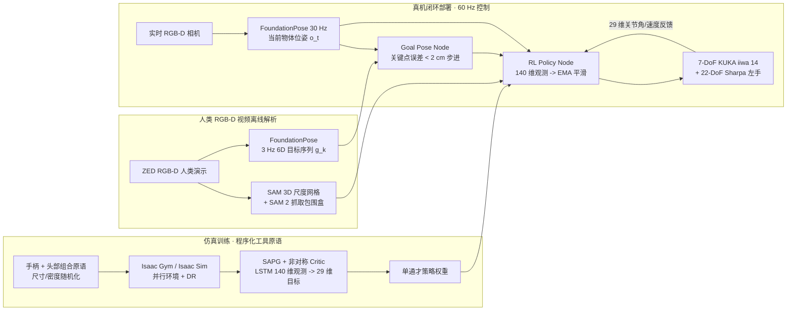
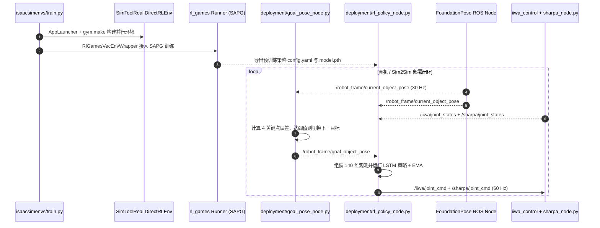

# SimToolReal：面向零样本灵巧工具操作的以物体为中心 RL 策略

**SimToolReal**（*SimToolReal: An Object-Centric Policy for Zero-Shot Dexterous Tool Manipulation*，RSS 2026，[arXiv:2602.16863](https://arxiv.org/abs/2602.16863)，[项目页](https://simtoolreal.github.io/)，[代码](https://github.com/tylerlum/simtoolreal)）由康奈尔大学与斯坦福大学团队提出（致谢 Sharpa 提供手部硬件支持）：不在仿真里为具体工具搭建数字孪生和调参专用奖励，而是用大量 **程序化工具原语** 训练单一「通用目标位姿到达」RL 策略，测试时直接跟踪人类 RGB-D 视频提取的物体 6D 轨迹，在 **KUKA iiwa 14 + 22-DoF Sharpa 左手** 上实现零样本跨工具操作。

## 一句话定义

**SimToolReal = 程序化手柄–头部工具原语 + 非对称 SAPG（140 维物体中心观测、4 关键点位姿误差奖励）训练单通才 LSTM 策略，真机由 SAM 3D / SAM 2 / FoundationPose 提取目标轨迹并闭环跟踪。**

## 英文缩写速查

| 缩写 | 英文全称 | 简要说明 |
|------|----------|----------|
| SAPG | Split and Aggregate Policy Gradients | 多探索块并行 PPO 聚合算法，用于缓解大规模并行仿真下的探索饱和 |
| DexToolBench | Dexterous Tool Manipulation Benchmark | 本文配套的 6 类 × 2 实例 × 2 任务（24 任务）真机与孪生基准 |
| EMA | Exponential Moving Average | 动作目标指数移动平均平滑（`α_arm = α_hand = 0.1`） |
| CoACD | Approximate Convex Decomposition | 将凹形工具网格分解为凸碰撞体以对齐 Isaac Gym / Isaac Sim 物理 |
| SAM 3D / SAM 2 | Segment Anything 3D / 2 | 分别用于单帧真实尺度物体网格重建与抓取区域分割 |
| Sim2Real | Simulation to Real | 纯程序化仿真训练后零样本迁移至真机 |
| DR | Domain Randomization | 观测/动作延迟、位姿噪声、抓取框扰动及随机外力/力矩域随机化 |

## 为什么重要

- **绕过逐任务建模与奖励工程：** 传统灵巧 Sim2Real RL 往往把能力局限在单物体抓取或纯手内旋转；SimToolReal 把问题统一为「将任意物体推/抓/旋至下一目标位姿」，从而让单一策略自发学出桌面拾取、手内 `90°/180°` 重定位与抗扰持握。
- **补齐人手遥操与运动学重定向短板：** 遥操作缺少力触觉反馈，纯运动学重定向忽略接触力，固定抓取（Fixed Grasp）则受限于臂运动学空间易撞桌；以物体为中心的闭环 RL 允许手内自适应调整抓握构型。
- **验证程序化原语对真实工具的迁移：** 训练阶段完全不接触 DexToolBench 真实工具模型或轨迹，却能在 120 次真机 rollout 中匹配单任务 specialist 并大幅抗住新物体/新轨迹分布偏移。

## 核心原理

### 流程总览

### 1）程序化工具生成与统一目标奖励

- **几何与物理随机化：** 工具由「手柄 + 垂直连接的头部」两段刚体组成（长方体或胶囊体），手柄长 `5–30 cm`、截面 `1–4 cm`、低密度 `300–600 kg/m³`；头部长 `1–15 cm`、截面 `0.5–12 cm`、高密度 `300–2000 kg/m³`，形成多样重心与转动惯量。
- **三段式奖励：** `r = r_smooth + r_grasp + I_grasped · r_goal`。桌面抓起前由指尖接近与抬升奖励引导，抬升触发 `I_grasped = 1` 后由 `r_goal` 主导：基于固定局部尺度 `[0.14, 0.03, 0.03] m` 的 4 个关键点最大位移进度（偏向对准工具主轴俯仰与偏航）与 `d < ϵ (2 cm)` 稀疏成功奖励。

### 2）140 维物体中心表示与非对称 SAPG

- **Actor 140 维观测：** 29 关节位置 + 29 关节速度 + 29 上步关节目标 + 7 手掌位姿 + 15 五指尖相对手掌位置 + 4 物体四元数 + 12 物体 4 个抓取框关键点（相对手掌）+ 12 到目标关键点误差 + 3 抓取框尺寸 `s`。采用 LSTM 记忆交互历史以隐式推断未观测惯量与几何细节。
- **动作空间（29 维）：** 手臂 7 DoF 采用增量目标（`k_arm = 0.025`），Sharpa 手 22 DoF 采用关节限位仿射绝对目标，双路均经 `α = 0.1` 的 EMA 平滑后以 `60 Hz` 下发位置控制。
- **SAPG + 非对称 Critic：** Critic 读取无噪声、无延迟的特权物体状态、线/角速度与当前阶段标志，解决部分可观测与大规模并行下的探索饱和。

## 源码运行时序图

官方仓库 `tylerlum/simtoolreal`（commit `313d5ae`）同时提供 Isaac Sim（推荐）/ Isaac Gym 训练入口与 4 节点 ROS 部署链路，运行时交互如下：

图依据：`tylerlum/simtoolreal@313d5ae`，核对 `README.md`、`docs/deployment.md`、`isaacsimenvs/train.py`、`deployment/rl_policy_node.py` 与 `deployment/goal_pose_node.py`（未在本地 GPU/真机运行）。

## 实验与评测

以下数字均取自 arXiv:2602.16863v3（论文自报）：

- **DexToolBench 真机零样本测试：** 6 类工具（hammer、marker、eraser、brush、spatula、screwdriver）× 2 实例 × 2 任务 = **24 任务**，每任务 5 次 rollout 共 **120 次真机测试**；以关键点距离 `< 2 cm` 为目标点到达判据统计 Task Progress。
- **基线对比：** 在真机刷子清扫双变体及基准对比中，Task Progress 整体超出运动学重定向（Kinematic Retargeting，难以建立稳定接触）与固定抓取（Fixed Grasp，需手内 `90°` 旋转时手臂撞桌）**37%**；在仿真中与单物体/单轨迹 Specialist 打平，而 Specialist 一旦更换轨迹（`Obj A / Traj B`）或更换物体（`Obj B / Traj A`）即显著掉点。
- **失败模式拆解（Sec. IV-A）：** 位姿跟踪丢失占 **43.7%**、物体掉落占 **34.5%**、手内旋转未到位占 **18.2%**、初始抓取失败占 **3.6%**；掉落后若仍在视野与工作空间内策略会主动重抓。
- **消融（Sec. IV-E，5 种子）：** 用标准 PPO 替代 SAPG，或去掉非对称 Critic 仅用部分观测训练价值网络，均导致训练回报大幅滑落。

## 结论

**SimToolReal 证明只要把任务规约为「物体中心 6D 位姿轨迹跟踪」，配合手柄–头部程序化工具原语与非对称 SAPG，单一纯仿真 RL 策略就能在真实 22-DoF 灵巧手上零样本操作 12 种未见工具（120 次 rollout 领先传统基线 37%，自报）。**

1. **视觉与几何抽象决定迁移上限**：只输入 6D 物体位姿与 3D 抓取包围盒完全绕开了视觉 Sim2Real 鸿沟，但真机 **43.7%** 的失败也直接来自 FoundationPose 跟踪丢失。
2. **SAPG 与非对称 Critic 缺一不可**：大规模并行灵巧抓取+手内重定位在标准 PPO 下极易探索饱和，消融证实两项 RL 设计是稳定收敛的主因。
3. **重定位能力来自目标采样分布**：首目标大范围采样诱导桌面抓取与手内 `90°–180°` 旋转，后续局部采样诱导连续轨迹跟踪。
4. **选型边界在「刚体几何跟踪」而非「高力闭环」**：目标阈值 `ϵ = 2 cm` 且无触觉/力反馈输入，不适合剪刀等非刚体/铰接工具或强力交互（钉钉子）的功能验收。
5. **复现分两条环境栈**：官方推荐用 `isaacsimenvs/train.py`（Isaac Lab，Python 3.11），论文原始训练与 ROS 部署文档仍基于遗留 Isaac Gym（Python 3.8），且需额外配置独立 `FoundationPose` 与凹面工具 CoACD 凸分解。

## 工程实践

| 检查项 | 复现与部署要点（基于 `tylerlum/simtoolreal` 文档与入口） |
|--------|----------------------------------------------------------|
| **开源范围** | 代码 MIT 已开源，含训练（Isaac Sim / Isaac Gym）、DexToolBench 数据下载、预训练权重下载脚本与 ROS 部署节点；外部感知依赖 [kushal2000/FoundationPose](https://github.com/kushal2000/FoundationPose) |
| **碰撞网格预处理** | Isaac Sim 会将单块凹面碰撞网格当成凸包导致工具接触失真，部署/仿真新工具前须运行 `dextoolbench/generate_collision_meshes.py`（CoACD 离线凸分解） |
| **Isaac Sim 训练** | `python isaacsimenvs/train.py --task Isaacsimenvs-SimToolReal-Direct-v0 --agent rl_games_sapg_cfg_entry_point`（默认 `num_envs=24576`、`expl_coef_block_size=4096`，保持比值为 6 个 SAPG block） |
| **安全 Sim2Sim 验证** | 上真机前先跑 `deployment/isaac/isaac_env_node.py`（带物理）或 `deployment/fake/fake_robot_node.py` + `fake_perception_node.py`（无物理接口检查），并配合 `visualization_node.py`（Viser）观察 |

## 局限与风险

- **无触觉/力觉闭环：** 仅靠 `30 Hz` 外部视觉物体位姿跟踪，遮挡（如细长马克笔）即触发跟踪丢失；难以判定真实接触力是否足以完成高阻力任务。
- **环境盲目与开环目标序列：** 策略不感知桌面以外的杂乱障碍物，且 `goal_pose_node.py` 按固定演示序列推进，若环境意外阻挡不会重规划路径。
- **刚体假设：** 依赖单刚体 6D 位姿与 3D 包围盒描述，不适用于剪刀、镊子等铰接或可变形工具。
- **指标口径：** 论文评测的是目标关键点到达进度（Task Progress，`ϵ = 2 cm`），不等同于实际物理作业功能成功（如实际钉入钉子或拧紧螺丝）。

## 关联页面

- [loco-manipulation](../tasks/loco-manipulation.md) / [manipulation](../tasks/manipulation.md) / [locomotion](../tasks/locomotion.md)
- [reinforcement-learning](../methods/reinforcement-learning.md) / [crisp-real2sim](../methods/crisp-real2sim.md)
- [whole-body-control](../concepts/whole-body-control.md)
- [夏帕机器人（Sharpa Robotics）](./sharpa-robotics.md) — 同一 22-DoF Sharpa 手硬件平台上的工作
- [Do as I Do](./paper-do-as-i-do.md) / [GALATEA](./paper-galatea.md) — 人类/生成视频引导的灵巧控制路线对照
- [Humanoid Motion Intelligence](./humanoid-motion-intelligence.md) / [Awesome-Real2Sim2Real](./awesome-real2sim2real.md)
- [Awesome-Real2Sim2Real 技术地图](../overview/sun-awesome-r2s2r-technology-map.md) / [开源主表覆盖索引](../queries/hmi-opensource-projects-coverage.md)

## 参考来源

- [simtoolreal_arxiv_2602_16863.md](../../sources/papers/simtoolreal_arxiv_2602_16863.md) — arXiv:2602.16863v3 全文与项目页一手摘录
- [simtoolreal.md（仓库归档）](../../sources/repos/simtoolreal.md) — `tylerlum/simtoolreal@313d5ae` 源码入口与部署架构核查
- [Humanoid Motion Intelligence 仓库归档](../../sources/repos/humanoid-motion-intelligence.md)
- [`sources/papers/sun_awesome_r2s2r_2602_16863_simtoolreal-an-object-centric-policy-for.md`](../../sources/papers/sun_awesome_r2s2r_2602_16863_simtoolreal-an-object-centric-policy-for.md) — 列表策展摘录

## 推荐继续阅读

- [SimToolReal 官方项目页（含浏览器 MuJoCo 交互 Demo）](https://simtoolreal.github.io/)
- [官方代码仓库 tylerlum/simtoolreal](https://github.com/tylerlum/simtoolreal)
- [arXiv:2602.16863v3 全文](https://arxiv.org/abs/2602.16863)
