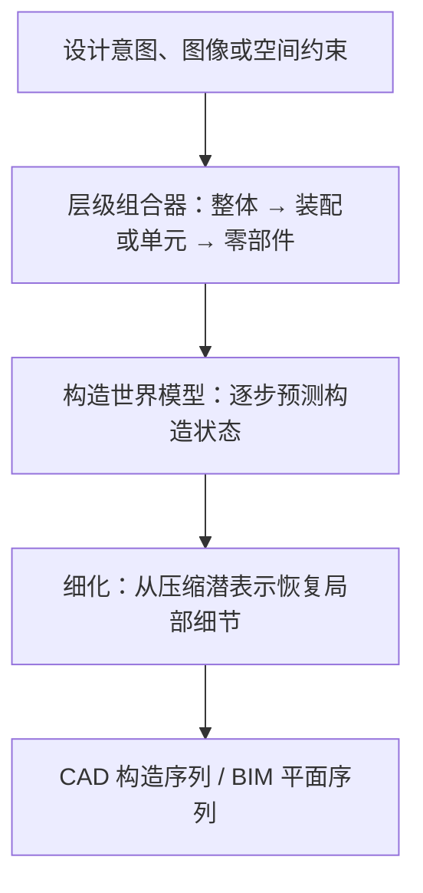

# SKY-001（Skyfall AI 工程世界模型）

**SKY-001** 是 Skyfall AI 面向工程设计发布的空间世界模型研究预览。它先把设计目标分解为层级结构，再为各个部分生成构造状态序列；官方演示覆盖从图像到 CAD 部件装配，以及从建筑轮廓到 BIM 楼层布局。与生成可观看场景的世界模型相比，SKY-001 强调的是带结构和步骤的设计结果。

## 英文缩写速查

| 缩写 | 英文全称 | 简要说明 |
|------|----------|----------|
| CAD | Computer-Aided Design | 计算机辅助设计；此处用于零部件几何和构造操作 |
| BIM | Building Information Modeling | 建筑信息模型；此处主要展示楼层和房间平面布局 |
| IoU | Intersection over Union | 预测形状/平面与参考结果的交并比指标 |
| LLM | Large Language Model | 大语言模型；博客将其作为对比基线之一 |

## 核心流程

官方博客把系统分成两个主要阶段：

层级组合器为复杂目标提供子目标，让模型逐层规划；同一层级的分支可以并行生成。构造模型再处理叶节点：CAD 先预测 3D 中间状态和相邻状态间的草图，BIM 则生成逐步绘制的 2D 平面。官方称 2D 序列使用压缩潜空间进行粗生成，再由细化器恢复细节。

## 官方报告的评测

| 任务 | 官方测试设置 | SKY-001 的发布方结果 |
|------|--------------|----------------------|
| CAD 构造 | 1,000 个零部件；约 100 个步骤；最终 3D 几何以 IoU 评估 | 79.7% IoU；3.9 秒、$0.005 每例 |
| BIM 构造 | 1,000 个平面；平均约 70 个步骤；最终布局以 IoU 评估 | 43.6% IoU；1.22 秒、$0.0024 每例 |

博客同时列出 GPT-6 Astra 对比结果：CAD 为 79.1% IoU、199 秒、$0.75/例；BIM 为 40.6% IoU、144.6 秒、$0.446/例。以上都是 Skyfall 自行披露的实验数字；目前无公开评测代码或独立复现可核对。CAD 与 BIM 的任务定义、分数和成本不能直接外推到通用工程设计。

## 对机器人和工程研发的意义

- **设计步骤进入世界模型：** 若能可靠表示部件层级、几何约束和构造顺序，这种接口有机会连接概念设计与 CAD/BIM 工具链；这是从发布方案得到的潜在方向，不代表已验证的机器人能力。
- **区别于机器人动力学世界模型：** 当前发布的重点是设计结构和视觉构造状态，资料没有显示它能预测力学、接触、材料行为或控制动作。机器人仿真仍需物理模型和实机校验。
- **层级拆分是核心假设：** 长序列被拆成局部子问题，有助于并行处理和减少逐步依赖；实际适用性仍取决于上层拆分正确与跨部件约束能否保持。

## 工程实践与局限

- **访问：** 产品页当前提供 waitlist；截至 2026-10-20，官方页面未列公开 API、源码、模型权重或数据集下载入口。
- **复现：** 官方博客披露了流程与部分数据规模、对比指标，但没有提供独立复现实验所需的公开代码入口。
- **输出边界：** 博客展示的是设计树及 CAD/BIM 构造状态序列；可编辑参数化操作历史和直接按文本修改工程设计列为后续方向。
- **不要等同于物理仿真：** 几何/布局 IoU 不等于制造可行性、结构安全、材料性能或机器人接触动力学验证。

## 关联页面

- [生成式世界模型](../methods/generative-world-models.md) — 世界模型的生成与仿真路径
- [世界模型功能分类](../concepts/functional-taxonomy-world-models.md) — 区分不同输出与用途
- [Marble（World Labs）](./marble-world-model.md) — 面向可编辑 3D 世界内容的世界模型产品

## 参考来源

- [SKY-001 官方产品页归档](../../sources/sites/skyfall-sky-001.md)
- [Introducing SKY-001 官方博客摘录](../../sources/blogs/skyfall_sky001_engineering_world_model.md)

## 推荐继续阅读

- [Introducing SKY-001: The First World Model for Engineering](https://skyfall.ai/blog/introducing-sky-001)
- [SKY-001 官方产品页](https://skyfall.ai/sky-001)
