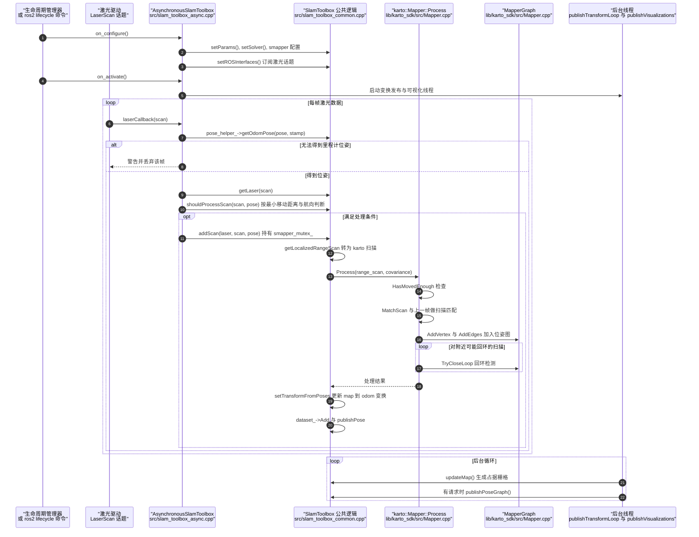

---

type: entity
tags: [repo, ros2, slam, 2d-lidar, mapping, navigation, linux-foundation]
status: complete
updated: 2026-07-27
related:
  - ../entities/navigation2.md
  - ../overview/navigation-slam-autonomy-stack.md
  - ../comparisons/lidar-slam-lio-vio-selection.md
  - ./oomwoo.md
sources:
  - ../../sources/repos/slam_toolbox.md
summary: "SLAM Toolbox 是 ROS 2 常用的 2D lifelong SLAM：Karto 后端、大地图序列化、建图/定位模式切换，常与 Nav2 组合。"
---

# SLAM Toolbox

**SLAM Toolbox** 面向 **2D 激光** 的 lifelong 建图与定位，支持大规模地图持久化与在线更新。

## 英文缩写速查

| 缩写 | 英文全称 | 简要说明 |
|------|----------|----------|
| SLAM | Simultaneous Localization and Mapping | 同步定位与建图 |
| ROS 2 | Robot Operating System 2 | 机器人系统集成与通信的常用中间件 |
| LiDAR | Light Detection and Ranging | 激光雷达，地形感知与建图主传感器 |
| LIO | LiDAR-Inertial Odometry | 激光-惯性里程计 |
| VIO | Visual-Inertial Odometry | 视觉-惯性里程计，融合相机与 IMU 估计位姿 |

## 为什么重要

- **Nav2 标配搭档**：室内 AMR 常见「slam_toolbox 建图 + Nav2 导航」闭环。
- **lifelong 能力**：地图可序列化、扩展与重定位，适合长期运行场景。

## 核心结构/机制

| 能力 | 说明 |
|------|------|
| **同步/异步模式** | 建图与纯定位切换 |
| **Karto 后端** | scan matching + 闭环 |
| **地图格式** | 序列化 pose graph 与 occupancy |
| **ROS 2** | 原生 Humble/Iron 生态支持 |

## 常见误区或局限

- **误区：可直接做 3D 避障** — 产物为 2D 占据栅格；3D 障碍需额外传感器或 nvblox。
- **局限**：非视觉 SLAM；与 ORB-SLAM3 等赛道不同。

## 源码运行时序图

入口：`launch/online_async_launch.py` 以 `LifecycleNode` 启动可执行文件 `async_slam_toolbox_node`，其 `main()`（`src/slam_toolbox_async_node.cpp`）创建 `AsynchronousSlamToolbox` 并调用 `rclcpp::spin`。图中展示异步建图模式下的激光处理链路；同步模式与定位模式的入口各自独立，未画入。

图依据：SteveMacenski/slam_toolbox@7376b23，读过 `README.md`（开头部分）、`launch/online_async_launch.py`（节点可执行文件与 LifecycleNode 声明）、`src/slam_toolbox_async_node.cpp`（`main`）、`src/slam_toolbox_async.cpp`（`laserCallback`）、`src/slam_toolbox_common.cpp`（`on_configure`、`on_activate` 线程创建、`setROSInterfaces` 调用处、`shouldProcessScan`、`addScan`/`addScanImpl`、`publishVisualizations` 循环）、`lib/karto_sdk/src/Mapper.cpp`（`Mapper::Process` 主体与 `MapperGraph` 的 `AddVertex`）。`publishTransformLoop` 的内部循环未逐行核对；回环内部的优化求解器调用未展开。未运行代码。

## 参考来源

- [sources/repos/slam_toolbox.md](../../sources/repos/slam_toolbox.md)
- [SteveMacenski/slam_toolbox](https://github.com/SteveMacenski/slam_toolbox)
- 源码核对（2026-11-02）：SteveMacenski/slam_toolbox@7376b23，读过 README.md、launch/online_async_launch.py、src/slam_toolbox_async_node.cpp、src/slam_toolbox_async.cpp、src/slam_toolbox_common.cpp、lib/karto_sdk/src/Mapper.cpp；时序图依据以上文件，未运行代码。

## 关联页面

- [Navigation2](../entities/navigation2.md)
- [导航·SLAM·自动驾驶栈总览](../overview/navigation-slam-autonomy-stack.md)
- [LiDAR / LIO / VIO 选型](../comparisons/lidar-slam-lio-vio-selection.md)
- [OOMWOO](./oomwoo.md) — 架构默认机载 2D SLAM 搭档

## 推荐继续阅读

- https://github.com/SteveMacenski/slam_toolbox/wiki
