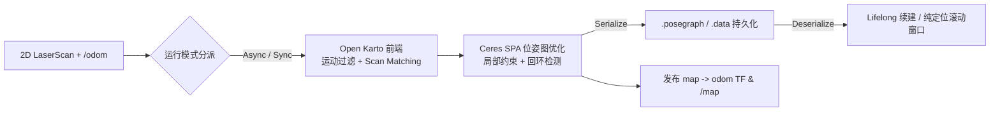
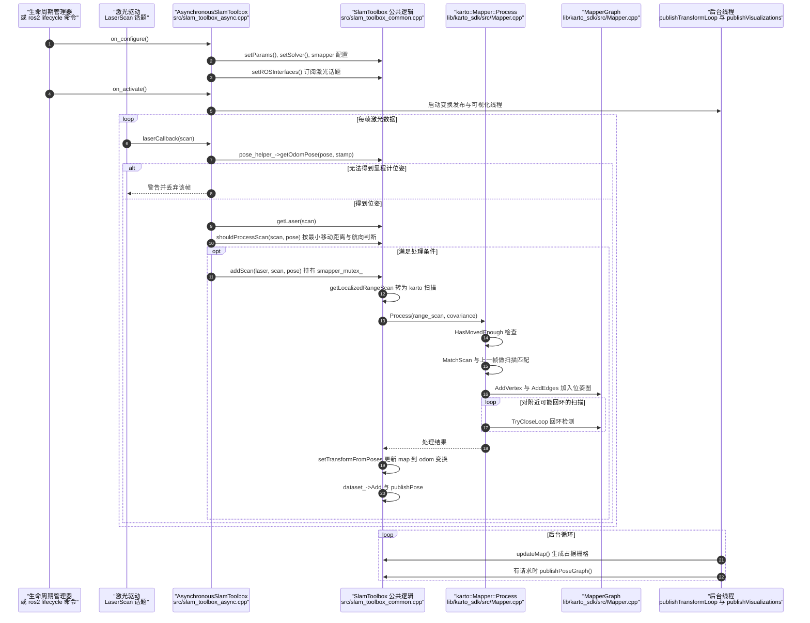

---

type: entity
tags: [repo, ros2, slam, 2d-lidar, mapping, navigation, linux-foundation]
status: complete
updated: 2026-11-21
related:
  - ../entities/navigation2.md
  - ../overview/navigation-slam-autonomy-stack.md
  - ../comparisons/lidar-slam-lio-vio-selection.md
  - ./oomwoo.md
sources:
  - ../../sources/repos/slam_toolbox.md
  - ../../sources/papers/slam_toolbox_joss_2021.md
original:
  - ../../sources/papers/slam_toolbox_joss_2021.md
summary: "SLAM Toolbox 是 ROS 2 常用的 2D lifelong SLAM：Karto 后端、大地图序列化、建图/定位模式切换，常与 Nav2 组合。"
---

# SLAM Toolbox

## 一句话定义

**SLAM Toolbox** 是基于增强版 **Open Karto** 前端与 **Google Ceres SPA** 位姿图后端的 **ROS 2 工业级 2D 激光 SLAM** 工具包，原生支持建图状态持久化、**终身建图（Lifelong Mapping）** 与 **同步/异步/纯定位** 模式无缝切换。

## 英文缩写速查

| 缩写 | 英文全称 | 简要说明 |
|------|----------|----------|
| SLAM | Simultaneous Localization and Mapping | 同步定位与建图 |
| ROS 2 | Robot Operating System 2 | 机器人系统集成与通信的常用中间件 |
| LiDAR | Light Detection and Ranging | 激光雷达，地形感知与建图主传感器 |
| LIO | LiDAR-Inertial Odometry | 激光-惯性里程计 |
| VIO | Visual-Inertial Odometry | 视觉-惯性里程计，融合相机与 IMU 估计位姿 |

## 为什么重要

- **Nav2 标配搭档**：室内 AMR 常见「slam_toolbox 建图 + Nav2 导航」闭环。
- **lifelong 能力**：地图可序列化、扩展与重定位，适合长期运行场景。

## 核心机制与架构

| 能力 | 原文机制（JOSS 2021 & 源码） |
|------|------|
| **前端扫描匹配** | 基于增强 Open Karto 相关扫描匹配（CSM）+ 运动距离/航向阈值滤波，抑制静止漂移 |
| **Ceres SPA 后端** | 将原始求解器升级为 Google Ceres 稀疏位姿调整（SPA），支持更大规模位姿图与闭环优化 |
| **四类运行模式** | **Async**（丢弃积压保实时）、**Sync**（严格逐帧）、**Offline**（`.bag` 离线精建图）、**Localization**（局部滚动窗口纯定位） |
| **终身建图与序列化** | 保存/重加载 `.posegraph` + `.data` 二进制图结构，支持跨班次续建并通过节点置信衰减控制图膨胀 |

## 工程实践

- **标准启动：** `ros2 launch slam_toolbox online_async_launch.py` 为最常用默认异步配置；硬件性能充足且需高精度基准复现时切换 `online_sync_launch.py` 或 `offline_launch.py`。
- **Lifelong 与纯定位切换：** 部署现场先建图并调用 `/slam_toolbox/serialize_map` 存盘，日常导航改用 `localization_launch.py` 加载同一位姿图以锁定内存上限。
- **RViz 人工辅助闭环：** 长通道、对称货架区出现误闭环时，可通过官方 RViz 插件直接微调子节点位置并触发重优化。
- **Nav2 对接：** 输出 `map -> odom` TF 与 `/map`（`nav_msgs/OccupancyGrid`），直接接入 [Navigation2](./navigation2.md) `global_costmap`；3D 障碍物需由 `nvblox` 或传感器代价层补充。

## 常见误区或局限

- **误区：可直接做 3D 避障** — 产物为 2D 占据栅格；3D 障碍需额外传感器或 nvblox。
- **局限**：非视觉 SLAM；与 ORB-SLAM3 等赛道不同。

## 源码运行时序图

入口：`launch/online_async_launch.py` 以 `LifecycleNode` 启动可执行文件 `async_slam_toolbox_node`，其 `main()`（`src/slam_toolbox_async_node.cpp`）创建 `AsynchronousSlamToolbox` 并调用 `rclcpp::spin`。图中展示异步建图模式下的激光处理链路；同步模式与定位模式的入口各自独立，未画入。

图依据：SteveMacenski/slam_toolbox@7376b23，读过 `README.md`（开头部分）、`launch/online_async_launch.py`（节点可执行文件与 LifecycleNode 声明）、`src/slam_toolbox_async_node.cpp`（`main`）、`src/slam_toolbox_async.cpp`（`laserCallback`）、`src/slam_toolbox_common.cpp`（`on_configure`、`on_activate` 线程创建、`setROSInterfaces` 调用处、`shouldProcessScan`、`addScan`/`addScanImpl`、`publishVisualizations` 循环）、`lib/karto_sdk/src/Mapper.cpp`（`Mapper::Process` 主体与 `MapperGraph` 的 `AddVertex`）。`publishTransformLoop` 的内部循环未逐行核对；回环内部的优化求解器调用未展开。未运行代码。

## 参考来源

- [sources/papers/slam_toolbox_joss_2021.md](../../sources/papers/slam_toolbox_joss_2021.md) — Macenski & Jambrecic, *SLAM Toolbox: SLAM for the dynamic world*, JOSS 2021
- [sources/repos/slam_toolbox.md](../../sources/repos/slam_toolbox.md)
- [SteveMacenski/slam_toolbox](https://github.com/SteveMacenski/slam_toolbox)
- 源码核对（2026-11-02）：SteveMacenski/slam_toolbox@7376b23，读过 README.md、launch/online_async_launch.py、src/slam_toolbox_async_node.cpp、src/slam_toolbox_async.cpp、src/slam_toolbox_common.cpp、lib/karto_sdk/src/Mapper.cpp；时序图依据以上文件，未运行代码。

## 关联页面

- [Navigation2](../entities/navigation2.md)
- [导航·SLAM·自动驾驶栈总览](../overview/navigation-slam-autonomy-stack.md)
- [LiDAR / LIO / VIO 选型](../comparisons/lidar-slam-lio-vio-selection.md)
- [OOMWOO](./oomwoo.md) — 架构默认机载 2D SLAM 搭档
- [A* 全局路径规划](../methods/a-star.md) — 序列化建图与定位为下游网格路径搜索提供地图和位姿，职责不同。
- [DWA（Dynamic Window Approach）局部路径规划](../methods/dwa.md) — 在 Nav2 等组合中，局部避障与速度选择应独立于 SLAM 后端评估。

## 推荐继续阅读

- https://github.com/SteveMacenski/slam_toolbox/wiki
