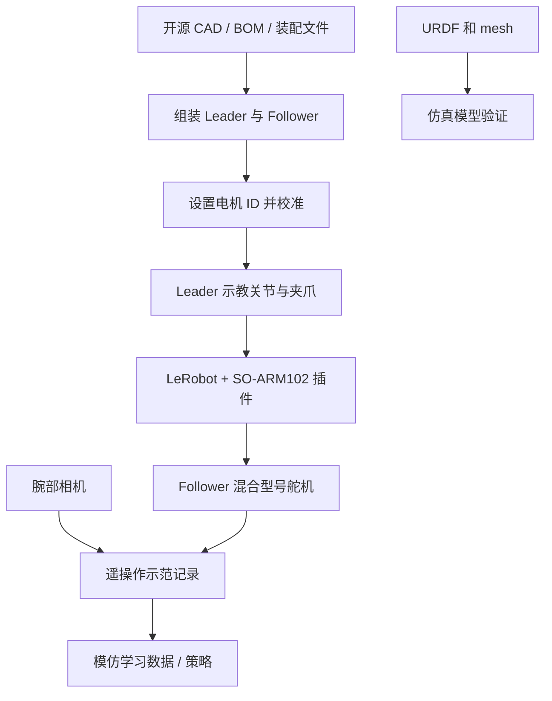
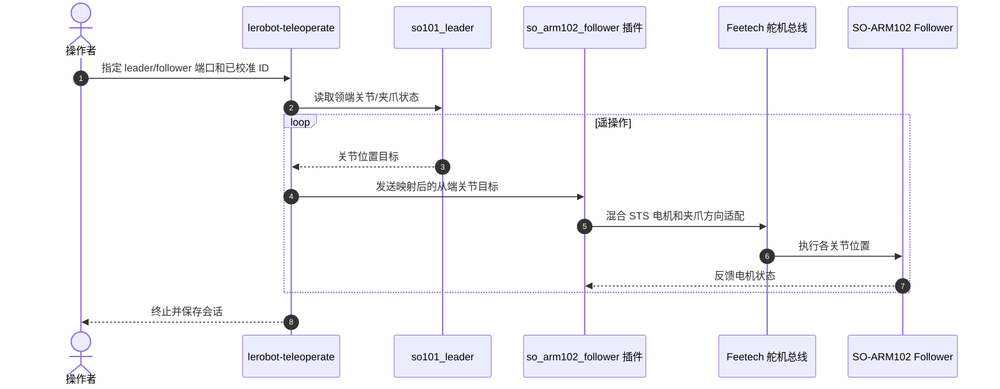

# SO-ARM102：面向遥操作与模仿学习的开源领从机械臂 / SO-ARM 102 Open-Source Leader–Follower Robot Arm Kit

## 一句话定义

SO-ARM102 是 Robonine 开源的机械臂领从套件，每个机械臂有 5 个关节自由度与 1 个夹爪自由度，用于遥操作数据采集和模仿学习的硬件实验。

## 英文缩写速查

| 缩写 | 英文全称 | 简要说明 |
|---|---|---|
| DOF | Degree of Freedom | 机械臂关节和夹爪自由度 |
| BOM | Bill of Materials | 零件、舵机、控制器及成本物料清单 |
| URDF | Unified Robot Description Format | 机械臂链节与关节模型 |
| PET-CF | Polyethylene Terephthalate–Carbon Fiber | 加强结构件所用打印材料 |

## 核心信息

| 项 | 资料 |
|---|---|
| 官方入口 | [项目或论文](https://github.com/roboninecom/SO-ARM102) |
| 官方源码 | [GitHub](https://github.com/roboninecom/SO-ARM102) |
| 开放程度 | 官方代码/资料可访问，详见归档与许可边界 |
| 本次检查 | 2026-11-23，一手材料静态核对，未独立复现 |

## 为什么重要

可重复的遥操作演示依赖机械臂自身刚度、夹爪几何、校准及软件兼容性。SO-ARM102 在 SO-ARM101 家族基础上强调平行夹爪与结构增强，但仍须在相同条件下验证性能和负载。

## 核心机制

1. 3MF / STL / STEP 和装配手册定义领端、从端机械结构及平行夹爪。
2. 独立 LeRobot 插件 `SO-ARM-102-Lerobot` 为从端定义混合 STS3235、STS3250、STS3215 电机及夹爪方向。
3. 分别校准 leader 和 follower，在 `lerobot-teleoperate` 读取领端角度并控制从端，支持单臂或双臂。
4. 采集动作与相机数据后，可接 LeRobot 模仿学习工具链；`simulation/urdf/` 提供机器人描述。

## 流程总览

## 源码运行时序图

依据仓库 README、官方可运行入口及相应模块文件编写；仅核对静态源码，未声称已执行训练或真机运行。

## 项目资料与能力边界

| 维度 | 官方资料 |
|---|---|
| 构型 | 单臂 5 DOF + 1 夹爪；领从单对或双对 |
| 夹爪 | 平行夹爪，标称开口约 85 mm |
| 结构挠度 | 官方 300 g 测试：SO-ARM101 7.5 mm，102 为 3.4–3.9 mm；材料不同 |
| 额定负载 | 项目报告 150 g → 300 g；非独立实验 |
| 许可 | 硬件 CERN-OHL-P-2.0；软件 Apache-2.0；文档 CC BY 4.0 |

## 结论

**SO-ARM102 是 Robonine 开源的机械臂领从套件，每个机械臂有 5 个关节自由度与 1 个夹爪自由度，用于遥操作数据采集和模仿学习的硬件实验；使用时必须区分作者报告和可独立复现的验证结果。**

1. 先核对领端 5V、从端 12V，不可对调电源。
2. 不要把不同材料打印的刚度对比当作完全控制变量的实验。
3. LeRobot 插件与硬件仓库维护独立，安装时核对插件最新兼容版本。

## 工程实践

官方硬件仓库包含 `models/3mf/`、`models/stl/`、`models/step/`、装配文档和 `simulation/urdf/`。LeRobot 插件 [SO-ARM-102-Lerobot](https://github.com/roboninecom/SO-ARM-102-Lerobot) 提供 `lerobot-setup-motors`、`lerobot-calibrate`、`lerobot-teleoperate` 命令；插件 README 示例版本 0.1.0a3，硬件仓库文档仍列 0.1.0a1，应核对兼容性而非混装。

## 与其他工具对比

| 系列 | 夹爪和硬件侧重点 | 备注 |
|---|---|---|
| SO-ARM101 | 早期角度开合夹爪与标准 LeRobot 支持 | 用作对照基线 |
| SO-ARM102 | 平行夹爪、PET-CF 框架和混合舵机 | 需要独立 follower 插件 |

## 局限与风险

电压错误会伤害舵机；装配、打印材料、关节负载和标定会改变精度。标称速度为舵机空载指标；官方强度/负载实验并非独立第三方认证。

## 关联页面

- [相关知识与路线](../tasks/teleoperation.md)
- [相关知识与路线](../tasks/manipulation.md)
- [相关知识与路线](../methods/imitation-learning.md)
- [相关知识与路线](../concepts/motion-retargeting.md)
- [相关知识与路线](../../roadmap/depth-teleoperation.md)

## 参考来源

- [原始资料归档](../../sources/repos/so-arm102-robonine.md)

## 推荐继续阅读

- [SO-ARM102 硬件与装配](https://github.com/roboninecom/SO-ARM102)
- [独立 LeRobot 插件](https://github.com/roboninecom/SO-ARM-102-Lerobot)
