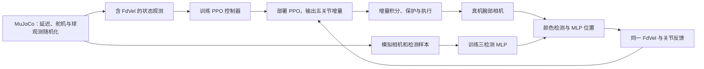
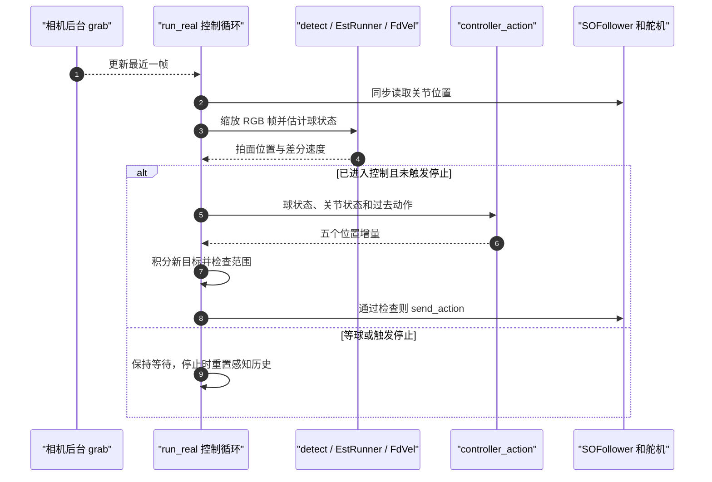

# SO-101 Ping-Pong Ball Balancing · SO-101 持拍平衡乒乓球

## 一句话定义

用 MuJoCo 训练的 PPO 控制器，通过腕部相机和关节读数调整球拍姿态，让 SO-101 把已经放到拍面上的乒乓球拉回中心。

## 英文缩写速查

| 缩写 | 英文全称 | 简要说明 |
|---|---|---|
| PPO | Proximal Policy Optimization | 仿真中训练关节增量策略 |
| MLP | Multilayer Perceptron | 三帧检测到拍面球位置的估计器 |
| DR | Domain Randomization | 随机化控制延迟、舵机响应及观测 |
| FPS | Frames Per Second | 腕部相机的请求帧率，不代表每个控制周期都有新帧 |

## 为什么重要

这里影响迁移的不只是画面像不像真机，还有状态估计的误差和延迟。作者报告用理想球速训练的策略无法直接接受实际相机差分球速；最后保留可解释的颜色检测器，让训练与部署共用速度滤波，而不是更换策略网络。

## 核心原理与流程总览

- **策略训练：** 以 30 Hz 控制周期在 MuJoCo 随机 0–4 个额外周期的指令延迟（约 0–133 ms），随机化舵机增益和球位置观测误差，并把最近三步动作作为观测的一部分。默认 24 个并行环境，每轮 3,072 个样本；约 2,900 万步、两小时是作者在六个 CPU 核加 RTX A1000 的 PPO 训练报告，不包含估计器训练。
- **感知通道：** 640×480 图像缩至 128×96；颜色检测输出橙球坐标、大小与可见性。小 MLP 输入最近 3 次检测，部署只用拍面位置输出，速度由 FdVel 从相邻位置差分后低通。MLP 的速度输出只作为训练辅助目标。
- **控制：** 球状态、相对关节状态与动作历史进入 PPO；输出五个归一化增量，缩放并加到当前关节目标，而非直接输出绝对角或控制夹爪。大幅偏离或丢球时进入保持等待。

## 源码运行时序图

此图依据固定提交的实际模块。源码复用的 FdVel 通过 4 项合成断言，覆盖首帧、速度响应、重复输入和重置；两个权重归档完整性检查通过。没有运行摄像头、PPO 权重或真机。

## 工程实践

建议先在模拟中把状态观测评估与相机观测评估分开，按同一组初始化和延迟分别报告。有条件再单独记录相机帧龄和控制迭代间隔：真机线程只保留最近一帧，而 FdVel 使用固定时间步，因此相机设为 30 FPS、循环目标 30 Hz，并不能证明每轮有一张新帧或没有超时。

## 实验与评测

| 作者披露 | 评测范围 |
|---|---|
| 97.5% | 随机化 MuJoCo 中 10 秒平衡；没有用检测器估计替换策略的球状态 |
| 113/120（94.2%） | 在模拟相机上接入完整检测、MLP 和速度差分后的仿真汇总 |
| 真机平衡演示 | README 给出视频，没有核验到带分母的 85.8% 真机成功率 |

源码的仿真成功条件还要求结束时球在中心 6 cm 内，不能简单理解为只要持续 10 秒未落地。

## 局限与风险

- 任务是持拍平衡已有球，不是抛接、连续颠球或对打。颜色阈值、装夹视角、相机延迟和水平初始姿态都可能影响结果。
- 同仓同时给出训练、评估和真机脚本，代码及发布权重采用 MIT；第三方机械臂资产和网格保留各自许可。笔记不托管权重。
- 真机脚本会自主运动并可在退出后保持上电，保持控制不等于切断扭矩。本次未上机。

## 关联页面

- [视觉伺服](../methods/visual-servoing.md)
- [PPO](../methods/ppo.md)
- [LeRobot](./lerobot.md)
- [SO-101 光照鲁棒性](./paper-so101-lighting.md)：可对照视觉条件变化，任务和评测不同。
- [域随机化选型](../queries/domain-randomization-guide.md)
- [Sim2Real 纵深：感知与视觉迁移](../../roadmap/depth-sim2real.md)

## 参考来源

- [固定版本、评估与源码核对](../../sources/repos/zecice-so101-pingpong-balance.md)

## 推荐继续阅读

- [作者 README](https://github.com/zecice/so101-pingpong-balance)
- [作者链接的真机演示](https://x.com/zecicc/status/2118380170662863229)
