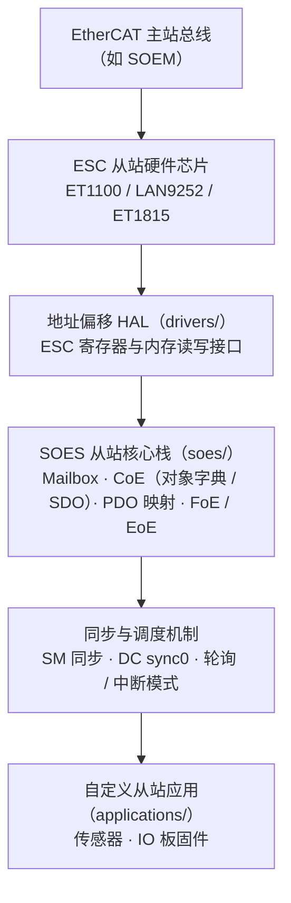
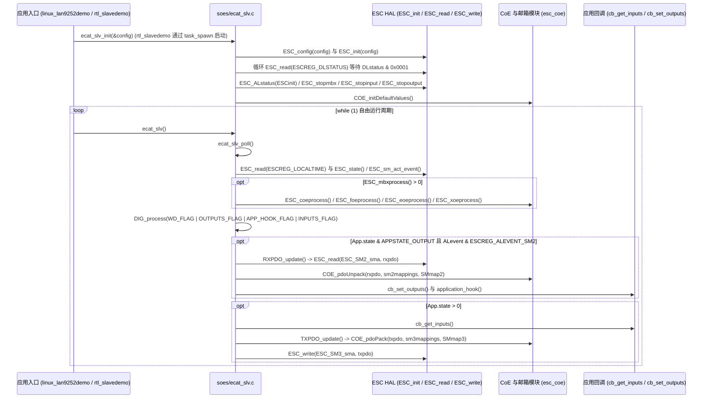

# SOES (Simple Open EtherCAT Slave)

## 一句话定义

与 SOEM 同组织的轻量开源 EtherCAT 从站协议栈，用于自制从站（传感器、IO 板）。（分类：EtherCAT 从站协议栈；语言/形态：C）

## 英文缩写速查

| 缩写 | 英文全称 | 简要说明 |
|------|----------|----------|
| ESC | EtherCAT Slave Controller | 从站硬件芯片（如 ET1100 / LAN9252 / ET1815） |
| EtherCAT | Ethernet for Control Automation Technology | 工业以太网现场总线 |
| CoE | CANopen over EtherCAT | 最常用的 EtherCAT 应用层协议 |

## 为什么重要

- 在 [EtherCAT 开源库清单](../overview/ethercat-opensource-libs-wechat.md) 中属于「从站协议栈」一栏，是机器人关节总线工具链的一环。
- 自研关节/传感器模块要接入 EtherCAT 总线时的开源从站起点；与商用 [Beckhoff SSC](./beckhoff-ssc.md) 构成「开源 vs 官方」选型。

## 核心原理

文章对该项目的描述（以下均为文章声明，未独立核查）：

- 语言：C；文章称是配套 SOEM 的同组织项目。
- 适配 ESC 芯片：ET1100、LAN9252、ET1815。
- 文章称 STM32 + LAN9252 组合非常常用，用于做自定义从站（传感器、IO 板）。
- 文章选型句：自己做硬件从站（薄膜传感器 IO 板）→ SOES + LAN9252。

### 架构流程图

## 工程实践

- 适用场景：自研关节/传感器模块要接入 EtherCAT 总线时的开源从站起点；与商用 [Beckhoff SSC](./beckhoff-ssc.md) 构成「开源 vs 官方」选型。
- 官方地址：<https://github.com/OpenEtherCATsociety/SOES>（文章给出，本次未独立打开核查）
- 协议背景见 [EtherCAT 协议基础](../concepts/ethercat-protocol.md)；主站实时调优见 [主站优化指南](../queries/ethercat-master-optimization.md)。

## 源码运行时序图

以下时序图基于仓库 `applications/linux_lan9252demo/main.c`、`applications/rtl_slavedemo/main.c` 与 `soes/ecat_slv.c` 源码整理，反映从站协议栈初始化与自由运行轮询周期的实际调用链。

## 局限与风险

- **开源状态：** 文章声明为公开仓库；**本次会话无法访问该仓库，开源程度/许可证未独立核查**，待后续按 ingest 步骤 2.5 补查。
- **推测/待核查：** SOEM 页已记载 SOES 为姊妹从站栈，两处一致；具体许可证与例程需读仓库（待核查）。
- EtherCAT 协议本身不开源，协议栈代码开源，ESC 硬件芯片需单独购买（文章避坑提醒）。

## 关联页面

- [MIT 模式模拟 CSP：前馈优先的内环整定与五关验证](../methods/mit-mode-csp-emulation-tuning.md) — 自研关节若以从站传输位置目标，CSP 与阻抗接口适配须在应用层另行实现，不能由协议栈名称推断。
- [Direct Force Feedback Control（直接力反馈控制）](../methods/direct-force-feedback-control.md) — 自定义传感器 IO 可作为力反馈数据通道，仍需补齐力标定、同步和控制律，通信通路不是力控制器。

- [soem](./soem.md)
- [beckhoff-ssc](./beckhoff-ssc.md)
- [ethercat-protocol](../concepts/ethercat-protocol.md)
- [ethercat-opensource-libs-wechat](../overview/ethercat-opensource-libs-wechat.md)

## 参考来源

- [sources/blogs/wechat_ethercat_opensource_libs_qt_adventure.md](../../sources/blogs/wechat_ethercat_opensource_libs_qt_adventure.md)
- [sources/raw/wechat_ethercat_opensource_libs_qt_adventure_2026-10-14.md](../../sources/raw/wechat_ethercat_opensource_libs_qt_adventure_2026-10-14.md)

## 推荐继续阅读

- EtherCAT Technology Group：<https://www.ethercat.org/>
- 文章原文：<https://mp.weixin.qq.com/s/C34QLsVb7Sd-GlvPvQlGKQ>
