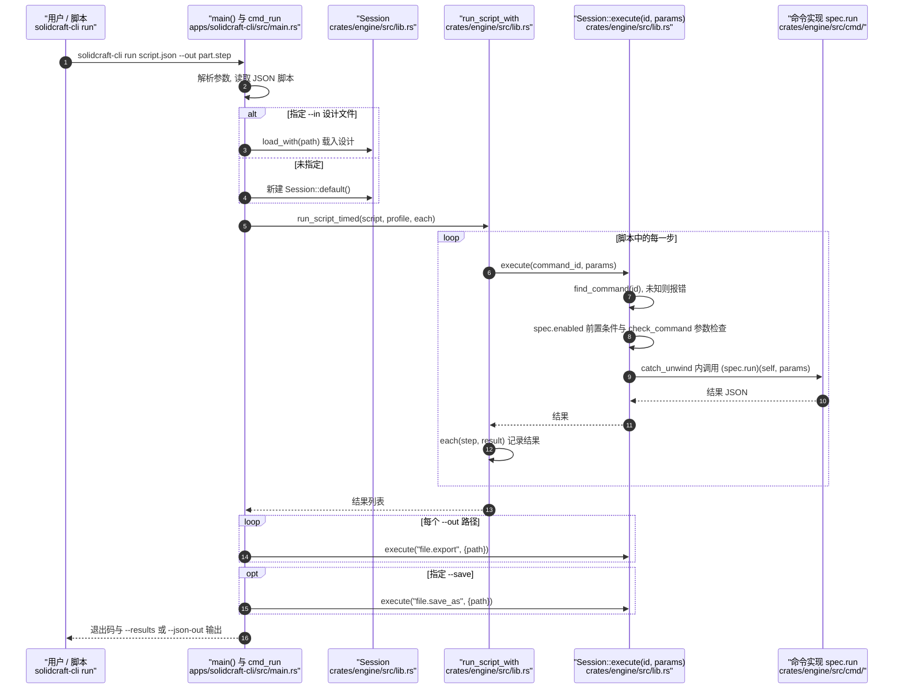

# SolidCraft（Rust 参数化 CAD）

**一句话定义**：SolidCraft 是一款用 Rust 构建的开源参数化 3D CAD，用户可绘制并约束草图、添加实体特征，再通过修改尺寸驱动时间线重建模型。

## 英文缩写速查

| 缩写 | 英文全称 | 简要说明 |
|------|----------|----------|
| CAD | Computer-Aided Design | 计算机辅助设计；本页讨论其参数化 3D 建模用途 |
| GUI | Graphical User Interface | 图形界面；SolidCraft 桌面版与浏览器版均可交互建模 |
| CLI | Command-Line Interface | 命令行接口；SolidCraft 提供无头命令脚本执行入口 |
| MCP | Model Context Protocol | 供 AI agent 通过统一命令接口驱动建模的协议 |
| WASM | WebAssembly | 浏览器应用的运行目标，可使用 WebGPU 或 WebGL2 |

## 为什么重要

机器人硬件设计常需要快速试制支架、外壳、夹具和连接件。SolidCraft 把参数化草图与特征时间线放在可直接打开的浏览器应用中，降低了试用门槛；命令接口还使同一建模能力可由 GUI、脚本、CLI 和 MCP 调用，适合探索可复现或 agent 辅助的 CAD 工作流。

它属于机器人几何设计链路的上游工具。几何模型进入仿真仍需处理坐标、质量与惯量、碰撞几何、连杆和关节等信息。

## 核心原理

### 草图约束与特征时间线

典型操作是在平面上创建轮廓，添加几何约束和尺寸，再将草图转为实体特征。特征按时间线保存；改变草图尺寸或参数后，系统按依赖关系重新构建后续特征。这样可用少量参数维护零件的尺寸关系和设计变体。

### 多入口共用命令

官方文档说明，用户操作被建模为带 JSON 参数的命令。工具栏、对话框、脚本、CLI、控制通道和 MCP 使用同一套命令，因此交互操作原则上也可脚本化、测试或交给 agent 执行。

### 跨端运行

SolidCraft 提供桌面应用、WebAssembly 浏览器应用和无头 CLI；桌面版基于 egui + wgpu，浏览器版支持 WebGPU 或 WebGL2。官方文档还列出用于 AI agent 建模的 MCP 服务。

## 工程实践

| 使用场景 | 可尝试的工作流 | 需要复核 |
|---|---|---|
| 浏览器快速建模 | 打开[在线应用](https://bherbruck.github.io/solidcraft/app/)，新建设计，绘制并约束草图，再逐步加入实体特征 | 浏览器图形接口、目标设备性能与应用当前功能范围 |
| 参数化零件变体 | 将孔距、板厚、外壳尺寸等设计变量放入草图/特征参数，修改后检查时间线重建结果 | 特征依赖、边界条件和变更后几何有效性 |
| 自动化或 agent 工作流 | 先通过 GUI 熟悉操作，再按官方命令参考使用 CLI/MCP | 工具处于早期阶段；脚本需检查执行结果与导出物 |
| 进入机器人仿真 | 将几何交给下游网格/机器人描述流程 | SolidCraft 几何不能代替 URDF/MJCF 中的坐标、质量惯量、关节及碰撞语义 |

## 与其他 CAD 工具的边界

- [FreeCAD](./freecad.md) 面向成熟的制造级 B-rep、STEP、装配和工程工作流；SolidCraft 提供 Rust 实现与浏览器入口，但功能范围仍在发展。
- [OpenSCAD](./openscad.md) 以脚本直接描述几何；SolidCraft 采用草图约束和特征时间线，并将同一命令系统暴露给 GUI、CLI 与 MCP。
- SolidCraft 官方列出的早期功能包括草图、实体建模、参数、带关节组件、钣金和塑料外壳子集；曲面、工程图、CAM 与仿真为规划功能。选型时按目标功能逐项核对官方清单。

## 局限与风险

- 项目文档将软件标为 early；上述功能和格式以当前发布版及官方功能清单为准。
- 官方路线图将曲面、工程图、CAM 和仿真列为延后工作，因此不要只凭“3D CAD”定位推断它已覆盖完整机械设计和制造链路。
- 参数化几何仍需进行工程审查：检查约束是否充分、薄壁/干涉等几何是否有效，以及尺寸和装配是否满足实际工况。
- 导出几何进入机器人仿真时，仍需单独维护机器人描述所需的坐标系、质量惯量、碰撞体、关节和接触参数。

## 源码运行时序图

入口：`solidcraft-cli run <脚本或设计文件> --out <输出文件>`（`apps/solidcraft-cli/src/main.rs` 的 `main()` 调用 `cmd_run`）。脚本的每一步都是引擎命令 id 加 JSON 参数，经 `Session::execute` 分发，与桌面应用和 MCP 服务器共用同一套命令注册表。下图只画无界面的脚本执行路径；MCP 服务器（`crates/mcp`）的请求分发未读，未画入。

图依据：bherbruck/solidcraft@6bca7d2，读过 `README.md`（开头部分）、`apps/solidcraft-cli/src/main.rs`（`main` 的命令分发、`cmd_run` 中的脚本执行与 `--out`、`--save` 处理、`load_with`）、`crates/engine/src/lib.rs`（`run_script`、`run_script_timed`、`run_script_with` 的步骤循环、`execute` 的查找与前置检查分支）、`crates/engine/src/cmd/script.rs`（`script_steps`，仅看到函数签名）。命令实现 `crates/engine/src/cmd/` 的具体内容未读；`check_command` 与 `catch_unwind` 的细节只依据分支概括。未运行代码。

## 关联页面

- [FreeCAD（开源参数化机械 CAD）](./freecad.md) — 对照成熟 B-rep、STEP 与工程化工作流。
- [OpenSCAD（脚本化参数 CAD）](./openscad.md) — 对照代码驱动的参数化几何建模。
- [URDF（统一机器人描述格式）](../concepts/urdf-robot-description.md) — 了解几何资产进入机器人描述/仿真的后续步骤。

## 参考来源

- [SolidCraft 官方项目页与使用文档](../../sources/sites/solidcraft.md)
- [SolidCraft 官方源码仓库归档](../../sources/repos/solidcraft.md)
- [SolidCraft 官方 README](https://github.com/bherbruck/solidcraft/blob/main/README.md)
- 源码核对（2026-11-02）：bherbruck/solidcraft@6bca7d2，读过 README.md、apps/solidcraft-cli/src/main.rs、crates/engine/src/lib.rs、crates/engine/src/cmd/script.rs；时序图依据以上文件，未运行代码。

## 推荐继续阅读

- [SolidCraft 在线应用](https://bherbruck.github.io/solidcraft/app/) — 无需桌面安装即可体验浏览器端 CAD。
- [SolidCraft 官方指南](https://bherbruck.github.io/solidcraft/) — 用户指南、开发者指南、命令参考与功能状态。
- [SolidCraft 官方仓库](https://github.com/bherbruck/solidcraft) — 源码、发行版、路线图和功能清单。
