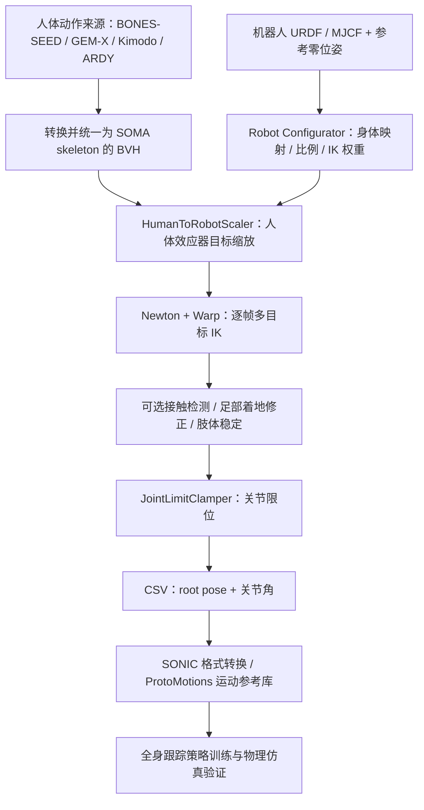
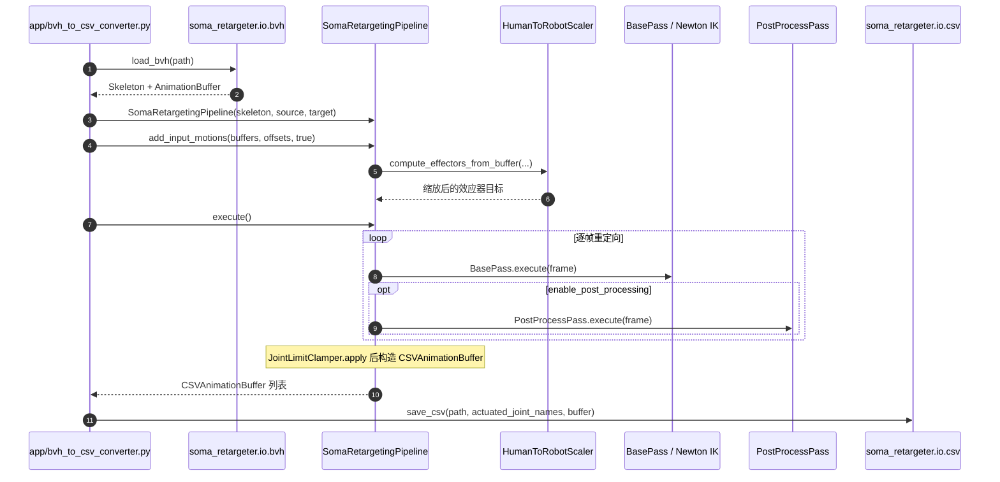

# SOMA Retargeter｜NVIDIA 人体运动到人形机器人的重定向工具

## 一句话定义

**SOMA Retargeter** 是 [NVIDIA 开源工具](https://github.com/NVIDIA/soma-retargeter)，将 SOMA 骨架的 **BVH 人体动作**，按目标人形机器人的身体比例、关节结构与活动范围转换成**根部位姿和关节角 CSV 参考轨迹**。v0.2 采用 [Newton](./newton-physics.md) + NVIDIA Warp IK，可交互调整机体配置并批处理运动集合；这些轨迹还不是可直接上机的闭环控制策略。

## 英文缩写速查

| 缩写 | 英文全称 | 简要说明 |
|------|----------|----------|
| BVH | Biovision Hierarchy | 输入的 SOMA 兼容骨架动画格式 |
| IK | Inverse Kinematics | 按人体目标求机器人关节位姿的逆运动学 |
| CSV | Comma-Separated Values | 导出的根部位姿和关节角逐帧轨迹 |
| URDF | Unified Robot Description Format | 为新机器人提供的可选机器人描述 |
| MJCF | MuJoCo Model Format | 另一种可由配置器导入的机器人描述 |

## 为什么重要

- **人体动作→机体参考**：动捕 BONES-SEED、单目恢复 [GEM-X](https://github.com/NVlabs/GEM-X) 和 [Kimodo](./kimodo.md)/ARDY 的动作须先落到统一 SOMA skeleton；机器人比例、零位姿和关节限制不同，不能直接复刻人体关节角。
- **跨机型而非仅 G1**：官方 **v0.2（2026-11-13 博客）**提供 Unitree G1、Unitree H2、Booster T1、AgiBot X2 Ultra 和 AgiBot A3T3 五种配置与匹配结果，也支持通过 Robot Configurator 增加机器人。
- **从一次调参到批量资产**：用 Viewer 检查少量代表性动作，修订配置和 IK 权重，然后 headless 批量转换，供 [ProtoMotions](./protomotions.md)、SONIC 或自研全身跟踪（WBT）训练。

## 流程总览

以下为官方技术博客与 v0.2 源码所支持的主干流程；接触修正属于**可配置后处理**，并非所有运行都自动启用。



## 源码运行时序图

官方可执行入口 `app/bvh_to_csv_converter.py` 在交互模式经 `Viewer.retarget_motion` 发起重定向；无界面模式走 `Viewer.batched_retargeting`，两者最终共用 `SomaRetargetingPipeline`。以下只呈现核对过的主要调用关系。



源码核对：[转换器入口](https://github.com/NVIDIA/soma-retargeter/blob/v0.2.0/app/bvh_to_csv_converter.py) 与 [SomaRetargetingPipeline](https://github.com/NVIDIA/soma-retargeter/blob/v0.2.0/soma_retargeter/pipelines/soma_retargeting_pipeline.py)；实际程序中接触检测和修正行为由机器人配置控制。

## 工程实践

### 运行与机体配置

1. 按官方 [安装文档](https://github.com/NVIDIA/soma-retargeter/blob/v0.2.0/documentation/installation.md) 准备环境后，从仓库根目录启动交互 Viewer：

   ```bash
   uv run python app/bvh_to_csv_converter.py --config assets/default_bvh_to_csv_converter_config.json --viewer gl
   ```

2. 用官方示例 `assets/motions/bvh/Neutral_walk_forward_002__A057.bvh` 先对 Unitree G1 做重定向，检查脚部接触、转向和动作首末帧，再保存 CSV。自定义 URDF/MJCF 机体可运行 `uv run python app/tools/robot_config_generator.py --viewer gl` 建立比例、零位姿、关键部位对应和配置；代表性动作上可尝试实验性 IK weight optimizer。
3. 确认单动作后按 [批处理文档](https://github.com/NVIDIA/soma-retargeter/blob/v0.2.0/documentation/batch-retargeting.md) 创建本地 JSON 配置，执行 `uv run python app/bvh_to_csv_converter.py --config local-configs/batch-retargeting.json`；不要把文档的示例 JSON 直接当作内置机型的准确配置，同批 BVH 需匹配 SOMA 骨架。
4. **CSV 格式注意**：根平移用 **cm**，root XYZ 欧拉角及驱动关节角用**度**，不同机体列名与顺序不同；CSV 不自带 FPS，工具自带 CSV loader 默认为 **120 FPS**。下游训练应核对采样率、关节次序与坐标约定。

### 开源与下游

- **已公开**：Apache-2.0 的 NVIDIA 工具源码、交互和批处理入口、5 种机器人配置、BONES-SEED 示例动作及参考 CSV。**样例运动数据另适用 NVIDIA Sample Data Evaluation License**，第三方机器人资产也按原始许可证使用，不可把整个仓库统称为 Apache-2.0 数据集。
- **下游职责**：SONIC 的 G1 SOMA CSV 转换器可接 motion library；[ProtoMotions](./protomotions.md) 也可用于基于物理仿真的动作跟踪。重定向解决几何匹配，策略训练负责在闭环下跟踪；上机前仍需仿真检查平衡、接触、执行器限值与跟踪误差。

## 局限

- 输入要求 **SOMA base skeleton**，非 SOMA 的 BVH 或 SMPL-X 数据需先做骨架表示对齐；不同机器人共用的 CSV 列位置不能直接互换。
- 官方 Robot Configurator 文档说明**高自由度灵巧手目前不支持**，建议新机体使用截至腕/掌的简化描述。
- 可选足部着地修正降低参考脚滑，但不会自动给出动力学可行的执行轨迹；仍需 [WBT](../concepts/whole-body-tracking-pipeline.md) 或其他闭环策略及 Sim2Real 验证。
- 处于活跃 beta 阶段，接口、依赖与默认配置可能变化；示例结果不代表所有体型、动作或真实硬件可成功执行。

## 关联页面

- [SOMA-X](./soma-x.md) — 上游统一人体表示
- [Motion Retargeting](../concepts/motion-retargeting.md) — 方法与评价标准
- [动作重定向纵深路线 Stage 4](../../roadmap/depth-motion-retargeting.md) — 工具链所在学习阶段
- [GMR](../methods/motion-retargeting-gmr.md) — 几何重定向方案比较
- [ProtoMotions](./protomotions.md) — 下游动作跟踪训练
- [Unitree G1](./unitree-g1.md) — 官方首个上手示例
- [CoRe v0.1.0](./paper-core.md) — SOMA 生态相关多机体接触精炼方法
- [robot_retargeter](./robot-retargeter.md) — SMPL-X/LAFAN1 CSV 与 mink IK 的另一种工具链

## 参考来源

- [NVIDIA 官方技术博客，2026-11-13](../../sources/blogs/nvidia_soma_retargeter_2026_11_13.md)
- [SOMA Retargeter v0.2 源码与文档归档](../../sources/repos/soma_retargeter.md)
- [NVlabs/SOMA-X 仓库归档](../../sources/repos/nvlabs-soma-x.md)
- [GENMO 论文归档中的 NVIDIA 生态互链](../../sources/papers/genmo.md)

## 推荐继续阅读

- [NVIDIA: Adapt Human Motion for Robots with SOMA Retargeter](https://developer.nvidia.com/blog/adapt-human-motion-for-robots-with-nvidia-soma-retargeter/)
- [NVIDIA/soma-retargeter 官方仓库](https://github.com/NVIDIA/soma-retargeter)
- [Robot Configurator 官方实战文档](https://github.com/NVIDIA/soma-retargeter/blob/v0.2.0/documentation/robot-configurator.md)
- [BONES-SEED 人体动作数据集](https://huggingface.co/datasets/bones-studio/seed)
