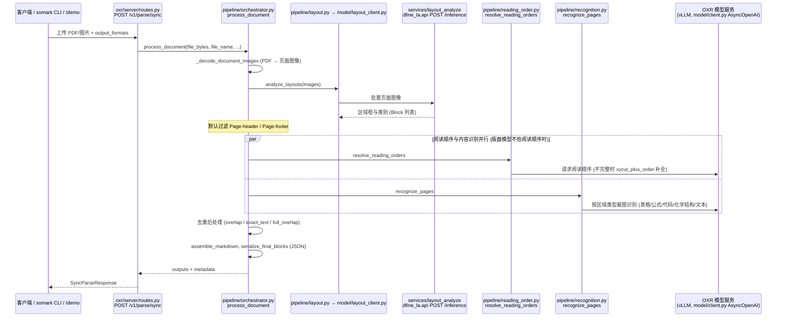

# OXR

OXR 是 SoMark 的文档解析模型，将 PDF 和文档图像转换为包含版面坐标的 Markdown 或 JSON，可用于资料整理。

## 英文缩写速查

| 缩写 | 英文全称 | 简要说明 |
|------|----------|----------|
| OXR | Optical Everything Recognition | 项目名称 |
| RSI | Recursive Self-Improvement | 递归自改进，官方用于后训练 |
| OCR | Optical Character Recognition | 光学字符识别 |
| PDF | Portable Document Format | 文档输入格式 |

## 核心机制

系统将版面分析与 OXR 识别分开：前者检测文档区域，可按场景替换；后者负责内容识别和阅读顺序。官方称模型有 1.3B 参数，可识别表格、公式、代码和化学结构等 13 类元素，并在后训练中针对表现薄弱的样本进行 RSI 迭代。

作者报告其在 olmOCR-Bench、OmniDocBench 和 DocParsingBench 上领先；具体比较范围、版本与评测方法应参考[官方基准说明](https://github.com/SoMarkAI/OXR/blob/main/docs/benchmark.md)，不应将作者报告视为独立验证。

## 工程实践与局限

| 项目 | 内容 |
|------|------|
| 机构 | SoMark |
| 代码与权重 | [官方仓库](https://github.com/SoMarkAI/OXR)及 [Hugging Face 权重](https://huggingface.co/SoMarkAI/OXR-1.0)公开；完整训练代码和数据开放情况尚未核实 |
| 部署 | 官方低并发本地测试建议支持 BF16 的 NVIDIA GPU、24 GB 显存；应结合自身文档实测 |
| 在线体验 | [Demo](https://free-oxr.somark.cn/)；[免费 API](https://free-oxr.somark.cn/api/v1) 不保证稳定性，官方不建议用于生产 |
| 许可 | 项目采用基于 Apache 2.0 附加条款的自定义许可；使用前应分别核对代码与权重的条款 |
| 质量控制 | 入库前应抽查公式、表格、阅读顺序及坐标；技术报告截至入库时尚待发布 |

与 [Unlimited OCR Works 2](./unlimited-ocr-2.md) 选型时，应在同一批目标文档上比较表格、跨页顺序及部署成本，而非直接对比不同基准结果。

## 源码运行时序图

入口：`oxr serve --config config.yaml --host 127.0.0.1 --port 8000 --workers 1`（`oxr/cli/main.py` → `cmd_serve.serve` → uvicorn 启动 `oxr/server/app.py`）；另需先起两个模型服务：`services/oxr/start_vllm.sh`（OXR 识别模型，端口 8080）与 `python -m uvicorn dfine_la.api:app`（版面分析，端口 8081）。也可用 `docker/Dockerfile.allinone` 一键启动。

图依据：SoMarkAI/OXR@c1a1dcb，读过 README.md、oxr/cli/main.py、oxr/cli/cmd_serve.py（前段）、oxr/server/app.py（grep）、oxr/server/routes.py、oxr/pipeline/orchestrator.py、oxr/pipeline/layout.py（grep）、oxr/pipeline/recognition.py（grep）、oxr/pipeline/reading_order.py（grep）、oxr/model/client.py（grep）、oxr/model/layout_client.py（grep）、services/layout_analyze/dfine_la/api.py（grep）。

## 关联页面

- [Unlimited OCR Works 2](./unlimited-ocr-2.md)
- [TeleOCR](./paper-teleocr.md)
- [LLM Wiki](../references/llm-wiki-karpathy.md)

## 参考来源

- [OXR 官方仓库归档](../../sources/repos/somark-oxr.md)
- 源码核对（2026-11-02）：SoMarkAI/OXR@c1a1dcb，读过 README.md、oxr/cli/main.py、oxr/cli/cmd_serve.py、oxr/server/app.py、oxr/server/routes.py、oxr/pipeline/orchestrator.py、oxr/pipeline/layout.py、oxr/pipeline/recognition.py、oxr/pipeline/reading_order.py、oxr/model/client.py、oxr/model/layout_client.py、services/layout_analyze/dfine_la/api.py（部分文件仅读入口与调用行）；时序图依据以上文件，未运行代码。

## 推荐继续阅读

- [OXR 官方仓库](https://github.com/SoMarkAI/OXR)
- [模型卡](https://huggingface.co/SoMarkAI/OXR-1.0)
