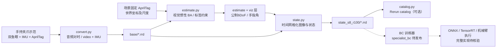
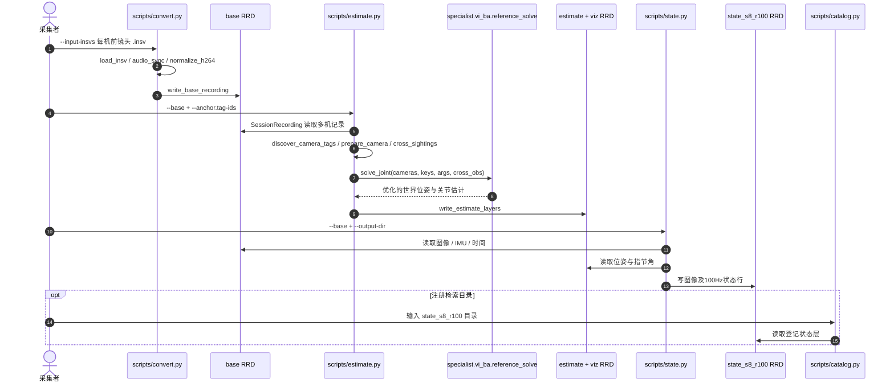

# Specialist：手持夹爪与视觉惯性重建的 UMI 采集系统

**Specialist**（*Specialist: Yet Another Universal Manipulator Interface*，**Specialist：另一种通用机器人操作接口**）是加利福尼亚大学伯克利分校（UC Berkeley）研究项目。官方公开[项目主页](https://specialist-ai.github.io/)、[装配文档](https://specialist-ai.github.io/specialist-docs/)和多个[源码仓库](https://github.com/specialist-ai)，但当前**尚不能据此宣称全栈训练至真机部署均已公开**。

## 一句话定义

用带有 Insta360 双鱼眼相机和 AprilTag 的便携手持夹爪在**没有机器人在场**的情况下采集操作演示，再经视觉惯性因子图重建夹爪公制 6DoF 轨迹与开合角，供具有匹配末端执行器的机器人模仿学习。

## 英文缩写速查

| 缩写 | 英文全称 | 简要说明 |
|---|---|---|
| UMI | Universal Manipulation Interface | 无机器人在场采集可迁移的操作示范 |
| 6DoF | Six Degrees of Freedom | 夹爪位置三自由度 + 姿态三自由度 |
| IMU | Inertial Measurement Unit | 加速度与角速度测量，用于视觉惯性优化 |
| VI-BA | Visual-Inertial Bundle Adjustment | 联合相机、惯性、标签重投影的因子图优化 |
| URDF / MJCF | Unified Robot Description Format / MuJoCo Model Format | 手持与驱动夹爪的机器人模型文件 |
| BC | Behavior Cloning | 将示范状态与动作映射为策略；对应训练仓库仍待发布 |
| RRD | Rerun Recording Data | 视觉、轨迹与策略状态的分层录制文件 |

## 为什么重要

- **低机器人占用成本：** 人直接持夹爪示范，离线处理而非持续让机械臂跟随，可在真实工作环境收集样本。
- **主动匹配末端：** 被动采集夹爪与主动执行夹爪共享手指运动学和相机安装关系，官方据此希望减少后续 retargeting，但并非证明可跨任意平台无校准部署。
- **可复查的数据处理：** 图像、IMU、AprilTag、多夹爪跨视角观测进入统一重建器，再以独立状态层导出；便于追溯采集与重建误差。

## 核心原理

### 采集硬件与场景

| 部分 | 官方构成 / 作用 |
|---|---|
| 手持夹爪 | 3D 打印件、弹簧、标记、Insta360 X3；用户手动开合 |
| 主动夹爪 | 同构手指、STS3215 舵机、相机；控制用 `specialist_sdk` |
| 标签 | 夹爪刚体与指节的 AprilTag + 墙面/天花板固定锚点；后者限定世界坐标系和公制尺度 |
| 相机 | 双背靠背鱼眼；一个视角看操作任务，另一视角捕捉固定标签与自体标记 |
| 时间同步 | 多机采集可利用录音同步；可用手势界定有效示范片段 |

### 离线重建和训练接口

`specialist` 主仓经 `convert.py` 将多机双镜头视频、IMU 和标定数据构成基础记录；`estimate.py` 基于 GTSAM 视觉惯性 BA（包括图像特征、IMU 预积分、AprilTag 角点重投影、跨夹爪观测）优化运动轨迹及指节角；`state.py` 从基础层与估计层导出按时序对齐的图像、位姿、速度及夹爪角度，供尚待发布的 BC 训练器读取。

注意 `f_row=100` 是导出状态行频率，不是相机原始拍摄帧率。默认 `--scale 8` 对应主仓 README 的 360×360 后镜头图像。

## 流程总览

以下仅画官方可追溯数据流；**训练与执行段用待发布边界标注，不臆造内部算法**。

## 源码运行时序图

基于已读取的实际入口 `scripts/convert.py`、`estimate.py`、`state.py` 及仓库 README；**不把官方未发布的训练器伪装成可运行代码**。

## 工程实践

1. **装配与标定：** 按[官方 BOM](https://specialist-ai.github.io/specialist-docs/bom/)及[Scene](https://specialist-ai.github.io/specialist-docs/scene/)固定 AprilTag 锚点，确认左右夹爪标签 ID 唯一、夹爪模型与真实安装一致。
2. **生成基础层：** `uv sync`，运行 `uv run python scripts/convert.py --input-insvs <camera0_00.insv> <camera1_00.insv> --output-dir logs`，自动同步同场录制。对单机可传一个输入。
3. **估计：** `uv run python scripts/estimate.py --base logs/base/<session-id>.rrd --anchor.tag-ids <id> --output-dir logs`；需要 Linux GPU、GTSAM 及 C++ 编译环境，且 anchor ID 与实际布置对应。
4. **生成训练状态：** `uv run python scripts/state.py --base logs/base/<session-id>.rrd --output-dir logs`，输出默认 `state_s8_r100`；可用 `catalog.py` 注册 Rerun 数据集。
5. **版本差异：** 官方网页 Dataset 文档提到 `--session-id`、`state_s12_r100`，但当前仓库主分支 `convert.py` 不提供该参数，`state.py` 默认 `scale=8`。**以实际 checkout 的脚本帮助和源码为准**。

## 局限与风险

- **开源边界：** `specialist_description`、`specialist`、`specialist_sdk`、`feetech_driver`、`insta360_driver` 已公开；官方组织 README 仍将 `specialist_bc`、`specialist_lerobot` 标为 *coming soon*；`specialist_sim` 和 `specialist_arm` 链接检查时不可访问。论文同样 *coming soon*。故目前没有经过独立核验的**从演示训练到真机部署**端到端开源复现。
- **位姿基准依赖：** 锚点遮挡、标签误检、IMU/视频时钟偏差和多机音频同步歧义会影响重建；需要检查轨迹重投影和动态一致性。
- **动作监督边界：** 原始采集只记录位置姿态与开合，**不等于实测接触力/力矩标注**；网络训练的动作空间、归一化和控制频率仍需等待公开训练代码核实。
- **驱动安全：** `specialist_sdk` 明确不提供碰撞停滞检测或 command watchdog，须独立防夹伤和物理急停；Insta360 的厂商 SDK 二进制授权与开源部分有别。
- **验证范围：** 本次已读主仓数据入口与官方技术文档，**没有**本地 GPU 数据重建、训练、硬件装配或真机实测。所有部署效果均为官方方案方向，非独立验证结果。

## 关联页面

- [遥操作与示范数据采集](../tasks/teleoperation.md) — 手持 UMI 与 leader–follower/XR 的接口选型
- [模仿学习](../methods/imitation-learning.md) — 状态 / 动作示范如何成为 BC 训练样本
- [UMI-Live](paper-umi-live.md) — 对比两种无机器人采集的传感器与重建技术路线
- [HiFi-UMI](paper-hifi-umi.md) — 对比头戴多视角与手持夹爪采集路线

## 参考来源

- [官方项目、硬件与开放状态核验](../../sources/sites/specialist-ai.md)
- [官方数据管线源码精读与调用入口](../../sources/repos/specialist-ai-specialist.md)

## 推荐继续阅读

- [官方完整构建指南](https://specialist-ai.github.io/specialist-docs/)
- [GitHub 组织官方项目索引](https://github.com/specialist-ai/.github/blob/main/profile/README.md)
- [数据处理源码](https://github.com/specialist-ai/specialist)
