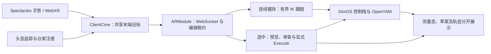
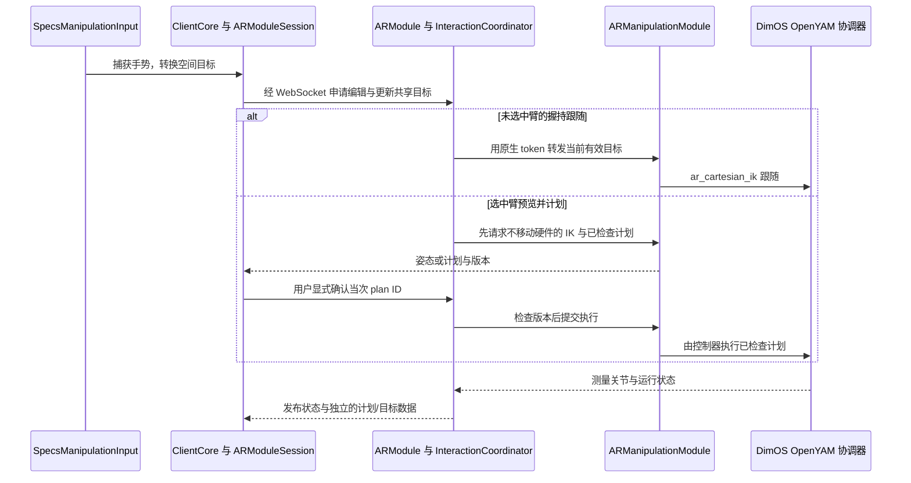

# Spectacles × Dimensional OS for OpenYAM Teleoperation｜用 AR 手势遥操作 OpenYAM 机械臂

## 一句话定义

> Snap Spectacles 用手势拖动 AR 末端目标，DimOS 在主机侧处理逆运动学、规划和执行授权，把目标变成 OpenYAM 的真实关节运动；眼镜不直接给电机发指令。

## 英文缩写速查

| 缩写 | 英文全称 | 简要说明 |
|---|---|---|
| AR | Augmented Reality | 把测量姿态、目标和轨迹叠加到实物附近 |
| IK | Inverse Kinematics | 从所需末端位姿求可用关节构型 |
| FK | Forward Kinematics | 从关节读数重建叠加的机械结构 |
| HMD | Head-Mounted Display | Snap Spectacles 和由 WebXR 支持的头显 |
| VPS | Visual Positioning System | 可配置的定位方式；不能假定当前演示使用它 |

## 为什么重要

这是一种操作员在场的机械臂接口，而不是自动策略。价值在于同一个视野内把手势目标、机器人实际姿势和待执行路径分开显示；渲染得流畅，不代表物理控制快或准确。

## 核心机制

1. **先注册坐标。** 原生 Lens 读取手势和追踪位姿，转换到 ClientCore，按注册关系得到地图或共享坐标中的目标。OpenYAM bench 默认使用固定底座与 AprilTag；标记到机械臂基座的相对位姿是配置输入，不能靠挪动虚拟模型代替标定。公开预设区分标签黑方块 56 mm 与完整纸面 70 mm。
2. **握持跟随和计划执行是两种动作路径。** 未选中臂时，抓住末端球可发送连续共享目标，由服务器持有原生控制 token，在 DimOS 协调器做有界 Cartesian IK。选中后移动虚拟把手可获取不驱动电机的 advisory IK；检查并确认轨迹后才按当前目标版本和对应 plan ID 执行。实时跟随不具备检查过的轨迹所提供的同等碰撞检查保证。
3. **反馈与所有权在服务端。** 共享目标由编辑租约管理，服务端转发原生跟随；过期或被替换的响应不能授权执行。正常松手可留下服务端的收尾动作，不等于立即停止。跟踪/连接丢失、停止、安全锁定和陈旧反馈各按运行时协议处理。
4. **显示和动作分离。** 反馈驱动的臂姿态、拖动目标、虚线导引与已检查路径不是同一种信息。显示插值和预测不会更新真实关节反馈，也不会授权运动。

## 工程实践

- 先固定版本：[公开 development 提交](https://github.com/V4C38/dimensional-os-ar/tree/9e0e103773cea967536534b528512e3c50e7be86) 与其 `.dimos-revision`。作者演示是 Spectacles Dev Kit；development 也有 Quest 3/3S 的 WebXR 客户端，两端共享协议但输入和渲染实现不同。
- 上游 OpenYAM 适配器说明 Linux SocketCAN 与 macOS 传输；**该 AR 项目的实臂操作指南明确以 Linux CAN 就绪为前提**，不要把通用主机/UI 支持写成所有实臂配置都获验证。源码提供官方模拟硬件入口，先验证注册、姿态方向、夹爪与运动授权，再做有人值守的台架验收。
- 建议分别记录头显采样到命令、命令到关节反馈两个延迟，静态对齐与动态跟随误差也分别报告。先验证失去追踪、断连和真正停止时的可见反馈，不用 overlay 动画确认停稳。

## 源码运行时序图

对应 [开发分支说明](../../sources/repos/spectacles-dimensional-os.md) 的 `openyam-ar-planner`，以及 Specs 原生输入和共享目标协议。

## 与其他工作对比

- [XRoboToolkit](paper-xrobotoolkit.md) 的重点是通用 XR 追踪流和跨本体遥操作；该项目的重点是让 AR 叠加共享 DimOS 的工作空间、授权和状态。
- [DimOS](dimensionalos-dimos.md) 提供运动与硬件能力；此项目提供 ARModule、Lens/WebXR 和交互生命周期，不把它当作 DimOS 自身的所有功能。
- 与 [运动重定向](../methods/motion-retargeting-gmr.md) 中的全身离线映射相比，它在线映射有限的手势控制目标，而不是从人体全身骨架转出关节轨迹。

## 局限与风险

- 作者演示表明实臂跟随，原帖没有外部测量的端到端延迟、对齐毫米误差、长期漂移统计或任务成功率。“几乎完美”不是可量化结论。
- 截至核验日期，公开 OpenYAM 实现来自 development，未看到 v2.0.0 标签；不要把稳定版 main 的描述和开发分支的能力混在一起。
- 638 项 ClientCore 测试只是 CPU 单元测试；未验证佩戴设备、真实标定、真机通信和安全停止。连续手势跟随不适合用视觉预览代替物理安全措施。

## 关联页面

- [遥操作](../tasks/teleoperation.md)：追踪、坐标映射、运动执行和反馈。
- [机器人操作](../tasks/manipulation.md)：末端目标、可达性和夹爪约束。
- [遥操作纵深 Stage 2](../../roadmap/depth-teleoperation.md)：从设备坐标到机器人目标与延迟评估。

## 参考来源

- [官方源码与运行入口](../../sources/repos/spectacles-dimensional-os.md)
- [作者原始 OpenYAM 演示](../../sources/sites/spectacles-openyam-demo.md)

## 推荐继续阅读

- 从 [AR Manipulation 指南](https://github.com/V4C38/dimensional-os-ar/blob/9e0e103773cea967536534b528512e3c50e7be86/dimos-ar/dimos/ar/manipulation/README.md) 核对预览、跟随、松手和 Stop 的不同生命周期。
