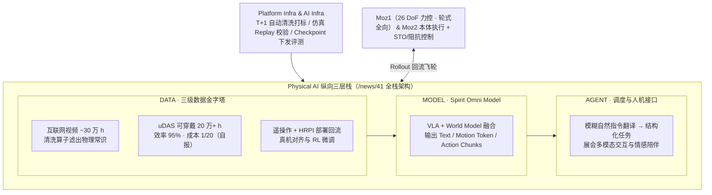

# 千寻智能（Spirit.AI）

**千寻智能（Spirit.AI / Spirit AI）** 是 2024 年 1 月成立的中国具身智能基础模型与机器人公司，由 CEO 韩峰涛与首席科学家高阳（清华大学交叉信息研究院助理教授）联合创立，围绕「**通用具身大脑 + 真实世界数据闭环（uDAS）+ 全力控人形本体（Moz1 / Moz2）**」推进全栈研发，并持续在 VLA 预训练多样性（[Spirit-v1.5](./cn-os-spirit-v1-5.md)）、异步动作延续（[Legato](./paper-legato.md)）、无机器人示范（[HuMI](./paper-notebook-humanoid-manipulation-interface.md)）及人形全身操作（[OpenHLM](./paper-loco-manip-161-154-openhlm.md)）产出一手研究。

## 一句话定义

> **千寻智能是以「非脚本真实生活可穿戴采集 uDAS + 视觉–语言–动作与世界模型融合框架 + 全身一体化力控轮式人形 Moz 系列」构建闭环数据飞轮并率先推进电池产线工业装配与商用服务落地的具身智能公司。**

## 英文缩写速查

| 缩写 | 英文全称 | 简要说明 |
|------|----------|----------|
| uDAS | Universal Data Acquisition System | 千寻自研七代可穿戴数采设备，自报效率达遥操作 95% 且成本约 1/20 |
| VLA | Vision-Language-Action | 视觉–语言–动作策略；如开源 `Spirit-v1.5` 与闭源融合版 `Spirit v1.6` |
| WAM | World-Action Model | 世界–动作融合模型；官网将 `Spirit v1.6` 与 `Spirit Omni Model` 归为 VLA + WM 结合 |
| WBC | Whole-Body Control | 协调轮式底盘与双臂移动操作的全身控制（如 MozRobot SDK 与 STO 安全） |
| HRPI | Human-Robot Policy Interaction / Online Rollout | 公司架构图中的真机部署回流通道，经 online rollout 反哺 Data Center 与 RL 微调 |
| STO | Safe Torque Off | Moz1 安全扭矩关断硬件保护，配合高精度关节力矩传感器实现碰撞检测 |
| DoF | Degree of Freedom | 自由度；Moz1 官网标明全身 26 个一体化力控自由度 |

## 为什么重要

- **可穿戴数采 vs 纯遥操作规模化的工业对照样本：** 当多数团队把预算压注在双臂遥操作上时，千寻用 7 代自研 **uDAS** 累计非脚本真实生活数据超过 **20 万小时**（配合约 30 万小时清洗后互联网视频），在 [Spirit-v1.5](./cn-os-spirit-v1-5.md) 公开博客中给出「开放式多样采集让未见任务微调迭代少 **40%**」的实验主张。
- **全栈横跨基础设施、基础模型与产业整机：** 不只停留在算法评测，自研 **Moz1** 全力控轮式人形于 2025-12 进入宁德时代中州基地动力电池 PACK 产线承担高压测试插接，2026-07 推出商用服务机器人 **Moz2**，2026-08 在世界人形机器人运动会全自主赛项获一金一银。
- **开源代码与多校联合前沿论文并行：** 一面维持核心 **Spirit v1.6 / Spirit Omni Model / uDAS 管线** 商业闭源，一面将基础型号 **Spirit-v1.5**（`Qwen3-VL-4B` + `BaseDiT`）及 RSS/CoRL 论文核心实现（[Legato](./paper-legato.md)、[OpenHLM](./paper-loco-manip-161-154-openhlm.md)）对外开源，为研究界留下清晰的研究参照。

## 公司概况

| 项 | 内容 | 核查来源 |
|----|------|----------|
| 公司名称 | **千寻智能（杭州）科技有限公司**（`/news/8`）；北京关联主体为 **万境千寻（北京）科技有限公司**（`91110108MADAJAR02C`）与 **千寻智能（北京）科技股份有限公司**（`/news/40`） | 官网 `/about`、`/news/8`、`/news/40` |
| 成立时间 | **2024 年 1 月**（注：早先 `/news/6`、`/news/7` 曾写 2024 年 2 月；公司路线排序锚点取官网 `/about` 与 `/news/8` 之 2024-01） | `/about`、`/news/8` |
| 办公布局 | 杭州（余杭阿里数字生态创新园）、北京（海淀中关村软件园）、深圳（南山模力营） | `/about` |
| 核心团队 | 创始人兼 CEO **韩峰涛**；联合创始人兼首席科学家 **高阳**（UC Berkeley 博士、清华交叉信息院助理教授）；联合创始人兼 COO **郑灵茵**；预训练负责人 **郭俊良** | `/about`、`/news/8`、`/news/41` |
| 愿景使命 | 愿景「缔造新一代智慧劳动力」；使命「10年，让全球10%的人拥有自己的机器人」 | `/about` |
| 公开融资记录 | 2024-08 近 2 亿元（弘晖等）→ 2024-11 数千万元 → 2025-03 5.28 亿元（Prosperity7）→ 2025-07 近 6 亿元（京东）→ 2026-02 近 20 亿元（两轮，约 2.8 亿美元）→ 2026-06 15 亿元 A+ 轮 | `/news/8`、`/news/26`、`/news/34`（公司口径） |

## 时间线

| 日期 | 里程碑 | 详情与来源 |
|------|--------|------------|
| **2024-01** | 公司成立；**2024-07** 初代原型 Moz 0 诞生 | `/news/8` |
| **2025-03** | 发布 Spirit v1 VLA 抢先版与 5.28 亿元 Pre-A 轮融资 | `/news/8`、`/en/news/1` |
| **2025-06** | 正式发布 **Moz1** 全力控轮式人形机器人（26 力控 DoF、七轴仿生臂、全向轮盘、1:1 负载自重比宣称） | `/news/10`、`/product`、`docs.spirit-ai.com` |
| **2025-12** | **宁德时代** 中州基地 PACK 产线规模化部署小墨（Moz）执行 EOL/DCR 高压测试插接（自报成功率 **>99%**） | `/news/22`、`/en/news/23` |
| **2026-01** | 开源 **[Spirit-v1.5](./cn-os-spirit-v1-5.md)**，宣布以开放式多样采集在 RoboChallenge Table30 登顶 | `/blog/spirit-v1-5`、`/news/24` |
| **2026-02** | 挂出 **[HuMI](./paper-notebook-humanoid-manipulation-interface.md)**（2602.06643）与 **[Legato](./paper-legato.md)**（2602.12978，RSS 2026）；公布近 20 亿元融资 | `/news/26`、`/news/33` |
| **2026-03–05** | 宣布与博世中国、地瓜机器人（Spirit v1.5 适配旭日 S600）、舍弗勒战略或生态合作 | `/news/28`、`/news/32`、`/news/35` |
| **2026-06** | 发布闭源 **Spirit v1.6**（VLA + 世界模型融合）与 15 亿 A+ 轮融资；官宣 RoboArena 1,924 Elo #1（后于 7–8 月改版撤榜，见下）；发布 **[OpenHLM](./paper-loco-manip-161-154-openhlm.md)**（CoRL 2026 Spotlight） | `/news/34`、`/news/36`、arXiv |
| **2026-07** | WAIC 首秀新一代商用服务机器人 **Moz2**；挂出 **[Emergent Transfer](./paper-emergent-transfer-cross-config.md)**（2607.25593） | `/en/news/48`、`/news/38`、`/news/42` |
| **2026-08** | 世界人形机器人运动会获全自主赛道一金（办公）一银（餐饮）；郭俊良作全栈 40 分钟系统 sharing（`/news/41`） | `/news/49`、`/news/41` |
| **2026-11** | 联合牛津、国科大与清华发布多目标指代接地前端 **[VGE](./paper-vge-2611-22625.md)**（2611.22625） | arXiv |

## 核心原理：全栈架构与四大瓶颈研究

依据 pretraining lead 郭俊良公开演讲实录（[官网 `/news/41` 归档](../../sources/sites/spirit-ai.md)），千寻将端到端 Physical AI 系统拆为「**两条横向基建 + 三大竖向能力模块**」驱动真实世界数据飞轮：

### 面向真实世界的四大工程研究瓶颈（`/news/41`）

| 瓶颈方向 | 发表 / 状态 | 核心问题与主要做法 | 公开披露的关键指标（`/news/41` 口径） |
|----------|-------------|--------------------|----------------------------------------|
| 跨本体对齐（Cross-Embodiment Alignment） | **RSS Workshop** | 针对双臂 Moz-1 与单臂 Franka 混合训练，实施 Frame / State（mask 笛卡尔状态）/ Arm-config / Visual 四维对齐 | Moz-1 → Franka 迁移率 `36.7% → 76.7%`；Franka → Moz-1 `30.0% → 85.0%`；物体迁移 `68.0% → 96.7%` |
| 语言模糊指代接地（Point-VLA） | **IROS 2026** | 长篇相对空间描述容易令 VLA 性能下降；改在视觉图像上提供显式视觉指向提示（visually grounded instruction） | 日常歧义指代与混杂摆放拣选优于纯长文本描述（具体数字见原论文；同类多目标接地探索见 [VGE](./paper-vge-2611-22625.md)） |
| 本体状态过拟合（State-free Policy） | **在投（2025/2026）** | 单任务微调直接喂入关节状态会使策略忽略图像反馈（抓空仍机械走位）；在补齐腕下等充分视觉观测后完全去掉状态输入 | 桌子高度变化与水平位置大幅扰动下空间泛化显著改善（在自研模型与 `π0.5` 验证） |
| 异步块间模态跳变（[Legato](./paper-legato.md)） | **RSS 2026**（[arXiv:2602.12978](../../sources/papers/legato_arxiv_2602_12978.md)） | 训练期重塑流场目标并融入随机三段延迟调度延续，免除推理期 VJP 计算税并压低跨块犹豫 | 三连倒水耗时 `95.07s → 75.73s`、`NSPARC` 平滑度 `2.85 → 1.65`、重叠 RMSE `7.64 → 5.14` |

## 开源与论文资产边界

| 资产 / 成果 | 开放状态（2026-11-19 核查） | 代码 / 权重 / 数据边界 | 本库详情页 |
|-------------|-------------------------------|------------------------|------------|
| **Spirit-v1.5** | **代码与微调权重开源** | GitHub `Spirit-AI-Team/spirit-v1.5` **MIT**（含推理与 FSDP 微调脚本）；HF 模型 **Apache-2.0**；`HF Datasets = 0` | [Spirit-v1.5](./cn-os-spirit-v1-5.md) |
| **Legato** | **仿真部分开源** | `lyfeng001/Legato-kinetix` **MIT** 仅含 Kinetix 2D JAX 仿真训练/评测；真机 $\pi_{0.5}$ / GR00T 版本未开源 | [Legato](./paper-legato.md) |
| **HuMI** | **项目页公开（代码状态详见该页）** | 无机器人全身采集接口（UMI + Vive Ultimate ×5 + 在线 IK 预览），5 Hz DP + 50 Hz 全身 RL | [HuMI](./paper-notebook-humanoid-manipulation-interface.md) |
| **OpenHLM** | **代码、数据与权重开源** | CoRL 2026 Spotlight；Apache-2.0 代码 + HF 数据/检查点；G1 34-D 全身 VLA 配方 + HuMI 共训 | [OpenHLM](./paper-loco-manip-161-154-openhlm.md) |
| **Emergent Transfer** | **确认未开源** | 轮式人形两代相机/夹爪硬件迁移阈值 $\tau(T)$ 定量规律 | [Emergent Transfer](./paper-emergent-transfer-cross-config.md) |
| **VGE** | **代码待发布** | 冻结 Qwen3.5-9B + Grounding DINO-base 广义指代接地前端 | [VGE](./paper-vge-2611-22625.md) |
| **issac_moz1 / MozRobot SDK** | **仿真部分公开 / SDK 定向发放** | `Spirit-AI-Team/issac_moz1`（GitHub 仓无显式 LICENSE）；`docs.spirit-ai.com/zh/` 中 `openpi` Pi0.5 适配包标明需售后秘钥（TOS 下载） | [官网归档](../../sources/sites/spirit-ai.md) |
| **Spirit v1.6 / Spirit Omni / uDAS** | **商业闭源** | 仅发布新闻稿与架构分享，无公开论文、权重或数据下载入口 | 本页 + [官网归档](../../sources/sites/spirit-ai.md) |

## 源码运行时序图

- **商用核心模型（Spirit v1.6 / Spirit Omni Model / uDAS）与完整硬件 SDK：** **不适用源码运行时序图**（未向公众开源；硬件适配源码面向客户凭秘钥定向提供）。
- **已开源组件与论文实现：** 请分别查看经源码直接核对的序列图：
  1. **[Spirit-v1.5 源码运行时序图](./cn-os-spirit-v1-5.md#源码运行时序图)**（覆盖 `scripts/run_robochallenge.sh` 真机推理循环与 `scripts/run_finetune.sh` → `train.py` FSDP 微调全过程）；
  2. **[Legato 源码运行时序图](./paper-legato.md#源码运行时序图)**（覆盖 `lyfeng001/Legato-kinetix` 训练损失与 `action_legato` 延迟评测）；
  3. **[OpenHLM](./paper-loco-manip-161-154-openhlm.md)**（覆盖全身遥操作 VLA 与 HuMI 共训链路）。

## 工程实践

- **模型选型边界清晰化：** 外界做二次微调与评测应以公开的 `Spirit-v1.5`（MIT 代码 / Apache-2.0 HF 权重，`Qwen3-VL-4B` + `BaseDiT`）为起点，注意其公开 `RoboChallengeDataset` 仅自带 Franka `move_objects_into_box` 读取格式，迁移需自改数据集接口；切勿将闭源版本 **Spirit v1.6**（含世界模型扩展）当作同一开源代码。
- **硬件与力控数据共训要点：** `/news/41` 问答强调若希望模型最终呈现柔顺接触性能，应在数据采集（遥操作阶段）即开启关节/笛卡尔阻抗控制，否则纯高刚度轨迹难以训出顺应执行策略；目前千寻自身在**触觉模态**也仅处于预研与传感器漂移排查阶段，尚未将触觉规模化纳入标准闭环。
- **异步推理落地建议：** 若自研流匹配 VLA 在真机出现类似 `Spirit-v1.5` / `π0.5` 等 60-step chunk 下的切换停顿或模式摇摆，可结合同团队公开机制 [Legato](./paper-legato.md)（训练期流目标重塑，无需推理期 VJP 反向传播）优化执行连续性。

## 局限与风险

- **RoboArena 榜首与撤榜事件（2026 年 6–8 月中立口径记录）：** 千寻于 2026-06-03 宣布闭源 **Spirit v1.6** 以 1,924 Elo 位居 RoboArena 榜首（`/news/34`）；随后 7–8 月 SCMP 等媒体报道 RoboArena 审计指出早期去中心化评测样本规模较小（不足 30 家机构、约 3,900 次评测）且部分匿名志愿者评测轨迹存异常争议，重整榜单方法后将 Spirit v1.6、NVIDIA Cosmos 3 与 X Square WALL-OSS 一并移出官方榜。千寻方面向 SCMP 回应称：组织方认可模型实际表现，移出主榜是因为「新规下的跨站点样本量门槛未满足」而非性能否定。百科读者解读排名数字时应严格区分**早期去中心化众测成绩与改版后合规样本门槛**。
- **数据体量、效率与产线指标均为公司自报口径：** 「uDAS 有效性 95% 且成本为遥操作 1/20」「20 万小时以上可穿戴数据」「宁德时代产线 >99% 成功率」「Diverse Collection 单人效率 +200%」均未公布第三方审计实验报告及完整原始语料（HF 公开数据集为 `0`）。
- **学术论文与商用栈隔离：** 高阳团队与千寻联合清华、上交、期智研究院、同济、牛津发表的多篇学术成果（HuMI、Legato、OpenHLM、Emergent Transfer、VGE）各有独立本体与实验设定，不能直接等价为商用闭源模型 Spirit v1.6 的完整生产配方。

## 关联页面

- [Spirit-v1.5（开源 VLA 与 Diverse Collection）](./cn-os-spirit-v1-5.md)
- [Legato（训练期流动力学重塑与原生 chunk 延续）](./paper-legato.md)
- [HuMI（无机器人人形全身操作示范）](./paper-notebook-humanoid-manipulation-interface.md) · [OpenHLM（34-D 全身 VLA 配方）](./paper-loco-manip-161-154-openhlm.md) · [Emergent Transfer（硬件跨代遗留数据阈值）](./paper-emergent-transfer-cross-config.md) · [VGE（VLM 引导指代接地前端）](./paper-vge-2611-22625.md)
- [机器人基础模型公司技术路线对照（2026）](../comparisons/robot-foundation-model-company-paths-2026.md) — 千寻智能在三视角矩阵中的横跨定位
- [国内具身智能实验室三层地图（2026）](../overview/china-embodied-ai-labs-landscape-2026.md) — 清华交叉信息院等高校孵化链路交叉
- [VLA](../methods/vla.md) · [Action Chunking](../methods/action-chunking.md) · [世界动作模型（WAM）](../concepts/world-action-models.md) · [全身控制（WBC）](../concepts/whole-body-control.md) · [Manipulation](../tasks/manipulation.md) · [Loco-Manipulation](../tasks/loco-manipulation.md)
- [VLA 纵深路线](../../roadmap/depth-vla.md)

## 参考来源

- [千寻智能官网、开发者文档、新闻时间线与开源核查（2026-11-19）](../../sources/sites/spirit-ai.md)
- [Spirit-v1.5 官方博客归档（2026-01-11）](../../sources/blogs/spirit_ai_spirit_v1_5_blog_2026-01-11.md)
- [Spirit-v1.5 GitHub 仓库与许可证核查归档](../../sources/repos/spirit-v1_5.md)
- [Legato 论文与源码精读归档（arXiv:2602.12978v2）](../../sources/papers/legato_arxiv_2602_12978.md)

## 推荐继续阅读

- [千寻智能官网博客（spirit-ai.com/blog）](https://www.spirit-ai.com/blog/) · [新闻动态（spirit-ai.com/news）](https://www.spirit-ai.com/news) · [开发者文档（docs.spirit-ai.com/zh）](https://docs.spirit-ai.com/zh/)
- [GitHub 组织：Spirit-AI-Team](https://github.com/Spirit-AI-Team) · [HuggingFace 组织：Spirit-AI-robotics](https://huggingface.co/Spirit-AI-robotics)
- [South China Morning Post 对 RoboArena 榜单重整与千寻回应的报道（2026-08-04）](https://www.scmp.com/tech/tech-trends/article/3363506/spirit-ai-says-its-robotic-model-was-dropped-key-ranking-over-data-shortage)
